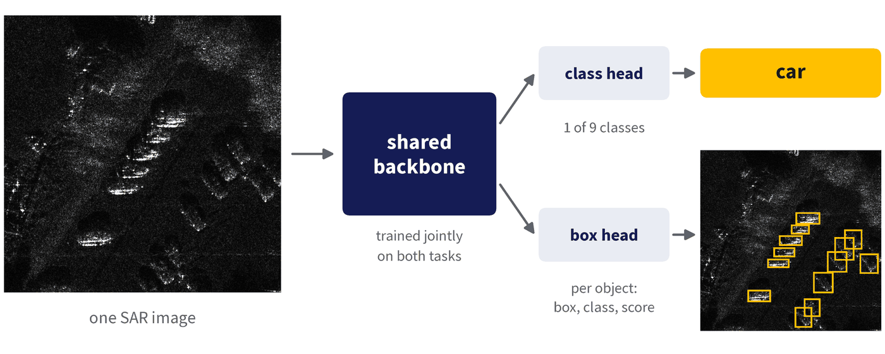
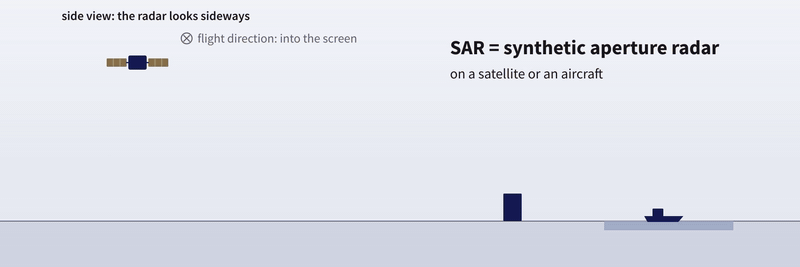
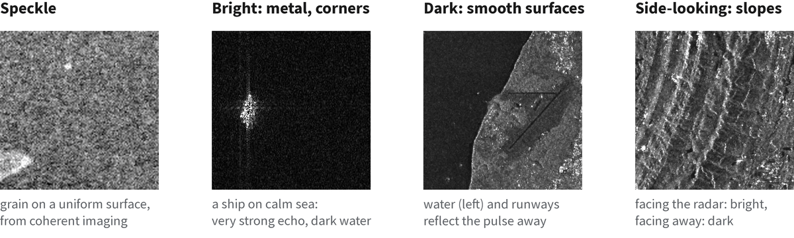
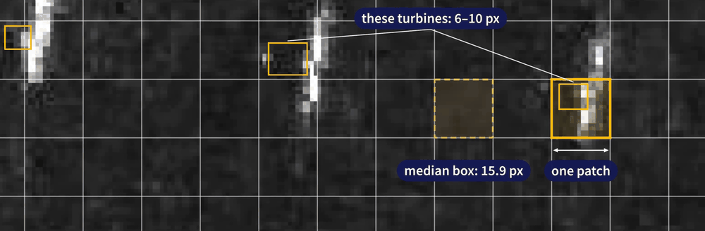

# CS701 SAR 多任务基准

[English](README.md) · **中文**

CS701 团队作业的参考代码。一个 ViT-B/16 骨干，在 SAR 图像上做两个任务：对图像进行**分类**（9 个类别），并**检测**其中的目标。



## 目录

1. [SAR 任务介绍](#1-sar-任务介绍)
   - [1.1 SAR 基础](#11-sar-基础)
   - [1.2 任务](#12-任务)
   - [1.3 指标](#13-指标)
   - [1.4 小目标](#14-小目标)
2. [快速开始](#2-快速开始)
   - [2.1 安装](#21-安装)
   - [2.2 训练基线](#22-训练基线)
   - [2.3 使用课程数据](#23-使用课程数据)
   - [2.4 生成提交文件](#24-生成提交文件)
3. [基线结果（供参考）](#3-基线结果供参考)
4. [代码结构](#4-代码结构)
5. [链接](#5-链接)

## 1. SAR 任务介绍

### 1.1 SAR 基础



- **主动雷达**：卫星或飞机发射微波脉冲并记录回波。白天、黑夜都能工作，也能穿透云层。侧向观测。
- **合成孔径**：沿飞行路径的回波合成为一根很长的虚拟天线，因此分辨率很高。
- **像素 = 回波强度**：8 位灰度，没有颜色。金属和拐角明亮，平静水面黑暗，带有颗粒状的相干斑。

<details>
<summary>SAR 图像是什么样子</summary>



</details>

### 1.2 任务

- 输入：一张 SAR 图像。输出：它的类别 + 每个目标的框、类别和分数。
- 每张图像：一个类别标签，1 个或多个框，全部属于该类别。
- 9 个类别：aircraft、airport、bridge、car、harbor、oil tank、playground、ship、wind turbine。
- 数据、格式、发布日期：[数据集卡片](https://huggingface.co/datasets/doem1997/cs701-sar-course-data)。规则：[Codabench](https://www.codabench.org/competitions/18271)。
- 限制：一个模型；总参数最多 130 M（冻结的参数也计入；本代码：106-107 M），可训练参数最多 40 M（含 head：LoRA 21.0 M；完全微调和从头训练为 106 M，超出限制）；每张图像以 ≤ 512 × 512 px 输入一次；不允许集成，不允许测试时增强。你的报告需说明参数量（总参数、可训练参数）和计算量；完整列表见 Codabench（Terms）。

### 1.3 指标

- 分类：macro-F1。检测：COCO mAP。
- 排名：**Δm**，即 macro-F1 和 mAP 相对参考模型（ViT + LoRA，即 2.2 中的示例命令；3 个 seed 的均值）的平均相对变化：`Δm = 100% × ½ [(F1 − F1_ref) / F1_ref + (mAP − mAP_ref) / mAP_ref]`
- Δm = 0：与参考模型一样好。Δm > 0：更好。ViT 完全微调：约 +13（超出可训练参数预算：作为上界）。

### 1.4 小目标

半数的框小于一个 16 × 16 的 ViT patch（在 512 × 512 输入下）。



## 2. 快速开始

### 2.1 安装

```bash
conda create -n cs701bench python=3.12 -y && conda activate cs701bench
pip install -r requirements.txt   # CUDA 12.8 builds of torch 2.9.0 / torchvision 0.24.0
```

### 2.2 训练基线

```bash
python train.py --backbone vit --init pretrained --adapt lora   # the Δm reference; one run, about 50 min
bash run_all.sh                                                  # all eight runs, about 7 h
```

- 选项：`--backbone vit|terramind`、`--init pretrained|scratch`、`--adapt full|lora|moelora`（`python train.py -h`）。
- `--adapt full` 和 `--init scratch` 训练 106 M 参数：超出 40 M 预算，仅供参考。
- 预训练权重在首次使用时从 Hugging Face 下载（ViT 0.4 GB，TerraMind 1.5 GB）。
- 时间以一块 RTX PRO 6000 Blackwell GPU 计。内存：[docs/DETAILS.zh-CN.md](docs/DETAILS.zh-CN.md#时间和内存)。

### 2.3 使用课程数据

助教 Zichen 是在另一种文件夹布局的全标注数据上运行这份代码的。要使用[课程数据](https://huggingface.co/datasets/doem1997/cs701-sar-course-data)，需要修改 `sarbench/data.py` 和 `train.py`：

- 在 `train/labels.csv` + `train/instances.json` 上训练
- 留出一部分 train 做本地验证（val 和 test 没有标签）
- 对 `val/images.json` 和 `test/images.json` 中的图像做预测

### 2.4 生成提交文件

`make_submission.py` 里有 `write_submission`（说明视频中的那个函数）：把你的框映射回原始图像像素，并写出供 Codabench 使用的 `submission.zip`。

## 3. 基线结果（供参考）

Test 划分，单位 %，3 个 seed 的均值 ± 标准差。Δm 参考：ViT + LoRA，其 3 个 seed 的均值（93.99 / 25.41），因此它的 Δm 为 0。完全微调和从头训练连同 head 训练 106 M 参数：超出 40 M 预算，仅作参考（完全微调：上界）。

| 骨干 | 适配方式 | 训练的骨干参数量 | macro-F1 | mAP | Δm |
|---|---|---:|---:|---:|---:|
| ViT (ImageNet-21k) | 完全微调 | 86.0 M | 95.8 ± 0.3 | 31.8 ± 0.2 | +13.5 ± 0.4 |
| ViT (ImageNet-21k) | LoRA | 0.88 M | 94.0 ± 0.2 | 25.4 ± 0.5 | 0.0 ± 0.9 |
| ViT (ImageNet-21k) | MoE-LoRA | 1.03 M | 93.4 ± 0.5 | 26.8 ± 0.3 | +2.5 ± 0.8 |
| TerraMind（地球观测） | 完全微调 | 85.3 M | 95.6 ± 0.2 | 30.8 ± 0.4 | +11.5 ± 0.7 |
| TerraMind（地球观测） | LoRA | 0.88 M | 92.6 ± 0.4 | 26.5 ± 0.4 | +1.4 ± 1.0 |
| TerraMind（地球观测） | MoE-LoRA | 1.03 M | 92.4 ± 0.1 | 27.8 ± 0.3 | +3.8 ± 0.7 |
| ViT，从头训练 | 完整训练 | 86.0 M | 82.8 ± 0.7 | 17.0 ± 0.3 | −22.5 ± 0.9 |
| TerraMind，从头训练 | 完整训练 | 85.3 M | 86.1 ± 0.2 | 17.8 ± 0.5 | −19.3 ± 0.8 |

<details>
<summary>Val 结果</summary>

Val 划分，单位 %，3 个 seed 的均值 ± 标准差。Δm 参考：同一配置在 val 上的结果（93.31 / 26.13）。

| 骨干 | 适配方式 | 训练的骨干参数量 | macro-F1 | mAP | Δm |
|---|---|---:|---:|---:|---:|
| ViT (ImageNet-21k) | 完全微调 | 86.0 M | 94.4 ± 0.3 | 32.0 ± 0.4 | +11.8 ± 0.7 |
| ViT (ImageNet-21k) | LoRA | 0.88 M | 93.3 ± 0.4 | 26.1 ± 0.4 | 0.0 ± 0.9 |
| ViT (ImageNet-21k) | MoE-LoRA | 1.03 M | 92.2 ± 0.8 | 27.1 ± 0.2 | +1.3 ± 0.9 |
| TerraMind（地球观测） | 完全微调 | 85.3 M | 94.2 ± 0.3 | 31.5 ± 0.1 | +10.7 ± 0.3 |
| TerraMind（地球观测） | LoRA | 0.88 M | 92.2 ± 0.4 | 27.0 ± 0.5 | +1.0 ± 1.3 |
| TerraMind（地球观测） | MoE-LoRA | 1.03 M | 91.9 ± 0.4 | 28.8 ± 0.1 | +4.4 ± 0.3 |
| ViT，从头训练 | 完整训练 | 86.0 M | 83.5 ± 0.9 | 18.2 ± 0.5 | −20.3 ± 1.3 |
| TerraMind，从头训练 | 完整训练 | 85.3 M | 86.0 ± 0.9 | 19.2 ± 0.4 | −17.3 ± 1.2 |

</details>

Accuracy 和 AP50：[docs/DETAILS.zh-CN.md](docs/DETAILS.zh-CN.md#完整结果)。

## 4. 代码结构

```
train.py              entry: train + evaluate one configuration
run_all.sh            the eight reference runs (calls train.py)
make_submission.py    write_submission(): predictions -> submission.zip
sarbench/             the code behind train.py
├── data.py           images + boxes at 512 × 512, flips; boxes back to original pixels
├── backbones.py      ViT (ImageNet-21k), TerraMind-1.0-base
├── adapters.py       LoRA, MoE-LoRA on a frozen backbone
├── model.py          backbone + class head + ViTDet feature pyramid + Faster R-CNN
└── metrics.py        accuracy, macro-F1, COCO box AP
tests/                checks of sarbench/ (python -m pytest tests)
docs/DETAILS.md       model, training protocol, design notes, time and memory
```

更多内容：[docs/DETAILS.zh-CN.md](docs/DETAILS.zh-CN.md)。

## 5. 链接

- 数据：https://huggingface.co/datasets/doem1997/cs701-sar-course-data
- 排行榜：https://www.codabench.org/competitions/18271
- 问题咨询：助教 Zichen，zichen.tian.2023@phdcs.smu.edu.sg
