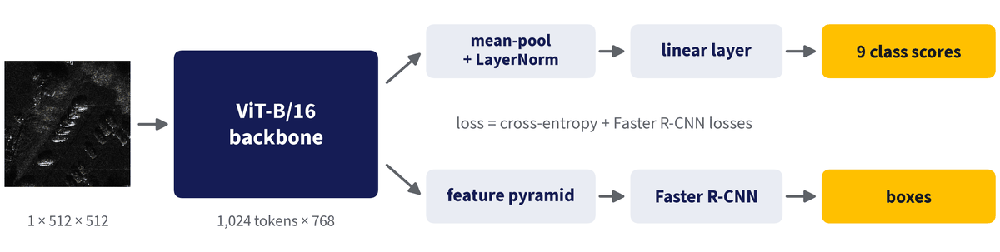

# 参考代码详情

[English](DETAILS.md) · **中文**

返回 [README](../README.zh-CN.md)。

## 模型

```
image [B,1,512,512] -> backbone -> tokens [B,1024,768]   (32 x 32 patches of 16 px)
  classification: mean over tokens -> LayerNorm -> Linear(768, 9)
  detection:      tokens as a [B,768,32,32] map -> SimpleFeaturePyramid (strides 4 to 64, 256 channels)
                  -> RegionProposalNetwork + RoIHeads (torchvision Faster R-CNN, 9 classes + background)
loss = cross-entropy + the four Faster R-CNN losses
```



**骨干**（`--backbone`），两者都是 ViT-B/16：

- `vit`：timm 的 `vit_base_patch16_224.augreg_in21k`（ImageNet-21k）。
- `terramind`：TerraMind-1.0-base（IBM/ESA），一个地球观测模型，通过其 Sentinel-1 GRD 输入使用。

**适配方式**（`--adapt`）：

- `full`：骨干的所有权重都训练。
- `lora`：骨干冻结；每个 attention block 的 `qkv` 和 `proj` 层变为 `y = W x + (alpha / r) B A x`，其中 r = 16，alpha = 32（0.88 M 可训练骨干参数）。
- `moelora`：与 `lora` 相同，但 rank-16 的更新拆分成 4 个 rank 4 的 expert（alpha = 8，因此 alpha / r = 2，与 `lora` 相同），由一个 softmax 路由器按 token 混合。每个任务有自己的路由器（1.03 M 可训练骨干参数）。

每次运行还会训练 head（neck、RPN、RoI heads、分类器）的 20.1 M 参数，因此 `metrics.json` 中的 `trainable_parameters` 等于骨干参数量 + 20.1 M。

## 训练协议（八次运行都相同）

- AdamW，weight decay 0.05，batch size 16，bf16 autocast，24 轮。
- 学习率 1e-4；两个预训练 `full` 运行的骨干用 2e-5（`--backbone-lr 2e-5`，见 `run_all.sh`），使预训练骨干得到温和的微调。
- 一轮线性 warmup，然后余弦衰减到 0，每次迭代更新。
- 每 4 轮以及最后一轮后做验证；test 只在结束时做一次。报告的模型是最后一轮的模型：不做 checkpoint 选择。

## 设计说明

- **每张图像都有两种标签**，因此每个训练 batch 都同时训练两个 head。
- **512 px 输入。** 每张图像都缩放到 512 x 512（非正方形图像被拉伸）：1,024 个 token。目标很小（512 px 下中位框为 15.9 px），因此最小的 anchor 是 8 px，位于 stride-4 层级。预测框在 COCO 打分前映射回原始像素。
- **归一化。** 图像读成一个灰度通道。两个骨干使用相同的 mean 和 std（0.2526, 0.2133），在 512 px 下基于 9,392 张 train 图像计算。
- **精度规则。** 骨干、neck 和分类头在 bf16 下运行；RPN 和 RoI heads 在 fp32 下运行。torchvision 的 box coder 会把 anchor 转换成回归输出的 dtype，而 256 到 512 之间的 bf16 数相隔 2 px：对 6-15 px 的目标来说太粗了。导入 terratorch（`sarbench/backbones.py` 每次运行都会导入）会把 GPU 上的 fp32 矩阵乘法切换为 TF32；框坐标在 fp32 下逐元素解码，不受影响。
- **MoE-LoRA 运行骨干两次。** 它的路由器是任务专属的，所以两个任务看到不同的特征，每次前向都要为每个任务运行一次骨干。
- **TerraMind 的域差异。** TerraMind 是在以 dB 为单位的 Sentinel-1 GRD 后向散射数据上预训练的（极化 VV 和 VH，10 m 像素）。我们的图像是 8 位灰度显示图像，大多分辨率更高；灰度通道同时作为 VV 和 VH 输入。这个差异是基准的一部分，代码中不做校正。

## 时间和内存

在一块 RTX PRO 6000 Blackwell GPU 上，单独一次运行约需 50 min（LoRA 约 47 min，MoE-LoRA 约 1 h）；八次依次运行约需 7 h。一次运行占用约 11-17 GiB GPU 内存；TerraMind 加 MoE-LoRA 需要最多，16 GB 的显卡放不下。较小的 `--batch-size` 能节省内存，但会改变协议。

## 一次运行写出的内容

`runs/<backbone>_<init>_<adapt>/`：

- `log.txt`：训练进度以及 val 和 test 分数。
- `metrics.json`：参数、参数量、`train_hours`（epoch 循环的墙钟时间，含周期性验证；GPU 被共享时会变长）、`peak_gpu_memory_gb`（`torch.cuda.max_memory_allocated`，单位 GiB；进程还需要多约 2.5 GiB）、每次验证结果，以及最终的 val 和 test 指标。
- `predictions_val.json`、`predictions_test.json`：COCO 结果格式的检测结果，使用原始像素坐标。
- `model.pt`：最终权重（`state_dict`）。

## 检查

```bash
bash run_all.sh --limit 64 --epochs 1 --out runs/smoke   # all eight configurations on 64 images per split, a few minutes
python -m pytest tests                                   # the tests (need a GPU)
```

`test_data.py`、`test_metrics.py` 和 `test_model.py` 按助教 Zichen 的布局读取数据（见 README），所以需要和代码一样做适配；`test_backbones.py` 和 `test_adapters.py` 不需要数据。

## 完整结果

分数单位为 %，是 seed 0、1、2 的均值 ± 样本标准差，使用最后一轮的模型。分类用 accuracy 和 macro-F1；检测用 COCO mAP（AP@[.50:.95]）和 AP50。各 seed 相差零点几个百分点，因此更小的差异属于噪声。Δm 按 seed 相对参考计算（参考为三次 ViT-B/16 + LoRA 运行的均值：test 93.99 / 25.41，val 93.31 / 26.13；Codabench 排行榜使用相同的值），再取平均，因此参考配置显示为 0。完全微调和从头训练连同 head 训练 106 M 参数，超出作业 40 M 的可训练预算：它们仅作参考，完全微调为上界。

Test（2,065 张图像）：

| 骨干 | 初始化 | 适配方式 | 可训练骨干参数量（M） | accuracy | macro-F1 | mAP | AP50 | Δm |
|---|---|---|---:|---:|---:|---:|---:|---:|
| vit | pretrained | full | 86.0 | 95.9 ± 0.3 | 95.8 ± 0.3 | 31.8 ± 0.2 | 62.4 ± 0.1 | +13.5 ± 0.4 |
| vit | pretrained | lora | 0.88 | 94.2 ± 0.2 | 94.0 ± 0.2 | 25.4 ± 0.5 | 53.9 ± 0.4 | 0.0 ± 0.9 |
| vit | pretrained | moelora | 1.03 | 93.7 ± 0.5 | 93.4 ± 0.5 | 26.8 ± 0.3 | 55.9 ± 0.5 | +2.5 ± 0.8 |
| terramind | pretrained | full | 85.3 | 95.8 ± 0.2 | 95.6 ± 0.2 | 30.8 ± 0.4 | 61.8 ± 0.4 | +11.5 ± 0.7 |
| terramind | pretrained | lora | 0.88 | 93.1 ± 0.3 | 92.6 ± 0.4 | 26.5 ± 0.4 | 55.4 ± 1.2 | +1.4 ± 1.0 |
| terramind | pretrained | moelora | 1.03 | 92.9 ± 0.1 | 92.4 ± 0.1 | 27.8 ± 0.3 | 57.7 ± 0.4 | +3.8 ± 0.7 |
| vit | scratch | full | 86.0 | 83.9 ± 0.6 | 82.8 ± 0.7 | 17.0 ± 0.3 | 36.7 ± 0.4 | −22.5 ± 0.9 |
| terramind | scratch | full | 85.3 | 86.7 ± 0.2 | 86.1 ± 0.2 | 17.8 ± 0.5 | 38.9 ± 0.4 | −19.3 ± 0.8 |

Val（1,426 张图像）：

| 骨干 | 初始化 | 适配方式 | 可训练骨干参数量（M） | accuracy | macro-F1 | mAP | AP50 | Δm |
|---|---|---|---:|---:|---:|---:|---:|---:|
| vit | pretrained | full | 86.0 | 94.7 ± 0.3 | 94.4 ± 0.3 | 32.0 ± 0.4 | 62.7 ± 0.4 | +11.8 ± 0.7 |
| vit | pretrained | lora | 0.88 | 93.6 ± 0.5 | 93.3 ± 0.4 | 26.1 ± 0.4 | 54.7 ± 0.6 | 0.0 ± 0.9 |
| vit | pretrained | moelora | 1.03 | 92.6 ± 0.8 | 92.2 ± 0.8 | 27.1 ± 0.2 | 56.4 ± 0.3 | +1.3 ± 0.9 |
| terramind | pretrained | full | 85.3 | 94.5 ± 0.2 | 94.2 ± 0.3 | 31.5 ± 0.1 | 62.4 ± 0.0 | +10.7 ± 0.3 |
| terramind | pretrained | lora | 0.88 | 92.6 ± 0.4 | 92.2 ± 0.4 | 27.0 ± 0.5 | 55.9 ± 0.8 | +1.0 ± 1.3 |
| terramind | pretrained | moelora | 1.03 | 92.2 ± 0.5 | 91.9 ± 0.4 | 28.8 ± 0.1 | 58.7 ± 0.1 | +4.4 ± 0.3 |
| vit | scratch | full | 86.0 | 83.8 ± 0.8 | 83.5 ± 0.9 | 18.2 ± 0.5 | 39.0 ± 0.7 | −20.3 ± 1.3 |
| terramind | scratch | full | 85.3 | 86.0 ± 1.0 | 86.0 ± 0.9 | 19.2 ± 0.4 | 41.4 ± 0.4 | −17.3 ± 1.2 |
