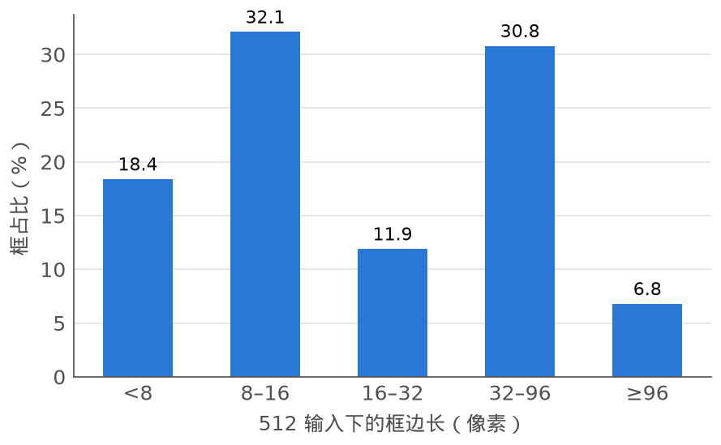
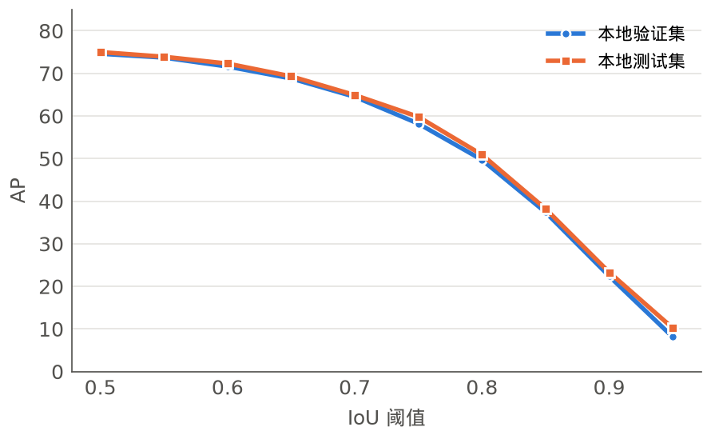
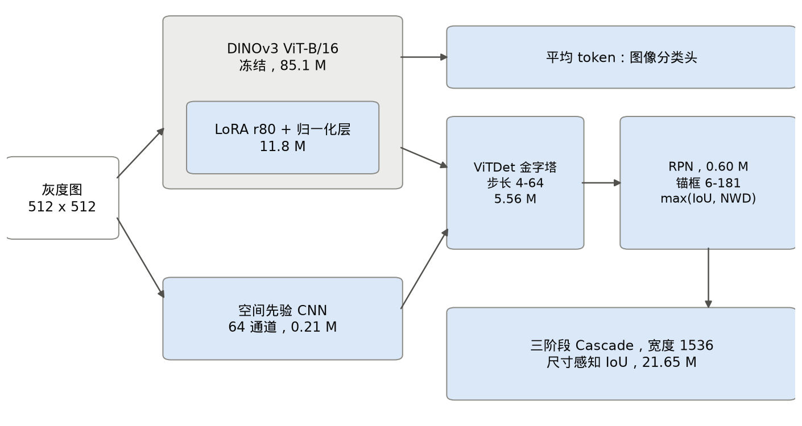
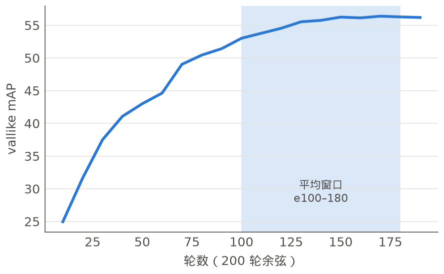
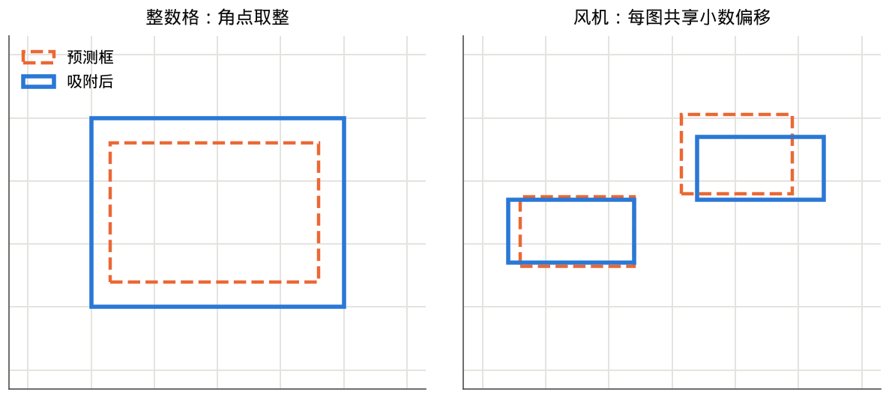
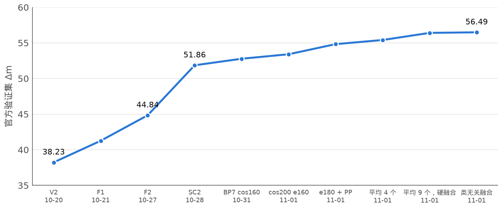
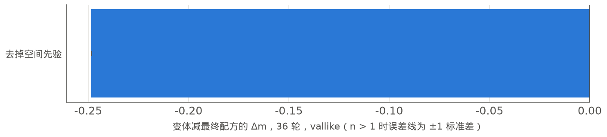
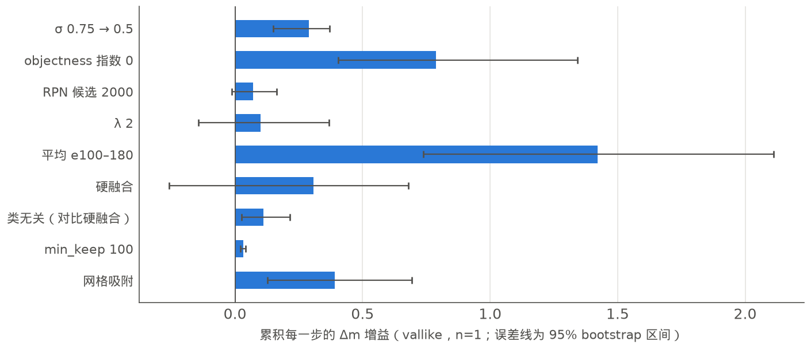
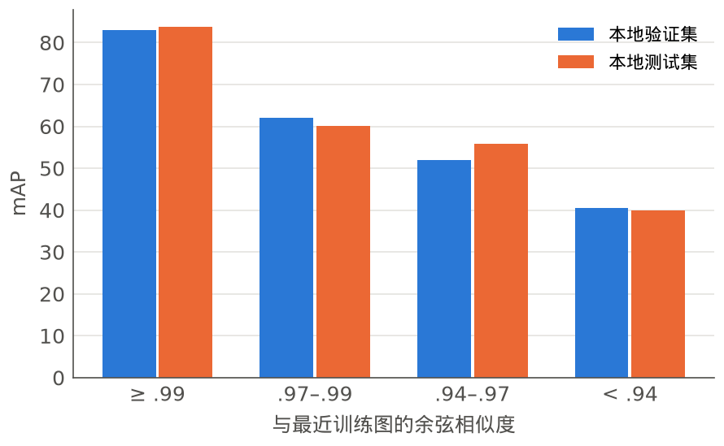
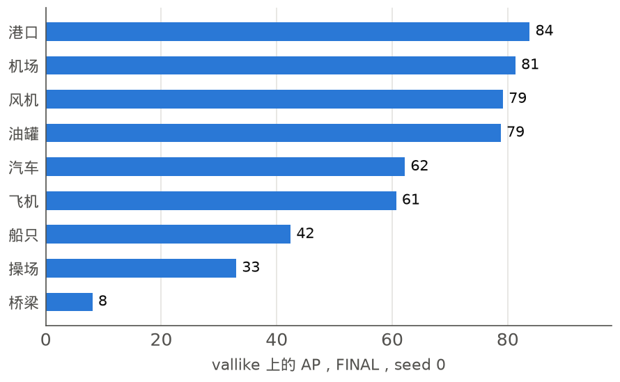

# 一个冻结的 DINOv3、宽 LoRA 和微小目标 Cascade：40 M 预算下的 SAR 图像多任务学习

**CS701 Team 7**（`cs701-team07`）。作者：Junkai Chen；其他作者待定。新加坡管理大学。

[English](REPORT.md)

> **状态（2026 年 11 月 5 日）。** 本报告的部分训练仍在运行。标注待定的内容会在训练结束后填入：全长运行的 seed 1 和 2、大部分消融变体、本地参考运行，以及项目 GPU 小时总数。

## 摘要

一个模型要同时把 SAR 图像分到九个场景类别，并检测图中目标，其中一半目标比 16×16 的 ViT patch 还小；参数上限为总量 130 M、可训练 40 M。我们的模型冻结 DINOv3 ViT-B/16，把预算用在秩为 80 的 LoRA 和专为微小框构建的三级 Cascade R-CNN 上。

| 阶段 | Δm | macro-F1 | mAP | AP50 | 排名 |
|---|---|---|---|---|---|
| Phase 1，验证集 | 56.49 | 95.27 | 55.10 | 74.85 | 9 队第 3 |
| Phase 2，测试集 | **61.25** | 96.96 | 55.74 | 75.19 | 11 月 5 日 8 队第 3；榜单 11 月 8 日锁定 |

相对参考成绩的提升几乎全部来自检测。本报告说明每个部分贡献了多少、如何实现、为什么这样做，以及哪些做法失败了，包括在本地划分上胜出、到榜单上却消失的结果。附录是完整的实验日志。

## 1. 引言

每张图像有一个类别标签和一个或多个该类别的框。队伍排名依据

```text
Δm = 50 × [ (F1 − F1_ref) / F1_ref + (mAP − mAP_ref) / mAP_ref ]
```

参考分数在验证集上为 93.31 / 26.13，在测试集上为 93.99 / 25.41。在验证集上，一个 mAP 点值 1.91 Δm，一个 F1 点值 0.54 Δm。一个 mAP 点的回报是一个 F1 点的 3.6 倍，所以我们几乎把全部精力放在检测上。

数据的三个特性决定了设计。

1. **框非常小。** 在 512 px 输入下，18.4% 的框边长小于 8 px，50.5% 小于 16 px，即一个 ViT patch 的尺寸。
2. **定位是瓶颈。** 我们的本地 AP 从 IoU 0.5 时的约 75 降到 IoU 0.9 时的约 22。
3. **标注带有模型可利用的结构：** 一个亚像素偏移，以及在部分类别和尺寸单元中的整数坐标网格（§4.5）。

| 框尺寸 | AP 随 IoU 阈值的变化 |
|---|---|
|  |  |

## 2. 相关工作

LoRA [Hu 2022] 和 MTLoRA [Agiza 2024] 以低成本适配冻结权重；我们使用单个宽 LoRA。针对微小目标，NWD [Wang 2021] 在分配中取代 IoU，Cascade R-CNN [Cai 2018] 逐级精修框，ViTDet [Li 2022] 从单张 ViT 特征图构建金字塔，ViT-Adapter [Chen 2023] 增加 CNN 空间先验。Soft-NMS [Bodla 2017] 和沿训练轨迹的权重平均 [Izmailov 2018] 是我们最大的两项零成本提升背后的思路。Δm 是常用的多任务汇总指标 [Maninis 2019; Vandenhende 2021]。

## 3. 方法



*图 1. 最终模型。蓝色模块参与训练（39.87 M）；灰色模块冻结。每张图像以 512 × 512 通过一次。*

| 部分 | 内容 | 原因 |
|---|---|---|
| **骨干** | timm `vit_base_patch16_dinov3.lvd1689m`，冻结；RGB patch 卷积核相加为一个灰度通道。全部 12 个 block 的 `qkv`、`proj`、`fc1`、`fc2` 上使用 LoRA，秩 80，α 160；LayerNorm 参与训练 | 项目早期预训练比架构更重要；宽 LoRA 后来证明是最有效的参数用法 |
| **颈部** | ViTDet 金字塔，步长 4–64，256 通道。一个 64 通道、随机初始化的 CNN（210,688 个参数）读取原始图像，经零初始化的 1×1 卷积加到步长 4 和 8 上 | 步长 16 的 token 图没有亚 patch 目标所需的像素细节 |
| **RPN** | 单元中心处 6–181 px 的锚框，用 max(IoU, NWD) 匹配，C = 8 | 2 px 的偏移就足以让 8 px 框的 IoU 接近零，使微小目标缺少正样本 |
| **Cascade** | 三级类无关阶段，宽度 1536，使用对齐的 RoIAlign。IoU 阈值随框边长变化：8 px 以下 .40/.45/.50，8–16 px .45/.50/.55，16–32 px .50/.55/.65，以上 .5/.6/.7 | 固定的 0.5/0.6/0.7 会让微小目标在后面的阶段没有正样本 |
| **翻转偏置** | `--flip-bias -0.3` 把翻转后的框移回 | 框带有约 −0.3 px 的系统性偏移；普通翻转会把它镜像，目标因此摆动两倍偏置 |
| **训练** | 只用翻转；AdamW，head LR 1e-4，骨干 LR 3e-4，权重衰减 0.05；一个 warm-up epoch，之后是 200 epoch 余弦日程；全局 batch 16；提交模型使用全部 9,392 张有标注图像 | 更慢的余弦日程两次在榜单上胜出 |

**Checkpoint 平均。** 同一次运行在 epoch 100、110、…、180 的九个 checkpoint 按张量逐一平均为一组权重（234 个张量，FP64 累加）。结果是只需一次前向的单个模型，不是预测集成。LoRA 使平均并不精确，因为 mean(BA) ≠ mean(B)·mean(A)；在 e180 和 e200 之间测得的差距为 0.002%。



*图 2. 训练期间留出划分上的 mAP（seed 0）。曲线在低 LR 尾部趋平，平均正是在这里起作用。*

**后处理** 只使用这一次前向：

- **框：** 三个阶段的均值，平移 −0.2 px。
- **框分数：** 类无关融合 `s_c = (1 − p_bg) · p_img(c)`，其中 `p` 是各阶段平均后的框概率，`p_img` 是图像分类器的输出。不使用 objectness。图像的类别先验可以去除其他类别的误检，又不会丢弃被错分图像中的真实框。
- **抑制：** 逐类高斯 soft-NMS，σ = 0.5，RPN top 2000，分数阈值 1e-5，每张图像 100 个框。
- **图像标签：** `argmax_c [ log p_img(c) + 2 · log max_i p_i(c) ]`。

**Phase 2 提交中新增的步骤**，从未在验证集上计分：

- **`min_keep` 100** 在一张图像通过阈值的框太少时，保留其最好的 100 个框。
- **网格吸附。** 飞机、汽车以及所有 256 px 图像的预测框角点，在原始像素坐标下取整。对风机，用置信框上的圆周均值估计每张图像的小数偏移，只在集中度 R ≥ 0.5 时应用。分数和排序不变。



*图 3. 网格吸附示意。格线为原始像素；右图的网格平移了图像内共享的一个小数偏移。*

## 4. 实验

### 4.1 验证以及如何选择提交

**划分。** `prepare_course_data.py` 用 seed 0 按类别把训练集划分为 7,512 / 940 / 940，用于 11-01 之前的筛选。本文的消融使用来自同一数据池的第二种划分：`vallike`（从旧留出集中取 992 张图像，采样使其匹配官方验证集的预测类别和图像尺寸构成）和 `trainvl`（其余 8,400 张）。官方验证集和测试集图像只做过预测；它们的预测类别计数决定采样构成。

**选择 Phase 2 提交。** 我们取官方验证集 Δm 最高的 Phase 1 配方，再加上两个步骤；这两个步骤都经配对 bootstrap 在本地留出集上确认为正，合计 +0.30 mAP [+0.20, +0.41]。在 `trainvl` 上训练的 twin 确认，平均窗口与最佳替代方案的差距在噪声范围内（0.1 mAP）。这些选择多次重复使用同一批数据，而且 Phase 1 的许多选择直接在验证集榜单上做出，所以我们的验证集分数偏乐观。

**噪声。** 36 epoch 的 C36 配置单次运行波动 ±0.70 本地 Δm（37 个 seed）；仅抽样就会在测试集和验证集之间造成约 2 Δm 的标准差。后处理比较在相同权重和图像上配对，所以 0.1–0.3 Δm 的差异在这里可能是真实的，而运行之间低于约 1 Δm 的差异则不能算真实差异。

### 4.2 官方成绩进展



*图 4. 各里程碑的官方验证集 Δm。*

**表 1.** 官方分数（Phase 1 验证集，参考分数 93.31 / 26.13；最后一行是测试集，参考分数 93.99 / 25.41；seed 0，各 1 次运行）。V2 和 F1 在 Codabench 上计分，其余在课程榜单上计分。

| 日期 | 提交 | Δm | F1 | mAP | 变化 |
|---|---|---|---|---|---|
| 10-20 | V2，120 ep 余弦日程，e100 | 38.23 | 95.06 | 45.62 | 首个长运行，90 % 数据 |
| 10-21 | F1，全量数据，100 ep | 41.26 | 95.90 | 46.97 | 全量数据，更好的后处理 |
| 10-27 | F2 | 44.84 | 95.46 | 48.97 | 尺寸感知 IoU，翻转偏置，平移 |
| 10-28 | SC2，150 计划中的 e130 | 51.86 | 95.35 | 52.66 | LoRA r80，head 1536，更长 |
| 10-31 | BP7，160 计划中的 e130 | 52.78 | 95.35 | 53.15 | 空间先验，更慢的余弦日程 |
| 11-01 | cos200，e160 | 53.41 | 95.02 | 53.56 | 再次放慢余弦日程 |
| 11-01 | e180，σ.5，obj^0，RPN 2k，λ2 | 54.83 | 95.09 | 54.29 | 仅后处理 |
| 11-01 | 平均 e100/120/140/160 | 55.41 | 95.20 | 54.56 | checkpoint 平均 |
| 11-01 | 平均 e100–180（9 个），硬融合 | 56.41 | 95.27 | 55.06 | 更宽的窗口 + 硬融合 |
| **11-01** | **同上，类无关融合** | **56.49** | **95.27** | **55.10** | **已发布，Phase 1** |
| **11-03** | **测试集：+ min_keep 100，吸附** | **61.25** | **96.96** | **55.74** | **已发布，Phase 2**（测试集参考分数） |

大多数步骤同时改变多项内容，所以归因依据 §4.3。在 F2 到 SC2 之间，更宽的适配和检测头带来最大的一步；此后更慢的余弦日程帮助了两次，最后的 3.1 Δm 完全不需要训练。

Phase 1 我们在九队中排第三，位于 Team 9（67.16）和 Team 6（65.85）之后。Team 6 的 AP50 只比我们高 0.8，mAP 却高 4.9，所以其领先几乎全部来自严格 IoU。在测试集上，我们的提交得分 61.25，Team 6 为 71.57，Team 9 为 71.40。差距仍然几乎全在 mAP 上（55.74 对 61.21 和 61.08），而我们的 macro-F1 为 96.96，高于这两队（96.11、96.27）。测试集和验证集的参考分数和图像都不同，所以 61.25 和 56.49 不能直接比较。

### 4.3 各部分的贡献

**模型部分。** 该表从最终配方中每次去掉一个部分：在 `trainvl` 上用 36 epoch 余弦日程训练，在 `vallike` 上对最后一个 checkpoint 用完整的 FINAL 后处理计分。这些运行是为本报告训练的。短运行会低估后期才见效的部分，所以它们只用于给各部分排序，不用于预测全长运行的提升。

**表 2.** 在 `vallike` 上的留一实验（36 epoch 余弦日程，FINAL 后处理，最后一个 checkpoint）。ΔΔm 是变体减去最终配方，按 seed 配对；n>1 时为 mean±std。

| 变体 | 可训练 M | n | mAP | F1 | ΔΔm |
|---|---|---|---|---|---|
| 最终配方 | 39.87 | 1 | 45.67 | 96.71 | — |
| 去掉空间先验 | 39.66 | 1 | 45.85 | 95.62 | -0.25 |
| 去掉尺寸感知 IoU | 39.87 | 待定 | | | |
| 去掉翻转偏置（平移 -0.4） | 39.87 | 待定 | | | |
| 去掉 NWD 匹配 | 39.87 | 待定 | | | |
| 去掉 Cascade（Faster R-CNN） | 32.16 | 待定 | | | |
| 参考锚框 | 39.86 | 待定 | | | |
| 冻结 LayerNorm | 39.83 | 待定 | | | |
| LoRA r32，head 1024 | 24.02 | 待定 | | | |



*图 5. 去掉一个部分时 Δm 的变化（只含已完成的运行；其余待定）。*

**早期阶梯。** 在 7,512 划分上，相对我们自己的参考运行，原始本地 Δm 逐步上升：DINOv3 取代 ImageNet-21k +8.1；所有线性层加 LoRA r32 并训练 norm +18.1；Cascade +21.0；NWD 加小锚框 +19.7（两者均为 24 epoch）；两者合用 36 epoch +31.3；48 epoch +38.6。相对 37 个 seed 的 C36 均值并使用最终后处理，尺寸感知 IoU 增加 +1.69（z = 2.4；风机 AP +6.5；8 px 以下 AP 从 8.2 升至 12.9），翻转偏置增加 +1.23（z = 1.75），两者合用增加 +2.26（z = 3.2）。LoRA r80 加 head 1536 在此基础上再增加 +5.92。这些筛选都是单 seed。

**日程。** 在官方验证集上，固定停止 epoch 时延长余弦长度得到 +1.29（130→160，7,512 张图像，e130），在全量数据上得到 +1.02，后者还改动了 data loader。随后 160→200 在 e160 上相对 cos160 的 e130 得到 +0.63。LR 减半损失 7.2 本地 Δm；e200 比 e180 低 0.12。

**后处理和平均。** 全长运行上的累积消融（seed 0 已完成；seed 1 和 2 待定）。平均是最大的单步，其次是 objectness 指数取 0。类无关融合优于硬过滤，因为硬过滤会丢弃被错分图像中的所有真实框。



*图 6. `vallike` 上每个累积步骤的 Δm 提升。*

**表 3.** 全长运行上的累积后处理和平均（n=1 个 seed；`trainvl` → `vallike`）。各步提升在同一 seed 的权重上配对；Δm 使用验证集参考分数，在本地划分上计算，所以其绝对水平不能和榜单比较。

| 步骤（累积） | mAP | F1 | ΔmAP | ΔΔm |
|---|---|---|---|---|
| e180，σ.75，obj^.25，RPN 1k，λ1 | 57.00 | 96.46 | — | — |
| σ 0.5 | 57.15 | 96.46 | +0.15 | +0.29 |
| objectness 指数 0 | 57.56 | 96.46 | +0.41 | +0.79 |
| RPN top 2000 | 57.60 | 96.46 | +0.04 | +0.07 |
| λ 2 | 57.60 | 96.65 | +0.00 | +0.10 |
| **平均 e100–180** | 58.37 | 96.53 | +0.78 | +1.42 |
| 硬融合 | 58.53 | 96.53 | +0.16 | +0.31 |
| 类无关融合（相对硬融合） | 58.59 | 96.53 | +0.06 | +0.11 |
| min_keep 100（相对类无关融合） | 58.61 | 96.53 | +0.02 | +0.03 |
| **吸附 = FINAL** | 58.81 | 96.53 | +0.20 | +0.39 |

### 4.4 没有奏效的做法

上下文实验的结果最有启发：在一个留出集上 +2.26 本地 Δm，在另一个上 −0.12，在榜单上 −0.03，港口 AP 在两个留出集之间从 +3.7 变为 −1.3。正因如此，我们不再信任单个留出集。一些否定结论也没有看上去那么可靠：LR ×1.25 的运行在 epoch 69 停止，E09b 的下降也从未归因到其多项改动中的某一项。

**表 4.** 尝试后放弃的做法。除非标注，数字都是本地 Δm；筛选都是单 seed，所以看较小的数值时要记住 §4.1 中 ±0.70 的噪声。

| 想法 | 结果 | 备注 |
|---|---|---|
| E09b 宽 LoRA + 正则项（24 ep） | 原始本地 Δm 6.18 对 18.08 | 原因从未分离 |
| ConvNeXt-T 全量微调（24 ep） | 6.78；AP_<8 1.9 | 低于 ViT + LoRA |
| 先验 + 多层 neck（24 ep） | 5.14 | 后来单独使用先验胜出 |
| D4 + copy-paste；长 D4，zoom | 7.13；每个 epoch 都落后于普通配置 | 增广有害 |
| 重叠 patch，步长 8 | -0.99，计算量 2.6× | 油罐 -6.8，港口 -4.6 |
| EMA 0.9998；IoU 分支（36 ep） | -0.13；-0.48 | 领先在 LR→0 时消失 |
| RoI batch 1024 | -4.02 | 原因未研究 |
| 桥梁/操场：类别权重、过采样、partial-neg | bridge ≤ + 0.9 AP; oversampling -4.15 | 风机 -10 AP |
| 只用于分类的 RoI 上下文（160 ep） | + 2.26, -0.12, board -0.03 | 未能迁移 |
| LR ×0.5；head/骨干混合 | -7.21；-2.77 | 早期领先到 e100 时已失去 |
| LingBot-B 骨干 | e60 榜单 39.23（BP7 e80：48.40） | 已暂停，没有公平的配对 |
| 框投票；去掉 100 框上限 | 验证集 mAP -0.03 至 0 | 没有效果 |
| 排名和尺寸先验；逐类偏置表；精修 | -3.1 to + 0.06 mAP | 噪声或有害 |
| kNN 标签迁移（仅本地） | + 0.52/+ 0.29 mAP | 测试时需要数据，涉及规则；未使用 |

### 4.5 数据中的发现

**标注网格。** 飞机和汽车的所有训练框，以及每张 256 px 图像的所有训练框，其 x、y、w、h 在原始像素下都是整数。约 40% 的风机图像把所有框放在同一个网格上，共享一个小数偏移。预测框吸附是唯一经受住检验的数据挖掘发现：在两个留出集上分别 +0.20 和 +0.36 mAP（配对 bootstrap P ≈ 1）。我们假设测试集也有这个网格。Phase 2 分数无法单独分离这一效果，因为只有组合后的提交被计分。

**近重复。** 按冻结 DINOv3 的余弦相似度，约 10% 的留出集图像在训练集中有近似副本。这些图像的本地 mAP 为 83，没有近邻的图像为 40；操场 AP 为 87 对 12。这解释了本地和官方差距的一部分。以只增加召回的模式迁移近邻的框，本地 mAP 提升 +0.52 / +0.29，但测试时需要训练图像和第二个网络，所以我们没有使用。

**弱类别。** 即使完整训练后，`vallike` 上桥梁的 AP 仍为 8，操场为 33。在较早的 SC1 模型上，只有 49% 的桥梁框在 IoU 0.5 下有 top-1000 候选框。尺寸不足以解释这一点，因为风机更小，却能达到 79。类别权重、过采样和 partial-negative 损失最多让桥梁变化 +0.9，对其他类别的损失更大。这些类别是否受未标注同类目标限制，只是看过 12 张图像后提出的未经验证的假设。

| 近重复 | 各类别 AP |
|---|---|
|  |  |

## 5. 效率和必须披露的内容

我们用参数换分数：用了 40 M 上限中的 39.87 M。更省的 23.8 M F2 在两块 GPU 上用 3.6 h 得到 44.84，所以通往 51.86 的路上约 7 Δm 是增加 16 M 可训练参数和更多 epoch 共同带来的。cos200 之后每个零成本步骤都不需要额外的训练时间。

**表 5.** Terms 要求披露的项目。

| 项目 | 内容 |
|---|---|
| 参数 | **共 125,076,960，可训练 39,867,360**：冻结 ViT 85.14 M；LoRA 11.80 M；norm 0.04 M；neck 5.56 M + 先验 0.21 M；RPN 0.60 M；Cascade 21.65 M；分类头 0.01 M |
| GPU | 2 × NVIDIA RTX 6000 Ada（46,068 MiB），与其他用户共享 |
| 最终训练 | 在 2 块 GPU 上到 e180 用时 12.97 h（25.9 GPU-h）；运行继续到 e200，用时 14.14 h。平均：CPU 30 s |
| 项目 GPU-h | 约 待定（本服务器，含调参；队友的 RTX 3080 运行未计入） |
| GPU 显存峰值 | 训练时每块 GPU 12.07 GiB（梯度检查点，每块 GPU 8 张）；推理时已分配 1.15 GiB |
| 推理 | batch 16 时每张图像 21–25 ms（bf16，含后处理，GPU 共享）；测试集运行时在负载下 batch 2 为 60 ms |
| 输入 | 一张灰度图像，拉伸到 512×512；训练集 mean/std 0.2526/0.2133；一次前向，不切块，不用 TTA |
| 预训练 | **最终：** DINOv3 ViT-B/16 LVD-1689M（timm）。**仅用于探索：** ImageNet-21k ViT-B/16；DINOv3 ConvNeXt-T；DINOv3 ViT-S/16 配 YOLO；TerraMind；LingBot-Vision-B/16。都没有在 SAR 上训练 |
| 代码 | 基础：助教参考仓库；torchvision、timm、pycocotools。我们的部分：LoRA 扩展、带尺寸感知 IoU 的 Cascade、NWD 匹配、空间先验、后处理、平均、吸附、评估器 |
| 验证 | §4.1。官方验证集和测试集只做预测 |
| Seed | 提交模型：1 次运行。最终配方的全长运行数：1 次已完成，2 次运行中（待定）。消融：表 2。C36：37 次运行，±0.70 |

## 6. 局限和结论

平均、融合、吸附和 `min_keep` 的提升都在同一个留出划分上测得，而这个划分也影响过之前的决定。36 epoch 消融不能度量全长运行的效果；带 IoU 分支的 GIoU（在 epoch 145 停止）和光度增强都没有在全长运行上评估。我们也没有找到办法解决与领先队伍之间约 5 mAP 的严格 IoU 差距。

提升的大部分来自冻结并用宽 LoRA 适配的强通用骨干，加上为亚 patch 目标重建的检测器；耐心的日程和对单次前向的细致利用贡献了其余部分。最有用的习惯是：只有第二个留出集或榜单也同意时，才承认本地提升。

**AI 工具的使用。** 大部分代码和实验执行由 AI 编程助手（Claude Code 和 OpenAI Codex）完成，由团队指导。

## 参考文献

- Agiza, Nesseem, Reda. MTLoRA: a low-rank adaptation approach for efficient multi-task learning. CVPR 2024.
- Bodla, Singh, Chellappa, Davis. Soft-NMS: improving object detection with one line of code. ICCV 2017.
- Cai, Vasconcelos. Cascade R-CNN: delving into high quality object detection. CVPR 2018.
- Chen et al. Vision transformer adapter for dense predictions. ICLR 2023.
- Hu et al. LoRA: low-rank adaptation of large language models. ICLR 2022.
- Izmailov et al. Averaging weights leads to wider optima and better generalization. UAI 2018.
- Li, Mao, Girshick, He. Exploring plain vision transformer backbones for object detection. ECCV 2022.
- Maninis, Radosavovic, Kokkinos. Attentive single-tasking of multiple tasks. CVPR 2019.
- Siméoni et al. DINOv3. arXiv:2508.10104, 2025.
- Vandenhende et al. Multi-task learning for dense prediction tasks: a survey. TPAMI 2021.
- Wang, Xu, Yang, Yu. A normalized Gaussian Wasserstein distance for tiny object detection. arXiv:2110.13389, 2021.

---

# 附录：完整实验日志

## A1. 如何阅读本附录

本附录保存主报告所概括的内容：尝试过的每个想法、原因、实现方式、在哪个尺度上提升多少，以及保留或放弃的原因。它是事实记录，不提出建议。每个数字的逐行来源见 `experiments/report_final_20261105/ledgers/ledger_{A_1013_1027,B_1027_1031,C_1101_1105}.md`。

### A1.1 证据

除非另有标注，数字都读自运行产物（`metrics.json`、`metrics_pp.json`、`log.txt`、`events.log`、zip 或代码），或在 CPU 上由保存的原始输出重新计算。较弱的证据标注如下。

- † **只记录在会话记录中**：工作会话中的陈述，没有找到对应的产物。
- ‡ **只见于仓库文档**：项目文档中的陈述，本服务器上没有运行目录。所有 Rayner 线的数字都属于这一类。
- 称为*会话工具输出*的数字由工具在工作会话期间打印，保存在会话日志中，但没有单独的文件。
- 官方分数由团队根据榜单截图或粘贴的 JSON 录入，再记录到 `official_scores_phase1.json` 等文件中。截图保留两位小数。助手从未上传任何内容；所有上传都是手动完成的。
- *推导*指对所引数字做简单算术。

路径使用以下缩写。除非标注，时间均为 SGT（UTC+8）。

**表 A1.** 路径缩写。

| 缩写 | 路径 |
|---|---|
| `$RUNS` | `/mnt/hdd/junkaichen/CS701/cs701_runs` |
| `$EXP` | 仓库中的 `experiments/` |
| `$RPT` | `experiments/report_final_20261105/`（bootstrap 证据的副本在 `prior_evidence/` 中） |
| `$BK44` | `backups/44.84-DINOv3-LoRA-Cascade-NWD-SizeIoU-FlipBias-shift0.2/` |
| `$BK28`, `$BK51` | `backups/` 下名称以 28.90 和 51.86 开头的目录 |
| `$BK56` | `backups/56.49-full-cos200-avgE100-180-DINOv3-LoRA80-Head1536-SP64-Cascade-NWD-SizeIoU-FlipBias-agn-soft0.5-obj0-shift0.2/` |
| `$PH2` | `.runtime/phase2/` |
| `$SUB` | `submissions/` |

### A1.2 指标尺度。绝不要跨尺度比较

**表 A2.** 本日志使用的指标尺度。

| 尺度 | 定义 | 示例 |
|---|---|---|
| 官方验证集 Δm（Phase 1） | 在 1,426 张官方验证集图像上计算 50[(F_1-93.31)/93.31 + (mAP-26.13)/26.13]。1 个 mAP 点 = 1.9135 Δm，1 个 F1 点 = 0.5358 Δm，比值 3.57 | 发布的提交 56.49 |
| 官方测试集 Δm（Phase 2） | 形式相同，参考分数 93.99 / 25.41，2,065 张图像。1 个 mAP 点 = 1.9677 Δm，1 个 F1 点 = 0.5320 Δm | Team 7 提交：61.25 |
| 本地 Δm，尺度 **L** | 参考为我们的单次运行 E00（验证集 91.50 / 22.41，测试集 91.61 / 23.31）。取本地验证集和本地测试集（各 940 张图像）的均值。注明后处理版本 | C36 v3：L 35.46 |
| 尺度 **LT** | 即 L，但只用本地测试集，用于在 train+val 上训练的运行 | V2 e70：LT 52.9 |
| 尺度 **BP** | 参考与 L 相同。取本地验证集和测试集的均值，平移 0，后处理 v3′。构造与 L 相同；AA 在一个来源中舍入为 37.82，在另一个来源中为 37.83 | AA 37.83，SC1 43.75 |
| 尺度 **LR** | 同样以 E00 为参考。只用本地验证集（测试集在单独文件中），平移 −0.2，提交用后处理 | lr1x 68.70 |
| 尺度 **Ry** | Rayner 文档的尺度：把官方验证集参考分数应用到本地划分的分数上。在此尺度上，E00 的原始测试集分数为 −6.31，E04r 的原始测试集分数为 +10.11 | 普通 YOLO26-s +1.4 |
| 本地留出集 mAP | 本地验证集、本地测试集（各 940 张）或合并（1,880 张）上的 COCO mAP；模型 W3（§A5.5），在 7,512 张上训练 | agn：52.907 / 53.780 |
| vallike mAP | 992 张图像的 `vallike` 留出集上的 COCO mAP；twin 在 8,400 张上训练（§A5.11） | TWIN1 FINAL：58.81 |
| vallike Δm | 把官方验证集参考分数应用到 vallike 分数上（表 2、3）。配对差值可用；绝对水平不能和榜单比较 | TWIN1 FINAL：64.26 |
| 代理分数 | 1.9135 mAP + 0.5358 F_1，不减参考分数。不是 Δm | 只用于 `proxy_eval.py` |

三个例子说明为什么不能混用。(1) lr1x e130 在尺度 LR 上为 68.70，在榜单上为 45.83；这一差距主要是参考分数不同造成的，并不是损失。(2) V2 e100 的本地测试集 F1 为 95.59、mAP 为 48.91，按官方参考分数得 +44.81，而榜单上是 38.23。(3) 同一组 W3 权重在 vallike 上的分数比在合并的本地留出集上高约 2.4 mAP（§A5.11）。参考值本身也经过舍入：把公式应用到发布提交的精确分数上得到 56.4911，而榜单显示 56.486765。

### A1.3 后处理版本

**表 A3.** 后处理版本。Thr = 分数阈值；σ = soft-NMS 参数；obj = objectness 指数；mk = `min_keep`；rpn = RPN 测试 top-n。从 v3 起，每类和每张图像都有 100 个框的上限。

| 版本 | Thr | σ | obj | 阶段框 | 平移 | mk | rpn | λ | 其他 |
|---|---|---|---|---|---|---|---|---|---|
| raw（模型自身的评估） | 0.05 |   |   | 末级 | 0 |   | 1000 | 0 |   |
| v1 | 1e-3 | .75 | .25 | 末级 | 0 |   | 1000 | 1 | 逐类高斯 soft-NMS |
| v2 | 1e-3 | .75 | .25 | 均值 | −0.4 |   | 1000 | 1 |   |
| v3 (`pp_eval.FINAL`) | 1e-5 | .75 | .25 | 均值 | −0.4 | 30 | 1000 | 1 |   |
| v3′（用于 `--flip-bias` 运行） | 1e-5 | .75 | .25 | 均值 | 0 | 30 | 1000 | 1 | 在 `pp_eval.py` 中自动选择 |
| 提交用，10-27 至 10-31 | 1e-5 | .75 | .25 | 均值 | −0.2 | 30 | 1000 | 1 | F2，尺度 LR；尺度 BP 的平移为 0 |
| e180 配方，11-01 | 1e-5 | .5 | 0 | 均值 | −0.2 | 30 | 2000 | 2 |   |
| 56.49 配方 | 1e-5 | .5 | 0 | 均值 | −0.2 | 30 | 2000 | 2 | 平均权重；`--fusion agn --gamma 1 --topk 9` |
| **FINAL** | 1e-5 | .5 | 0 | 均值 | −0.2 | 100 | 2000 | 2 | 56.49 配方加网格吸附 |

### A1.4 运行名称冲突

项目期间有些名称被重复使用。下面是在来源中发现的易混淆之处。

**表 A4.** 运行名称冲突。

| 名称 | 含义 |
|---|---|
| `V2` | IN21k 上的 NWD（搁置，从未运行），以及 120 epoch 的 2-GPU 运行 `V2_ddp` |
| `F1`, `F2` | 搁置的折，以及全量数据模型。F1 也指 macro-F1 |
| `S5` | E09b 上的 Mona（暂存，从未运行），以及空间先验筛选 `S5_sp` |
| `D3` = `W3_dino_spml` | D3 的目录名以 W3 开头，但与 `W3` 无关；后者是 Part C 中 e70–120 平均的本地权重 |
| `E00` | 目录 `ref_s0/vit_pretrained_lora` |
| `BP7` | `BP7_spatial64`（LoRA r32，head 1024，36 epoch，7,512 张图像，`$RUNS/BP7_spatial64`）。从 10-29 起，“BP7” 指 LoRA r80、α160、head 1536、SpatialPrior64 |
| 45.83（舍入后） | 两个不同的提交：SC2 e80（45.8331）和 BP7 本地 lr1x e130 |
| `TWIN1`, `TWIN2` | TWIN1 是最终配方的 seed 0。TWIN2 是 GIoU + IoU 分支变体，不是另一个 seed。`RPT_TWIN_cos200_s1` 和 `_s2` 才是 seed 1 和 2 |
| zip 名称中的 `v2pp` | `V2_e100_val_v2pp.zip` 和 `V2_e120_val_v2pp.zip` 使用的是后处理 v3 |
| `pp_eval.FINAL` | 指 v3，不是表 A3 中的 FINAL |
| A, B, C | 上下文三连提交（§A4.8）；11-01 的“候选 A”是 e100–180 窗口；A 到 D 还是 kNN 融合模式（§A5.12） |
| L, R1, R2 | 尺度 L 与运行 L36、L1、L2。筛选 R1、R2 与 R01，后者是从未运行的参考 seed |

## A2. 时间线和分工

两条工作线从助教的参考仓库并行展开。

**表 A5.** 两条工作线。

| 工作线 | 范围 |
|---|---|
| Rayner 线 | 分支 `origin/rayner`，另一台机器上的 RTX 3080，10-12 至 10-23。包含 10-20 之前的所有工作和整个 YOLO 系列（§A3.1）。还有工具：提交准备、早停、指标和框可视化。本服务器上没有运行目录，所有数字都来自 `git show e9969d3:docs/dino_yolo.md`。该分支上 `docs/improvement.md`（10-13）的想法清单列出了 MLP 上的 LoRA、更高的秩、EMA、阈值 0.001、4–6 px 锚框、soft-NMS、Cascade 和在全量数据上重新训练。其中几项后来在另一条工作线上胜出；日志没有显示那边的工作是否读过这个文件 |
| Junkai 线 | 分支 `junkai`（原 `junkai-claude`），位于带 2 块 RTX 6000 Ada 的共享服务器。`events.log` 第一行为 10-20 06:05。从 E00 到 F2、SC1、SC2、BP7、cos200 的全部内容，所有后处理、网格吸附、twin 协议和本报告的运行。代码和执行由 AI 编程助手完成，由团队指导：10-28 之前是 Claude Code，10-28 至 11-01 是 Codex，11-01 晚上至 11-02 以及 11-05 起又是 Claude Code。较早的一条仓库笔记称“实验在 10-20 至 10-23 运行”，这只对这条工作线成立 |

**表 A6.** 项目时间线（SGT）。运行细节见下面各节。

| 时间 | 事件 |
|---|---|
| 10-12 至 10-13 | Rayner 线：CNN 空间先验配置、提交和分析工具 |
| 10-20 00:50 | Rayner 线：DINOv3 + YOLO 系列开始 |
| 10-20 06:05 | Junkai 线：第一个运行事件。E00 参考，之后是骨干和适配筛选 |
| 10-20 07:07–07:50 | 后处理 v1，无需重新训练 |
| 10-20 至 10-21 | Cascade、NWD、更长的日程；V2 到 120 epoch；后处理 v2 和 v3；V2 e100 得分 38.23（按会话时间戳为 10-20 22:23）；F1 得分 41.26（10-21 04:54）；训练 F2 |
| 10-22 00:57 至 10-23 15:42 | 自动回退队列运行 36 次 C36 的 seed 重复。GPU 工作于 10-23 15:54 停止 |
| 10-27 16:11 | F2 平移 −0.2 在新榜单上记录为 44.84 |
| 10-27 17:32–20:11 | SC1 训练；20:53 得分 28.90 |
| 10-28 02:07–08:28 | SC2_full150 在 2 块 GPU 上运行。09:35 计分：e130 51.86，e150 51.81 |
| 10-28 09:44 至 10-29 08:31 | 桥梁和操场筛选 BP1–BP5、BP7–BP9 |
| 10-29 14:49–20:57 | BP7 全量，130 epoch 余弦日程；配对预览计分。21:07 团队停止架构工作，转向 LR 和 epoch |
| 10-29 22:04 至 10-30 21:30 | lr1x、lr05x、hybrid130；lr125x 在 e69 停止 |
| 10-30 21:31 至 10-31 03:45 | 本地 cos160，在 e154 停止。大约同时在缓存输出上做 CPU 试验 |
| 10-31 03:34–12:09 | TIDE 和数据审计；只用于分类的上下文（03:48–11:46 训练，11:50–12:01 提交）；骨干审计 |
| 10-31 12:17–19:16 | BP7 全量，cos160，在 e130 停止：**52.78** |
| 10-31 19:41 | 启动 cos200；随后三次中断（§A5.1）。LingBot 同时训练，于 11-01 约 00:59 在 e64 暂停 |
| 11-01 11:17–20:59 | 十三次官方 BP7 提交。**56.49 于 20:59:42 发布** |
| 11-01 21:09–21:48 | AUG1 和 DP1 筛选：失败或被终止，团队更改协议后停止 |
| 11-01 21:49 | TWIN1 按 vallike 协议开始 |
| 11-01 约 23:00 | 发现标注网格；编写 `snap_submission.py` |
| 11-01 23:59 | Phase 1 结束。最终 9 队第 3 |
| 11-02 00:01–00:05 | 下载测试集；自动构建候选和 FINAL zip |
| 11-02 00:11–00:27 | 本地 kNN 标签迁移实验；团队决定不使用 |
| 11-02 12:02–12:20 | TWIN1 在 e190 结束并评估。TWIN2 于 12:04 开始 |
| 11-02 21:28 | 团队停止所有实验。TWIN2 在 e145 中被终止；最后的 checkpoint 为 e140 |
| 11-05 | 恢复报告工作。本报告的运行于 11:49:56 开始 |

## A3. Part A，10-12 至 10-27：到 F2 为止的早期工作

### A3.1 Rayner 的 YOLO 线

本小节的所有数字都只见于仓库文档‡，尺度为 Ry。提交日期来自 `git log origin/rayner`。

**表 A7.** Rayner 线。结果为尺度 Ry 上的测试集 Δm。

| 日期 | 提交 | 想法和原因 | 实现 | 结果 | 决定 |
|---|---|---|---|---|---|
| 10-12 | `447367a` | 针对小目标的 CNN 空间先验 | `sarbench/model.py`、`run_all_3080.sh`：4 个 adapter 配置，有无先验各一组，10 GB 显卡用 batch 8 | vit + MoE-LoRA + 先验，24 ep：92.8 / 28.6，+4.5。文档中没有有无先验的对比表；batch 8 与协议不同 | 无记录 |
| 10-13 | `2ca51ab` `8f203ca` `27e22cd` `8a224cc` | 工具 | 提交 zip 准备、早停（`--patience`）、指标和手动框可视化 | n/a | 作为工具保留 |
| 10-20 00:50 之前 | 运行 `full_seed0`、`single_seed0*` | 更长时间训练 TerraMind + MoE-LoRA | Epoch 24 / 50 / 100 | +5.0 / +16.5 / +21.8 | epoch 数起主导作用的早期证据 |
| 10-20 00:50 | `dea971d` `cbd32e5` `d84efcd` | 第二个系列：把 DINOv3 特征融合进 YOLO | `sarbench/dino_yolo.py`、`train_yolo.py`；YOLO12-s + ViT-S/16，31.2M 全部可训练，ViT 使用 0.1× LR，零初始化 1×1 融合，mosaic 等 | 24 ep +7.4；50 ep +15.0；100 ep +19.0。24 ep 时 `--cls-head`：F1 +3.0/+4.1，mAP −1.9/−1.4，测试集 +6.9 | 分类头默认关闭 |
| 10-20 10:42–18:11 | `fea565b` `4d91512` `a0d936d` | YOLO26 和一个普通基线 | `--yolo yolo26s`、`--dino none`、`yolo26s-p2` | 普通 YOLO26-s +1.4；DINO + YOLO26-s +9.4；P2 +7.6；DINO + YOLO26-s 100 ep +21.3（3.9 h） | P2 没有更好（mAP −1.1/−1.2，1.5 h 对 0.9 h） |
| 10-21 07:57 | `a1e920f` | 用 90° 旋转应对小数据 | `--rot90 0.75`、`RandomRot90` | mAP −3.1/−2.7，Δm −6.4/−5.2（YOLO12/26）。文档中未经检验的假设：雷达阴影和叠掩方向 | 默认关闭 |
| 10-21 21:56 | `cda7acc` | 冻结 ViT-B/16 + LoRA，使更大的 ViT 能放进预算 | `--dino-adapt frozen\|lora` | 冻结 +2.1；LoRA r16 +8.7；MLP 上也加 LoRA +8.3 | “MLP 上的 LoRA 没有改变任何东西”；对比 §A3.3 |
| 10-22 06:55 | `bfac2af` | LoRA 秩扫描 | r16 / 64 / 256，qkv + proj | +8.7 / +7.8 / +10.0 | 见 §4.1 的 seed 说明 |
| 10-22 22:14 | `e85cdfd` | 部分解冻和 YOLO26-m | `--dino-unfreeze K` | 最后 2 个 block +5.5；最后 4 个 +7.0；LoRA + 解冻 2 个 +9.2；YOLO26-m +9.2 | 低于 r256 |
| 10-23 12:10 | `e9969d3` | 最长的 ViT-B 运行 | ViT-B/16 + LoRA r256 + YOLO26-s，100 ep，8.7 h | 测试集 +21.2，验证集 +22.5 | “与 ViT-S 持平”，总参数量却是 3.5× |

另有一个数据点：YOLO11-s “改进版（48 ep）” 93.08 / 36.93，官方 +20.53。其唯一来源是 10-29 的一份较晚的团队草稿；本仓库中没有代码、运行或日期‡。Rayner 文档还给出一条 seed 说明：“±0.9 Δm，只信任大于约 1.5 的差异”‡。

### A3.2 基线和基础设施

**表 A8.** Junkai 线上的基线和基础设施，10-20。

| 项目 | 内容 | 数字 |
|---|---|---|
| **E00** `ref_s0/vit_pretrained_lora` | 参考配方：ViT-B/16 IN21k + 只加在注意力上的 LoRA r16，24 ep，翻转，seed 0，本地训练集 7,512。目的：作为本地 Δm 参考，因为划分和数据量与官方不同。只有一个 seed，不同于官方的 3-seed 参考；计划中的 R01 从未运行 | 共 107,039,257，可训练 20,997,913。原始验证集 91.50 / 22.41 / AP50 48.63，测试集 91.61 / 23.31 / 52.77。v1 验证集 92.45 / 23.70，测试集 92.67 / 25.12，L +3.93。1.02 h |
| 预算检查 | 如果参数加浮点 buffer 超过 130M 或可训练参数超过 40M，`train.py` 退出；`--allow-over-budget` 只用于参考运行 | F2 快照中 `train.py` 的第 25、372 行 |
| 速度测试 A00、A01 | A00：参考 54.5 img/s，DINOv3 全线性层 LoRA 44.4；第一次 compile 结果不可用，因为计入了编译时间。A01：2 epoch 稳态，compile 提速 +12 %，损失相同。ViT 运行开启 `--compile` | 37.0 → 41.5；`events.log` 显示 37.0 和 41.9 |
| 同一 GPU 上跑两个任务 | 测试后改为每块 GPU 一个任务 | 23.4 + 23.5，单独运行约 52 img/s† |
| 队列 | 每块 GPU 一个 runner，`watchdog.sh`（处理积压任务，否则用新 seed 重复 `fallback_args.txt`），`events.log`，DDP 用 HOLD 任务 | `$RUNS/queue/` |
| 代码审查 | 用 13 个 agent 做自动对抗审查；在 `7afacd7`、`bba17ee` 中修复 6 个确认的 bug：`_orig_mod` 键导致无法加载 compile 过的运行；`--train-norms` 漏掉 ConvNeXt LayerNorm2d（E03 崩溃）；`predict.py` 默认值不是最终后处理；通过 `cdist` 计算的 NWD 在 TF32 下丢失精度；Cascade 在每个阶段都追加 GT 行（1×/2×/3×）；copy-paste 带入了相邻目标的像素 | E00–E02 和 E09b 在修复之前已完成或已启动 |

### A3.3 骨干和适配

所有运行：24 epoch，本地训练集，seed 0。L 是本地验证集和测试集的均值。

**表 A9.** 骨干和适配筛选（尺度 L）。M = 可训练/总参数量（百万）。

| 运行 | 假设；相对 E00 的 flag | M | h | 原始验证集 F1/mAP | 原始测试集 F1/mAP | 原始 L | v1 L | 决定和所述理由 |
|---|---|---|---|---|---|---|---|---|
| E01 `E01_dino_ref` | 更好的预训练。`--backbone dinov3` | 21.0/ 106.25 | 1.06 | 93.42/ 25.49 | 93.07/ 26.80 | 8.10 | 10.88 | 保留骨干。按尺寸看，DINOv3 在 16 px 以下弱、以上强† |
| E02 `E02_vit_all32` | 适配容量是否为限制？IN21k，LoRA r32 α64 用于 qkv、proj、fc1、fc2，`--train-norms`，`--backbone-lr 3e-4` | 24.87/ 110.87 | 1.13 | 92.92/ 26.70 | 93.85/ 28.52 | 11.37 | 14.91 | 垫脚石：提升超过单纯更换骨干 |
| E03 `p10_E03_cnx_all32` | ConvNeXt-B LoRA，获取步长 4 特征。`--backbone convnext_dinov3`，LoRA 用于 `mlp.fc1,fc2` | n/a | 秒级 | 崩溃 |   |   |   | `NativeLayerNorm` 反向传播时运行错误：stem LayerNorm 只有 bias 可训练（即上文的 bug）。修复后的任务被搁置；**从未运行** |
| E09b `E09b_dino_wide64` | 文献中的“宽 LoRA”配方加两项提升。r64，α64，`--loraplus 2 --drop-path 0.1 --train-bias --train-ls --wd-hygiene` | 29.66/ 114.80 | 1.04 | 95.23/ 24.36 | 94.74/ 25.30 | 6.18 | 9.07 | 放弃：F1 最好，检测下降。依赖的任务暂缓。原因从未分离（§A11） |
| E07 `E07_cnxT_full` | ConvNeXt-T 全量微调能放进 40M；参考显示全量微调 ≫ LoRA。`--backbone convnext_t_dinov3 --adapt full --box-head small --drop-path 0.1 --backbone-lr 5e-5 --wd-hygiene`，不 compile | 35.48/ 35.48 | 0.89 | 94.66/ 24.98 | 93.82/ 25.59 | 6.78 | 9.09 | 放弃：低于 E02，尽管参数效率最高。8 px 以下 AP 1.9，比参考的 4.0 差†；弱点归因于 DINOv3 预训练 |
| **E04r** `E04r_dino_all32` | 诊断：DINOv3 + E02 的普通配方。E02 的 flag 用于 DINOv3 | 24.87/ 110.08 | 1.00 | 94.77/ 29.65 | 94.85/ 30.98 | 18.08 | 21.40 | **新基础**；v1 下验证集和测试集相等 |
| D6 `D6_r64` | 秩 64。E04r，r64 α128 | 29.59/ 114.80 | 1.05 | 94.11/ 30.70 | 94.57/ 30.94 | 18.95 | 22.03 | 放弃：相对 +4.7M 提升太小。测试集 mAP v1 下降 32.52→32.03，验证集上升 31.10→32.17 |

从未运行：E09c（去掉 drop path 的 E09b）、E05、E05b、E06、E08、E10、E04（已取消）、R01。它们都在 `$RUNS/queue/parked` 或 `staging` 中，没有一个在 `done` 中。DINOv2 ViT-B/14 在纸面上就被否决，因为 patch 14 在 512 下无法对齐网格†。

### A3.4 后处理 v1

10-20 的 07:07 到 07:50 之间完成，无需重新训练。

**表 A10.** 后处理 v1 的步骤。

| 步骤 | 测量 | 决定 |
|---|---|---|
| E00 上阈值 0.05 → 0.001 | 验证集 22.41 → 22.56，测试集 23.30 → 23.43（`ref_s0/pp_study.log`） | 保留 |
| 用图像类别概率重新给框打分（`mult`、`agn`、`hard`） | 在 E00 上变化在 ±0.05 mAP 以内，解读为：错误在定位，不在类别 | 当时否决。类无关融合在 11-01 重新启用（§A5.6） |
| 检测辅助分类 λ | E00 F1 验证集/测试集：λ0 91.50/91.61，λ0.5 92.15/92.33，λ1 92.45/92.67，λ2 91.98/93.21。在强模型上 ±0.2–0.6†；在 3 个长运行模型上，λ 0、0.5、1 的平均 F1 = 95.02、95.14、95.22† | 保留 λ1；取整数以限制调参 |
| Soft-NMS σ 0.75 + objectness^0.25 | E00 验证集 22.41 → 23.70，测试集 23.31 → 25.12，含 λ 和阈值。σ 0.5–1 和指数 0.25–0.5 “差不多”† | 保留；最先由一个研究 agent 发现，主会话复现 |

E00 在此后处理下，soft-NMS 之前为 +0.84，之后为 +3.93。这是两个阶段，不是矛盾。

### A3.5 小目标检测器

基础为 E04r 或 IN21k 对照。除非注明，都是 24 epoch。此时定下一条筛选规则：两个留出集都要提升，且 mAP 均值至少提升 0.4。

**表 A11.** 检测头和小目标筛选（尺度 L）。M = 可训练参数量（百万）。

| 运行 | 假设、机制、flag | M | h | 原始验证集/测试集 mAP | 原始 L | v1 L | 决定 |
|---|---|---|---|---|---|---|---|
| V1 `V1_cascade` | Cascade 精修框；AP50 ≫ AP75。IN21k E02 + `--cascade --aligned-roi`（`sarbench/tiny.py`：3 个阶段，类无关轻量检测头，权重 1 / 0.5 / 0.25） | 23.80 | 1.30 | 28.34/ 30.18（相对 E02 +1.64/ +1.66） | 15.59 | 17.97 | 通过规则；对照 |
| **D1** `D1_cascade` | DINOv3 上做同样改动。E04r + `--cascade --aligned-roi` | 23.80 | 1.28 | 31.04/ 32.21（+1.39/ +1.23） | 21.01 | 23.35 | **保留** |
| **D2** `D2_nwd` | 有偏移的 8 px 框 IoU 接近 0；在 RPN 匹配中使用高斯距离。`--rpn-nwd 8 --anchor-offset 0.5`，锚框 `6,8,11;16,19,23;32,38,45;64,76,91;128,152,181` | 24.87 | 1.12 | 30.53/ 31.55（+0.88/ +0.57） | 19.74 | 22.95 | **保留** |
| D3 `W3_dino_spml` | 空间先验 + 多层 neck，解决 16 px 以下目标。`--spatial-prior 64 --ml-levels 2,5,8,11` | 25.08 | 1.19 | 24.36/ 24.67 | 5.14 | 9.04 | 放弃。一条较早的笔记归咎于 neck；不存在只改 neck 的运行（推断）。后来单独测试先验：S5 |
| D4 `D4_d4cp` | 旋转和 copy-paste 增广稀有小目标。`--aug d4 --copy-paste 0.5` | 24.87 | 1.05 | 24.90/ 25.80 | 7.13 | 9.83 | 放弃。单独 copy-paste 和单独 D4 在 24–36 ep 从未运行；D4 后来在 L1 中长时间重测 |
| D5 `p18_D5_mona` | Mona 多尺度 adapter。`--mona 64 --compile`；27.56M / 112.76M；初始化时完全不起作用（2.68M，24 个 adapter） | 27.56 | 崩溃 |   |   |   | compile 图的一个 depthwise 卷积中出现 cuDNN `BAD_PARAM` 错误，发生在第一次迭代。没有去掉 `--compile` 重试。放弃；有更稳妥的选择 |

计划但未运行：E09b 上的 S1–S5，E02 上的 V2–V5。GIoU 损失（`--giou`，提交 `938d493`）已实现，但只出现在 A01 中；这一时期没有计分的运行使用它。`--pretrained-prior` 从未使用。

### A3.6 训练长度

训练长度是这一时期最大的单项提升。

**表 A12.** 长度筛选（尺度 L，本地训练集，seed 0）。

| 运行 | 改动 | h，峰值 GiB | 原始验证集/测试集 mAP | 原始 L | 后处理 L | 决定 |
|---|---|---|---|---|---|---|
| L36 `L36_dino_36ep` | E04r，24 → 36 ep | 1.50, 42.6 | 34.91/36.03 | 29.35 | v1 32.77；v3 等效 34.30 | “最大的单项提升” |
| C36 `C_casc_nwd_36ep` | E04r + Cascade + NWD，36 ep | 2.10, 42.6 | 35.34/37.25 | 31.28 | v1 33.16；v3 35.46 | 之后所有筛选的基础 |
| C48 `C_casc_nwd_48ep` | 相同，48 ep | 2.71, 42.6 | 39.33/39.85 | 38.62 | v1 39.6†；v3 42.28 | 更长在两个留出集上都更好 |

中止且未计分：`FINAL_v1`（36 ep 全量数据，在 e10 被终止）和 `FINAL_v2`（48 ep，在 e3 被终止），两者都应团队要求；`V2L_local` 和 `V2F_full`（两个 1-GPU 120 epoch 运行，2 分钟后被终止，因为团队想要多 GPU 运行）。

**V2 `V2_ddp`。** 目标：一直运行到增长停滞。C48 配方，120 ep 余弦日程，train+val 8,452 张图像，每 10 epoch 监控本地测试集 940 张，2-GPU DDP（`--train-split train+val --eval-splits test --eval-every 10 --save-every 10`，`NCCL_P2P_DISABLE=1`），3.86 h，峰值 37.95 GiB。最初的 DDP 尝试在构建 DDP 时卡在 NCCL；所述原因是 PCIe P2P†，禁用后恢复正常。

**表 A13.** V2 在本地测试集上的结果。v2 和 v3 列由原始输出重新计算。关于较早把 v2 行错标为 v3 的问题，见 §A11。

| Epoch | 10 | 20 | 30 | 40 | 50 | 60 | 70 | 80 | 90 | 100 | 110 | 120 |
|---|---|---|---|---|---|---|---|---|---|---|---|---|
| 原始 mAP | 23.52 | 30.21 | 34.10 | 39.07 | 41.37 | 43.44 | 44.79 | 46.10 | 46.48 | 47.03 | 46.62 | 46.86 |
| 原始 F1 | 93.72 | 94.41 | 93.09 | 94.81 | 95.13 | 95.55 | 95.82 | 95.45 | 95.55 | 95.73 | 95.63 | 95.65 |
| v2 mAP |   |   |   |   |   |   | 46.92 | 47.84 | 48.31 | 48.91 | 48.61 | 48.54 |
| v3 mAP |   |   |   |   |   |   | 47.04 | 47.97 | 48.44 | 49.07 | 48.77 | 48.70 |

决定：根据监控集选择 e100。Epoch 100–120 相差约 0.4，在噪声范围内。当时已注意到选择偏差。100 epoch 这个数被延续到 F1 和 F2，作为在 100 结束的余弦日程。

**5 折。** `tools/make_folds.py` 构建了折（`86c1bf2`），并排队了任务 `b0..b4_F*_c36`。团队为了新想法取消了它们，这些任务从未运行。

### A3.7 后处理 v2 和 v3

**表 A14.** 后处理 v2 和 v3 的步骤。数字为 mAP。

| 步骤 | 原因 | 证据 | 决定 |
|---|---|---|---|
| 512 输入上**平移 −0.4** | 研究 agent 的提示；在 3 个模型上独立测试 | C48 39.85→40.31，40.28→40.95†。C36 在平移 0 / −0.2 / −0.4 / −0.6 下重新计分：验证集 36.74 / 37.11 / 37.22 / 37.24，测试集 38.42 / 38.84 / 39.04 / 38.88 | 保留（`6b9dab2`） |
| 分别处理角点、x/y，原始像素平移 | 偏移是否均匀？ | C48 上“与均匀 −0.4 相差在 ±0.02 以内”† | 不改动 |
| **阶段框均值**（`stage_box='mean'`） | Cascade 已经平均类别概率；同一次前向 | C48 40.33→40.86，40.97→41.51；C36 36.71→37.15，38.51→38.98；V2 e70 46.58→46.92†。各阶段权重的差异最多 0.06；小框用较早的阶段最多 +0.04 | 保留（`dd87834`） |
| **阈值 1e-5，每张图像至少 30 个框** | e100 zip 中有 84 张官方验证集图像没有框；低排名的框应能增加召回 | V2 +0.16（针对 e100 重新计算），C48 +0.09，C36 +0.06† | 保留（`91f024d`） |

### A3.8 相对 C36 的 36 epoch 筛选

所有运行：36 epoch，本地训练集，seed 0，后处理 v3 或 v3′。“相对均值”使用 37 次运行的 C36 均值 L 35.56 ± 0.705（§4.1），z = Δ /0.705。“相对单次”使用 C36 seed 0，L 35.46，这是当时决策时用来比较的值。

**表 A15.** C36 上的筛选。每行都是一个 seed。

| 运行 | 假设；flag | 验证集 F1/mAP | 测试集 F1/mAP | L | 相对均值 (z) | 相对单次 | 决定和理由 |
|---|---|---|---|---|---|---|---|
| S8 `S8_stride8` | 一半的框小于 1 个 patch；重叠 patch 使 token 网格加倍。`--token-stride 8`，步长 8 的 neck，DDP，28 img/s | 94.91/ 37.09 | 95.59/ 38.40 | 34.57 | −0.99 (−1.4) | −0.89 | **放弃。** 早期领先（e12 +1.29）在原始分数上逐渐缩小到 e24 的 +0.44 和 e36 的 +0.12。计算量 2.6×。相对 C36 的逐类均值：油罐 −6.8，港口 −4.6，桥梁 +0.7，操场 +1.4，风机 +1.6。原因未调查 |
| E1 `E1_ema` | EMA 通常对长运行有帮助。`--ema 0.9998` | 95.98/ 37.40 | 95.02/ 38.74 | 35.43 | −0.13 (−0.2) | −0.03 | **放弃。** 同一运行中最后一次迭代为 37.51/38.74。e8–e24 约 +1 mAP 的领先在 LR→0 时消失 |
| **A4** `A4_sizeiou` | 小目标在阶段 IoU 0.6/0.7 下得不到正样本。`--cascade-size-iou`，表在 `tiny.py:122`：8 px 以下 .40/.45/.50，8–16 .45/.50/.55，16–32 .50/.55/.65，其余 .5/.6/.7 | 95.27/ 38.15 | 95.27/ 39.78 | 37.25 | +1.69 (+2.4) | +1.79 | **保留。** 到 e16 落后于 C36，从 e20 起领先 |
| B1 `B1_iou` | 预测的 IoU 重新排序框。`--iou-branch 0.5`（1,025 个参数），`quality_pow` | 95.27/ 37.25 | 95.01/ 38.75 | 35.08 | −0.48 (−0.7) | −0.38 | **放弃。** 重打分指数 0/1/2：验证集 37.25/36.88/36.40，测试集 38.75/38.47/38.09 |
| **A2** `A2_flipfix` | 翻转会镜像标注偏置，目标因此摆动 ±0.3 px。`--flip-bias -0.3`（`data.py`：翻转将框移动 2b，b 以原始像素计；只用于 `flip` 增广） | 95.74/ 37.86 | 95.00/ 39.61 | 36.79 | +1.23 (+1.75) | +1.33 | **保留。** 不再需要 −0.4。平移扫描：0：37.86/39.61；−0.2：38.04/39.80（L 37.20，相对均值 +1.65）；+0.2：37.44/39.12 |
| A4b `A4b_small16` | 只放宽 16 px 以下，以保护 32–96 px。`--size-iou-table small16`：8 以下 .40/.45/.50，8–16 .45/.50/.60 | 95.94/ 37.82 | 95.02/ 39.41 | 36.60 | +1.04 (+1.5) | +1.14 | **放弃。** 比 A4 低 0.33/0.37；32–96 的 AP 仍然下降 |
| **AA** `AA_a4a2` | A4 和 A2 能否叠加？F2 的本地 twin。两个 flag 都用 | 95.05/ 38.43 | 95.55/ 40.01 | 37.82 | +2.26 (+3.2) | +2.36 | **在 F2 运行之后确认了 F2 的组合**（AA 于 14:09 开始，F2 于 12:02 结束）。低于两者之和。平移 −0.2 时：38.59/40.19，L 38.20，+2.64 (+3.75) |
| R1 `R1_nwd16` | 对小框放宽 NWD。`--rpn-nwd 16` | 95.64/ 38.05 | 95.39/ 39.08 | 36.52 | +0.96 (+1.4) | +1.06 | 未采用：测试集相对单次 +0.04，在噪声范围内 |
| R2 `R2_roi1024` | 更多 RoI 样本。`--roi-batch 1024` | 95.91/ 35.38 | 95.62/ 37.08 | 31.54 | −4.02 (−5.7) | −3.92 | 未采用；原因未调查。唯一明显有害的筛选；2.50 h |
| S5 `S5_sp` | 在更长日程下单独使用空间先验。`--spatial-prior 64`，随机初始化 | 95.39/ 38.23 | 95.04/ 39.79 | 37.32 | +1.76 (+2.5) | +1.86 | 在 F2 之后完成；标记为下一个候选。不在 F2 中 |
| S6 `S6_pe` | 让 patch embedding 适配 SAR。`--train-patch-embed --full-lr 5e-5` | 94.98/ 37.62 | 95.23/ 39.39 | 36.16 | +0.60 (+0.9) | +0.70 | 未采用，提升小 |
| N1 `N1_top2full` | 把预算用在最后 2 个 block 上。`--unfreeze-last 2 --full-lr 3e-5`，37.19M / 108.23M | 95.05/ 38.05 | 95.21/ 39.69 | 36.96 | +1.40 (+2.0) | +1.50 | 不在 F2 中，在其之后完成；接近 40M 上限 |

相对 C36 的逐类均值。A4：风机 +6.5，油罐 +3.1，操场 +1.2，船舶 +1.2，机场 −1.6，飞机 −0.9，汽车 −0.8，港口 −0.7。AA：风机 +10.6，油罐 +3.3，操场 +1.2，飞机 −2.0，机场 −1.6，港口 −1.0。

**表 A16.** 512 输入下按框边长的 AP，本地验证集和测试集的均值，v3（重新计算）。

|   | 全部 | < 8 | 8–16 | 16–32 | 32–96 | ≥ 96 |
|---|---|---|---|---|---|---|
| C36 | 38.1 | 8.2 | 17.0 | 28.4 | 52.4 | 47.6 |
| A4 | 39.0 | 12.9 | 20.7 | 28.2 | 50.4 | 47.6 |
| A4b | 38.6 | 12.5 | 21.3 | 29.6 | 49.8 | 47.8 |

对 32–96 下降给出的解释是：小目标额外的低 IoU 正样本影响了共享分类器。这是推断，未经测试。A4 和 A2 都是单 seed；seed 0 的 C36 在验证集上低于均值（37.22 对 37.46），所以决策时所述的提升与相对均值的提升不同。相对均值的验证集 mAP 差值：A4 +0.69（原为 +0.93），A2 +0.40（原为 +0.64）。测试集：A4 +0.87（原为 +0.74），A2 +0.70（原为 +0.57）。

### A3.9 长增广筛选

余弦日程 100 epoch，train+val，本地测试集，1 块 GPU。增加这些运行是因为增广可能需要长时间训练才有回报。

**表 A17.** 长增广筛选。基线：V2 e100 v3 49.07，e120 v3 48.70。

| 运行 | Flag | h | 各 epoch 的原始 mAP | 最终 v3 F1/mAP | LT | 决定 |
|---|---|---|---|---|---|---|
| L1 `L1_d4long` | `--aug d4` | 6.15 | e10 20.43 ... e90 43.60，最终 43.70 | 95.89 / 45.43 | 49.80 | 放弃；每个 epoch 都落后于 V2（原始分数） |
| L2 `L2_zoomlong` | `--zoom-p 0.3`（最大 1.5） | 6.30 | e10 22.06 ... e90 45.51，最终 45.67 | 95.68 / 47.68 | 54.51 | 放弃 |

会话中把这些结果与 48.91 和约 48.5 比较，它们是 v2 的数字。结论不变，在 v3 上差距更大。

### A3.10 到 F2 为止的提交

**表 A18.** 到 F2 为止的提交（文件在 `submissions/` 中）。

| Zip | 模型、后处理 | 框数 | 本地 | 官方 |
|---|---|---|---|---|
| `interim_E02_val.zip`, `interim_E04r_val.zip` | 安全备份 | 101,757 / n/a |   | 未计分 |
| `V2_e70_val.zip` | V2 e70，v2。GPU 暂停 33 s | 54,311 | LT 52.9 | 无分数记录 |
| `V2_e100_val.zip` | V2 e100，**v2**（thr 1e-3） | 39,485 | v2 48.91 / F1 95.59，LT 57.1 | **38.2349**，F1 95.0593，mAP 45.6234，AP50 70.3755，acc 95.3717。Codabench。84 张图像没有框 |
| `V2_e100_val_v2pp.zip`, `V2_e120_val_v2pp.zip` | v3 | 73,244 / 70,509 |   | 未计分；只作回退 |
| `F1_full_val.zip` | V2 配方，余弦日程 100 ep，全部 9,392，v3。3.54 h | 76,758 | 无 | **41.2598**，F1 95.9015，mAP 46.9684，AP50 71.5669，acc 96.2132。Codabench |
| `F2_full_val.zip` | F1 + A4 + A2，v3′ 平移 0 | 79,992 | 无 | 未计分，所以 −0.2 对官方集的效果未测量 |
| **`F2_full_val_shift-0.2.zip`** | `predict.py --from-raw --shift -0.2`，12,363,762 字节 | 79,969 | 无；AA twin 平移 −0.2：38.59/40.19 | **44.84**，F1 95.46，mAP 48.97，AP50 71.53，acc 95.79。新榜单 |

F2 命令：`$BK44/run/a3a1_F2_full_ddp.sh`，其中 `F2_extra_args.txt` = `--flip-bias -0.3`。F2 共 109,014,752 个参数，可训练 23,805,152 个，训练 3.59 h，峰值 37.95 GiB。

**官方尺度上的提升相互混杂。** V2 e100 → F1（+3.03）改变了三件事：数据多 11 %，余弦日程在实际使用的 epoch 结束，后处理 v2 → v3。F1 → F2（+3.58：mAP +2.00，F1 −0.44，AP50 大致不变）改变了 A4、A2、平移 −0.4 → −0.2 和重新训练的噪声。没有一个步骤单独计分。计分前的预测是 +2 到 +3†。

## A4. Part B，10-27 至 10-31：从 F2 44.84 到 BP7 52.78

这部分的每次运行都是 seed 0。下文的“后处理”指 soft-NMS σ 0.75、objectness^0.25、三阶段框均值、分数阈值 1e-5、min_keep 30、每类 100、总数 100、λ 1，并注明平移。之后 11-01 的设置见 Part C。

### A4.1 扩展到预算上限：SC1 和 SC2

**假设。** F2 只用了 40M 可训练参数中的 23.8M，所以加宽现有模块可能换来分数。团队决定保持架构不变，用满预算，先在 80:20 划分上测试，再用全量数据。

**实现。** `--lora-rank 80 --lora-alpha 160 --cascade-rep 1536`，另加 `--grad-ckpt`，只是为了能放进共享 GPU。候选表在 CPU 上计算（`$BK28/REPORT.md` §1）。`--unfreeze-last` 被否决，因为它不增加参数。参数量：共 124,866,272，可训练 39,656,672。

**表 A19.** SC1 对 AA（36 ep，7,512 张图像，seed 0，后处理，平移 0，尺度 BP）。

|   | 验证集 F1 / mAP | 测试集 F1 / mAP | 本地 Δm |
|---|---|---|---|
| AA | 95.05 / 38.43 | 95.55 / 40.01 | 37.83 |
| SC1 | 95.65 / 40.96 | 95.05 / 42.87 | 43.75 |

SC1 减 AA 为 +5.92（验证集 +5.97，测试集 +5.87）。按尺寸，取两个留出集的均值：8 px 以下 +5.6，8–16 +6.3，16–32 +3.4，32–96 +3.2，至少 96 为 0.0。SC1 平移 −0.2 得到验证集 41.21、测试集 43.17，即 +0.25 / +0.30 mAP。官方：28.90，F1 94.69，mAP 40.85，AP50 67.64；未发布。AA 的榜单分数“约 24”明确是估计值，因为 AA 从未提交。

**SC2。** 全部 9,392 张图像，150 epoch 余弦日程，2-GPU DDP，全局 batch 16，seed 0；具体命令在 `$RUNS/SC2_full150/run.sh`。团队要求约 150 epoch，以便挑选最佳 checkpoint；余弦日程取决于总 epoch 数，无法在运行中途延长。

**表 A20.** SC2 对 F2（官方验证集）。

|   | Δm | F1 | mAP | AP50 | Acc |
|---|---|---|---|---|---|
| F2（100 ep，23.8M） | 44.84 | 95.46 | 48.97 | 71.53 | 95.79 |
| SC2 e130 | **51.86** | 95.35 | 52.66 | 73.18 | 95.58 |
| SC2 e150 | 51.81 | 95.44 | 52.61 | 73.24 | 95.72 |

e130 根据官方分数选出；0.05 的差距被视为噪声。相对 F2 的 +7.02 混合了扩展和 100 → 150 epoch，无法拆分。只改检测头和只改 LoRA 的扩展消融曾被提出，但从未运行。SC2 在 10-31 之前一直是最佳提交。中止的尝试：`SC2_full_aborted_e8`（100 ep，应团队要求重启为 150）、一次随父会话一起在 e1 终止的 150 epoch 尝试、`SC2_full150_1gpu_aborted_e22`（为 2-GPU 运行而停止）和 `SC1s1_aborted`（seed 1 重复，团队在 e1 停止，把 GPU 留给全量数据）。

### A4.2 桥梁和操场筛选

**原因。** 在 AA 上这两个类别的 AP 只有 1.7 和 3.7，据估计同时提高两者会有很大提升。团队要求在训练前先做文献检索，并用一块 GPU。通用配置：LoRA r32，α64，head 1024，36 ep，7,512 张图像，seed 0，batch 16，A4 + flip-bias −0.3，NWD 8，`--grad-ckpt`。命令：`$RUNS/BP_queue/run_all.sh`、`run_queue2.sh`、`followup_20261028/queue.log`。

**表 A21.** 小配置筛选（尺度 BP；类别 AP 为验证集和测试集的均值，括号内是与 AA 的差值）。

| 运行 | Flag | 本地 Δm | 验证集/测试集 mAP | 桥梁 | 操场 | 相对 AA 的其他类别变化 | 决定 |
|---|---|---|---|---|---|---|---|
| AA_a4a2 | 基线 | 37.83 | 38.43/ 40.01 | 1.70 | 3.72 |   | 基线 |
| BP1_ctx3 | `--roi-context 3`（共享） | 40.08 | 39.45/ 40.84 | 2.54 (+0.84) | 4.49 (+0.77) | 油罐 +3.14，机场 +2.71，风机 −1.07 | 未原样沿用；见 BP8 |
| BP2_clsw3 | `--cls-weights 3:3,7:3` | 38.29 | 38.19/ 40.42 | 2.60 (+0.90) | 6.49 (+2.77) | 风机 −2.09，港口 −1.52，油罐 +1.22 | 放弃 |
| top-n 2000 | AA 上 `predict.py --rpn-topn 2000` | n/r | 38.44/ 39.98 | 1.69 | 3.73 |   | 放弃：没有变化 |
| top-n 3000 | AA 上 `--rpn-topn 3000` | n/r | 38.44/ 39.97 | 1.67 | 3.70 |   | 放弃 |
| BP4_partial | `--partial-neg` | 37.94 | 38.52/ 40.12 | 2.27 (+0.57) | 4.78 (+1.06) | 测试集 F1 −0.85 | 放弃 |
| BP4 + 融合 | 图像类别概率 × 分数 | 39.25 | 39.19/ 40.65 | 2.10 | 4.90 |   | 放弃 |
| BP5_partial_ctx3 | `--partial-neg --roi-context 3` | 39.14 | 38.91/ 40.76 | 2.31 (+0.61) | 4.31 (+0.58) | 机场 +3.34，港口 +2.26，船舶 −1.26 | 放弃 |
| BP5 + 融合 |   | 40.63 | 39.71/ 41.33 | 2.32 | 4.38 |   | 放弃 |
| BP3_os2 | `--oversample 2:2,6:2` | 33.68 | 36.72/ 37.73 | 2.33 (+0.63) | 7.06 (+3.33) | 风机 −9.97，港口 −4.70，机场 −4.67，油罐 −3.49 | 放弃 |
| BP7_spatial64 | `--spatial-prior 64` | **41.06** | 40.02/ 41.37 | 2.32 (+0.62) | 5.25 (+1.53) | 机场 +3.60，油罐 +3.11，港口 +2.28，汽车 +1.20 | **转到全量规模** |
| BP8_ctx3_cls_only | `--roi-context 3 --roi-context-mode classification` | 40.86 | 39.82/ 41.33 | 2.29 (+0.59) | 5.13 (+1.41) | 油罐 +5.35，机场 +1.97，飞机 +1.57 | 用大配置重测（§A4.8） |
| BP9_ctx3_clsw3 | `--roi-context 3 --cls-weights 3:3,7:3` | 39.19 | 39.34/ 40.31 | 2.60 (+0.91) | 6.31 (+2.59) | 风机 −2.10 | 放弃 |

**机制**（`sarbench/tiny.py`、`train.py`）。

- *RoI 上下文：* `context_boxes()` 放大每个 RoI，每条边 = max(3 × side,32 px)。`LightBoxHead` 增加第二个 1×1 `ctx_reduce` 卷积：3 个阶段共 49,344 个参数。
- *分类模式：* 同一个 head 运行两次。`feat = head(local, ctx)` 用于分类，`box_feat = head(local)` 用于回归。
- `partial_negative_ce`：在类别 c 的图像中，未匹配的 RoI 只学习 - log(1-p_c)，而不是“背景”。
- `--cls-weights`：RoI 交叉熵中的类别权重。`--oversample`：`WeightedRandomSampler`，epoch 长度不变，只支持单 GPU。
- `--spatial-prior 64`：原始像素上的 `SpatialPrior` CNN，步长 4 和 8，经零初始化的 1×1 卷积加入 `SimpleFeaturePyramid`（`sarbench/model.py`）。210,688 个参数（推导：24,015,840 - 23,805,152）。随机初始化；未使用 `--pretrained-prior`。

**AA 上的融合检查**†。乘以图像类别概率后，mAP 验证集/测试集为 38.49–38.51 / 40.04–40.08，桥梁和操场不变。当时放弃。类无关融合在 11-01 重新启用。

**表 A22.** AA 上的错误分析。只记录在会话记录中†；没有找到产物。

|   | IoU 0.1 下的 AP | RPN 召回（IoU  ≥  0.5） | 匹配框上检测器类别概率的中位数 |
|---|---|---|---|
| 桥梁 | 17 | 53 % | 0.08 |
| 操场 | 18 | 67 % | 0.06 |
| 风机 | 97 | 96 % | 0.97 |

**表 A23.** 正样本诊断（AA 模型，每类固定 16 张训练图像，共 144 张；这是采样诊断，不是 AP）。工具 `tools/diagnose_roi_samples.py`，输出 `roi_diagnostic.json`。

| 类别 | 阶段 1/2/3 正样本 | 被覆盖的 GT（不含追加的 GT），阶段 1/2/3 | CE 负/正比值 |
|---|---|---|---|
| 桥梁 | 296 / 323 / 283 | 0.76 / 0.72 / 0.60 | 0.31 / 0.36 / 0.39 |
| 操场 | 274 / 338 / 328 | 0.96 / 0.96 / 0.81 | 0.41 / 0.42 / 0.38 |
| 风机 | 1373 / 1681 / 1764 | 1.00 / 1.00 / 1.00 | 0.98 / 0.89 / 0.86 |

诊断显示这两个类别的正样本较少，而且负样本损失*并未*占主导。这与先前认为背景淹没了它们的说法相矛盾。

**提出但从未运行：** BP6（降低高置信负样本的权重）、自训练伪标签、EQL v2、Seesaw、动态或分别归一化的正/负损失。这些筛选都没有以小配置提交到榜单。桥梁和操场的 AP 最多变化 +0.91 和 +3.33，而操场的最大提升付出了约 4 本地 Δm 的代价（BP3）。

### A4.3 大模型上的空间先验

**假设。** S5 成本低，能放进剩余的 0.34M 预算。配置（`$EXP/bp7_full130/README.md`）：SC2 + `--spatial-prior 64`，9,392 张图像，130 epoch 余弦日程，DDP，每 rank 2 个 worker（SC2 用 8 个）。共 125,076,960，可训练 39,867,360。6.13 h；rank 0 峰值 11.77 GiB。

**表 A24.** 官方验证集上的配对阶段预览（Δm / mAP / F1）。

| Epoch | BP7 cos130 | SC2 cos150 | BP7-SC2 Δm |
|---|---|---|---|
| e40 | 32.89 / 42.68 / 95.61 | 30.70 / 41.45 / 95.88 | +2.19 |
| e80 | 48.40 / 50.75 / 95.71 | 45.83 / 49.37 / 95.86 | +2.57 |
| e110 | 51.60 / 52.45 / 95.65 | 未计分 |   |
| e130 | 51.76 / 52.53 / 95.65（AP50 73.32） | 51.86 / 52.66 / 95.35 | **−0.10** |

该运行 README 中列出的混杂因素：余弦日程 130 对 150，worker 2 对 8，单个 seed，各 epoch 属于同一轨迹。在 e80，BP7 的 LR 为 3.27e-5，SC2 为 4.53e-5†。在 150 epoch 计划的 e130，LR 因子约为 4.4 %（推导），而 BP7 cos130 在 e130 已为 0，所以 −0.10 不能单独代表先验的效果。SC2 仍是最佳，但 BP7 架构被保留作为日程工作的基础，因为团队选择不再改动架构。

### A4.4 学习率搜索

**原因。** LR 从未搜索过，团队选择停止架构改动，转而优化 LR 和 epoch。固定 BP7，本地 7,512 张图像，130 epoch。

**新增支持。** `--schedule-epochs`、`--resume`、`--stop-after-epoch`、`--reproducible-loader`、`--save-training-state`；`sarbench/training_state.py`（包含 AdamW、scheduler、每 rank RNG 和兼容性签名的完整状态）；`tools/evaluate_lr_checkpoint.py`（用提交后处理做本地评估）。

**预先定好的规则。** 指标 = e130 的本地验证集 Δm，提交后处理。差距在 1.0 以内时，优先 lr1x，其次 hybrid，再次 lr05x。1.0 是操作性的取值，不是统计意义上的。计划中的本地测试集确认从未运行，因为队列已被替换。

**表 A25.** LR 搜索（尺度 LR：本地验证集，平移 −0.2，seed 0）。

| 运行 | Head / 骨干 LR | Δm | F1 | mAP | AP50 | 桥梁 | 操场 | 训练 h | 决定 |
|---|---|---|---|---|---|---|---|---|---|
| lr1x | 1e-4 / 3e-4 | **68.70** | 95.32 | **52.27** | 73.12 | 4.78 | 22.94 | 5.79 | 保留 |
| lr05x | 5e-5 / 1.5e-4 | 61.49 (−7.21) | 95.54 | 48.99 | 72.45 | 3.52 | 17.23 | 6.03 | 放弃 |
| hybrid130 | 1e-4 / 2e-4 | 65.92 (−2.77) | 95.23 | 51.05 | 72.18 | 4.52 | 20.37 | 9.31（共享） | 放弃 |
| lr125x | 1.25e-4 / 3.75e-4 | 无最终评估 |   |   |   |   |   | 在 e69 停止 | 团队放弃 |

**表 A26.** 本地验证集上的原始曲线：mAP (F1)。

| Epoch | lr1x | lr05x | hybrid | lr125x | cos160 |
|---|---|---|---|---|---|
| 10 | 22.24 (93.51) | 21.14 (92.11) | 23.78 (93.18) | 21.94 (92.93) | 22.91 (92.83) |
| 30 | 32.35 (93.35) | 35.97 (95.34) | 37.51 (95.56) | 32.05 (93.99) | 32.26 (92.97) |
| 60 | 45.61 (96.10) | 44.35 (95.21) | 45.41 (95.96) | 43.88 (95.41) | 43.83 (95.26) |
| 100 | 51.05 (95.33) | 47.74 (95.48) | 50.02 (95.47) |   | 49.74 (95.14) |
| 120 | 51.49 (95.33) | 47.90 (95.52) | 50.09 (95.39) |   | 51.51 (95.01) |
| 最终 / e130 | 51.43 (95.24) | 47.89 (95.43) | 50.19 (95.39) |   | 51.99 (94.92) |

e30 的早期领先者（lr05x 相对 lr1x +3.62 mAP，hybrid +5.16 mAP）最后落后。助手原先的判断偏向 hybrid；这个判断输了。lr1x 官方：45.83，F1 94.80，mAP 49.66，AP50 72.07，acc 95.09。lr125x 在 e69 停止，当时 e60 的 mAP 比 lr1x 低 1.73，团队选择不改 LR，转而尝试更长的日程。因此对 +25 % 的判断依据的只是一段不完整的曲线。

### A4.5 更慢的余弦日程

**假设。** LR 太快降到 0，限制了尾部提升。在 warm-up 加余弦的日程下，改变总长度会改变每个 epoch 的 LR（`train.py` 中的 `lr_factor`）。因此，比较 130 和 160 epoch 的计划不等于“多 30 个 epoch”。

**本地 cos160**（`$EXP/bp7_fixed160/README.md`）。与 lr1x 相比只有 `--epochs` 和 `--schedule-epochs` 不同。团队在 e154 停止；不存在 e160，也没有后处理后的 e130 本地文件。

**表 A27.** e130 的配对，7,512 张图像。

|   | 官方 | 原始本地验证集 |
|---|---|---|
| cos130 (lr1x) | Δm 45.83，F1 94.80，mAP 49.66，AP50 72.07 | mAP 51.43，F1 95.24，AP50 73.25 |
| cos160 | Δm 47.12，F1 94.58，mAP 50.41，AP50 71.62 | mAP 51.99，F1 94.92，AP50 73.14 |
| 变化 | +1.29，F1 −0.22，mAP +0.75，AP50 −0.45 | mAP +0.56，F1 −0.32，AP50 −0.11 |

较晚的 cos160 checkpoint 在榜单上并没有更好：e130 47.12，e150 46.92。后处理后的 cos160 e150：本地验证集 Δm 69.60，mAP 52.63，F1 95.51；本地测试集 Δm 65.80，mAP 53.23，F1 94.57。更新次数：local130 = 61,100；local160 = 75,200；full130 = 76,310；full160 = 93,920。本地 160 和全量 130 相差约 1.5 %。一个自动队列（`tools/run_bp7_full_selected.py`）只有在 160 本地好出 1.0 以上时才会选中它，然后在全量数据上训练；它在运行前被取消。

**全量 cos160，在 e130 停止**（`$EXP/bp7_full_cos160_stop130/README.md`、`tools/run_bp7_full_stop130.py`）。`--epochs 160 --schedule-epochs 160 --stop-after-epoch 130 --reproducible-loader --save-training-state`，BP7 架构，seed 0，9,392 张图像，76,310 次更新。e130 的 LR：峰值的 8.53 %。e130 预先指定为唯一候选。

**表 A28.** e130 的全量数据模型（官方验证集）。

| 模型 | Δm | F1 | mAP | Acc | AP50 |
|---|---|---|---|---|---|
| BP7 cos130 e130 | 51.76 | 95.65 | 52.53 | 95.93 | 73.32 |
| SC2 cos150 e130 | 51.86 | 95.35 | 52.66 | 95.58 | 73.18 |
| **BP7 cos160 e130** | **52.78** | 95.35 | **53.15** | 95.58 | **73.76** |

差值：相对 BP7 cos130 +1.02，相对 SC2 +0.92。+1.02 不是纯粹的日程效果：BP7 cos130 没有 `--reproducible-loader`，cos160 有。一个中途预览（BP7 cos160 e50，`aaa.zip`，121,485 个框）在任何地方都没有分数记录。

**接下来的日程选择。** 有人提出不衰减 LR 是否会更好，并提议从共享的 e110 出发比较恒定 LR 到 e130 与 WSD 尾部；文献结论不一。只剩一天时，团队在没有对照组的情况下选择了最可能最好的方案：cos200，并在 e130 和 e160 设停止点，与 LingBot 共享 GPU（`tools/run_bp7_cos200_final.py`、`tools/train_gpu_limited.py`，每进程 20 % 的分配上限）。恒定 LR 和 WSD 从未运行。cos200 的细节见 §A5.1。

### A4.6 CPU 后处理试验

全部在 `$RUNS/SC1_r80h1536/raw_val.pt`（940 张图像，CPU）上进行，平移 −0.2。基线验证集 mAP 41.2098，AP50 68.0708，AP75 43.0989，F1 95.6468，78,365 个框。

**表 A29.** 缓存的 SC1 输出上的 CPU 试验。

| 试验 | 假设 | 机制 | 结果（验证集 mAP） | 决定 |
|---|---|---|---|---|
| 框投票 `tools/evaluate_box_voting.py` | NMS 之前的同类候选可以精修坐标 | IoU \{0.8, 0.9\} × α \{0.10, 0.25\}，同一前向候选的加权均值，分数不变 | 41.2040 / 41.1810 / 41.1993 / 41.2027，全部低于基线（−0.0058 至 −0.0288） | 放弃；未打开测试集 |
| 小框投票 `tools/evaluate_size_gated_voting.py` | 只有小框受益 | √area < 16 或 < 32 | 41.2036 / 41.2015 | 放弃；探索性 |
| 去掉总数 100 上限 `tools/evaluate_detection_cap.py` | 940 张图像中有 603 张达到上限，345 张为多类别；错误类别可能挤掉正确类别 | `total=None`，保留每类 100 | 41.2073 (−0.0025)，框数 78,365 → 129,283 | 放弃 |

投票的官方检查：`$SUB/SC2_e130_val_shift-0.2_boxvote_iou0.8_alpha0.10.zip`。团队注意到几乎没有差异；没有记录数字。

**表 A30.** SC1 本地验证集上的候选框覆盖率：在 IoU  ≥  0.5 下有任一 RPN 候选框的 GT（不是召回或 AP）。`proposal_coverage.json`。

| 分组 | GT | Top 500 | Top 1000 | IoU ≥ 0.75 下的 Top 1000 |
|---|---|---|---|---|
| 全部 | 3,323 | 88.44 % | 89.77 % | 60.58 % |
| 16 px 以下 | 1,698 | 80.74 % | 82.51 % | 47.82 % |
| 桥梁 | 357 | 45.94 % | 48.74 % | 10.64 % |
| 操场 | 276 | 56.88 % | 66.30 % | n/r |

**SC2 RPN 2000**（`tools/make_rpn2000_submission.py`）：SC2 e130 上 RPN 测试的 NMS 前后数量从 1000 → 2000。61,896 个框对 61,683 个；0 个分类标签改变；共享 GPU 上 53.2 ms/图像；峰值 0.96 GiB。该文件没有官方分数记录。

### A4.7 TIDE 错误分解

`$EXP/autoresearch_20261031/`，工具 `tools/research_bp7_errors.py`，只用 CPU。TIDE 1.0.1 用于 `lr1x/predictions_val.json`，原生后处理。AP 与 COCO 完全一致。

**表 A31.** lr1x 上的 TIDE。oracle dAP 值是上升空间；它们既不可相加，也不是可实现的提升。

| IoU | AP | Miss dAP | Loc dAP | Bkg dAP |
|---|---|---|---|---|
| 0.50 | 73.246 | 14.736 | 3.461 | 1.341 |
| 0.75 | 56.319 | 9.323 | 20.437 | 0.741 |

该笔记排出的候选：(A) BP7 上只用于分类的上下文，*已运行*，§A4.8；(B) NWD 排序分配，未运行；(C) Cascade GIoU，这一时期未运行（当时 Cascade 模式还不支持 `--giou`）；(D) 按步对齐的日程（cos200 部分实现）、`--wd-hygiene`（未运行）、小幅后处理校准（11-01 完成）。旧的 EMA 0.9998 同运行比较相对最后一次迭代为验证集 −0.221、测试集 −0.024 mAP。

### A4.8 只用于分类的上下文及其未能迁移

**假设。** BP8 在小配置下有正面证据，而桥梁和操场混淆占图像错误的一半：lr1x 中 48 个有 24 个。团队为此在 e154 停止本地 cos160，并取消了全量队列。

**配置。** `$EXP/bp7_context160/README.md`：BP7 + `--roi-context 3 --roi-context-mode classification`，cos160，7,512 张图像，seed 0。共 125,126,304，可训练 39,916,704（剩余 83,296）。7.93 h。初始化时的 RNG 消耗与基线不同。配对使用 e150，因为基线在 e154 停止。验证集结果为正后，团队要求做第二个留出集检查，并做三次榜单提交。

**表 A32.** 上下文，在 e150 配对。本地 Δm 使用尺度 LR（验证集），本地测试集使用相同形式。

| 留出集或榜单 | 指标 | 基础 cos160 e150 | 上下文 e150 | 差值 |
|---|---|---|---|---|
| 本地验证集 | Δm | 69.60 | 71.86 | **+2.26** |
|   | mAP | 52.63 | 53.60 | +0.97 |
|   | F1 | 95.51 | 95.69 | +0.19 |
| 本地测试集 | Δm | 65.80 | 65.69 | **−0.12** |
|   | mAP | 53.23 | 53.05 | −0.18 |
|   | F1 | 94.57 | 95.06 | +0.49 |
| **官方** | Δm | 46.92 (A) | 46.89 (B) | **−0.03** |
|   | mAP | 50.32 | 50.19 | −0.13 |
|   | F1 | 94.48 | 94.89 | +0.41 |
|   | AP50 | 71.65 | 72.07 | +0.42 |

其他官方上下文数据点：e130 (C) 46.93，F1 94.78，mAP 50.24，AP50 72.33，即相对无上下文的 e130 47.12 为 −0.19；e160 46.80，F1 94.89，mAP 50.15，AP50 72.02（本地验证集 72.00，mAP 53.69，F1 95.60）。

**表 A33.** 各类别 AP，上下文减基础，e150。

| 划分 | 飞机 | 机场 | 桥梁 | 汽车 | 港口 | 油罐 | 操场 | 船舶 | 风机 |
|---|---|---|---|---|---|---|---|---|---|
| 验证集 | +0.34 | +0.22 | **−0.38** | +1.46 | **+3.66** | +0.79 | +1.40 | +1.64 | −0.45 |
| 测试集 | +1.91 | **−4.02** | **−0.24** | −1.16 | **−1.33** | +1.92 | +0.31 | +1.15 | −0.14 |

本地提升主要来自港口、船舶和汽车，约占验证集净提升的 78 %†。桥梁在两个留出集上都没有改善，所以最初的目标没有达成。图像分类从 940 张中 892 张正确变为 895 张†；`accuracy` 94.89 → 95.21。**决定：** 放弃上下文，保留更便宜的普通 BP7。来源指出这并不能证明上下文有害。e130 的原始 mAP 在验证集上也偏向上下文（52.95 对 51.99），而 e130 的官方配对为 −0.17 mAP。

### A4.9 骨干审计

`$EXP/backbone_audit_20261031/`。只统计公开来源和 meta-device 的参数量；没有训练。

**表 A34.** 骨干审计。^* = 骨干加 adapter 加同规模 SC2 检测头，未做端到端集成。

| 候选 | 含检测头总量 | 可训练 | 状态 |
|---|---|---|---|
| SC2 DINOv3-B 灰度，r80 | 124,866,272 | 39,656,672 | 重建结果与 `metrics.json` 一致 |
| LingBot-B 灰度，r80 | 124,894,688 | 39,656,672 | 已试验，见下一小节 |
| TIPSv2-B/14 RGB，r80 | 125,934,560^* | 39,656,672^* | 未运行 |
| RADIOv3-B timm-512 RGB，r80 | 126,074,336^* | 39,655,136^* | 未运行；NVIDIA 原版 137.87M 超出预算 |
| DINOv3 ConvNeXt-B，MLP r80 / r64 | 127,116,192 / 124,228,512 | 39,594,016 / 36,706,336 | 未运行 |
| ConvNeXtV2-B | 127,242,528 | 39,594,016 | 未运行 |

README 中列出理由并筛除：PE-Spatial、EVA-02、SAM2.1 Hiera-B+、SwinV2、VMamba、MambaVision、InternImage、Franca-B、TerraMind/DOFA。DINOSAR 被排除，因为 UniSAR-7M 包含 SAR 检测和分类数据集。DINOv3-L/SAT 及更大的模型超出预算。没有找到官方的 “DINOv4” 发布。

### A4.10 LingBot

**配置**（`$EXP/lingbot_full_cos160_stop130/README.md`、`sarbench/lingbot.py`、`sarbench/vendor/lingbot_vision`、`tools/run_lingbot_full_stop130.py`）。与 BP7 相比只更换骨干（`--backbone lingbot_b`）：LoRA80，head 1536，SP64，9,392 张图像，cos160，计划在 e130 停止。共 125,105,376，可训练 39,867,360，27,664 个浮点 buffer。灰度 patch 卷积核 = RGB 卷积核之和；关闭 RoPE 随机坐标缩放。

**零训练拼接，`bbb.zip`。** 应团队要求，从 BP7 cos160 e50 复制 88 个检测头张量（28,032,480 个参数），训练步数为 0。与 `aaa.zip` 的分类一致率为 26.37 %，预测类别计数大幅偏移。`bbb.zip` 和 `aaa.zip` 都没有官方分数记录。

**训练运行。** 第一个队列在冒烟测试的第一次反向传播时失败：逐 block 的 `torch.compile` 与 non-reentrant 梯度检查点冲突。去掉 `--compile` 后重启。e60 官方：**39.23**，F1 94.02，mAP 46.44，AP50 72.63，acc 94.60。

**决定。** 团队暂停它，以保留一个 BP7 任务运行：在 e64 停止，step 37,568，可恢复。不存在相同 epoch、相同日程的比较。最接近的参考是 BP7 cos130 e40 32.89 和 e80 48.40，日程不同。

### A4.11 这一时期记录的官方分数

**表 A35.** 10-27 至 11-01 00:53 的官方分数，按时间排序。图像 = 训练图像。文件 `official_scores_phase1.json` 遗漏了 10-29 的预览，所以不是完整列表。

| SGT | 提交 | 图像 | Δm | F1 | mAP | AP50 | Acc |
|---|---|---|---|---|---|---|---|
| 10-27 | F2 平移 −0.2 | 9,392 | 44.84 | 95.46 | 48.97 | 71.53 | 95.79 |
| 10-27 | SC1 | 7,512 | 28.90 | 94.69 | 40.85 | 67.64 |   |
| 10-28 | SC2 e130 | 9,392 | 51.86 | 95.35 | 52.66 | 73.18 | 95.58 |
| 10-28 | SC2 e150 | 9,392 | 51.81 | 95.44 | 52.61 | 73.24 | 95.72 |
| 10-29 | BP7 cos130 e40 | 9,392 | 32.89 | 95.61 | 42.68 | 70.72 | 95.93 |
| 10-29 | SC2 e40 | 9,392 | 30.70 | 95.88 | 41.45 | 70.00 | 96.14 |
| 10-29 | BP7 cos130 e80 | 9,392 | 48.40 | 95.71 | 50.75 | 74.00 | 96.00 |
| 10-29 | SC2 e80 | 9,392 | 45.83 | 95.86 | 49.37 | 72.78 | 96.07 |
| 10-29 | BP7 cos130 e110 | 9,392 | 51.60 | 95.65 | 52.45 | 73.48 | 95.93 |
| 10-29 | BP7 cos130 e130 | 9,392 | 51.76 | 95.65 | 52.53 | 73.32 | 95.93 |
| 10-30 | BP7 lr1x cos130 e130 | 7,512 | 45.83 | 94.80 | 49.66 | 72.07 | 95.09 |
| 10-30 | SC2 e130 框投票 | 9,392 | 几乎没有差异；没有记录数字 |   |   |   |   |
| 10-31 | BP7 cos160 e130 | 7,512 | 47.12 | 94.58 | 50.41 | 71.62 | 94.95 |
| 10-31 | 上下文 cos160 e160 | 7,512 | 46.80 | 94.89 | 50.15 | 72.02 | 95.16 |
| 10-31 | A：BP7 cos160 e150 | 7,512 | 46.92 | 94.48 | 50.32 | 71.65 | 94.88 |
| 10-31 | B：上下文 e150 | 7,512 | 46.89 | 94.89 | 50.19 | 72.07 | 95.16 |
| 10-31 | C：上下文 e130 | 7,512 | 46.93 | 94.78 | 50.24 | 72.33 | 95.09 |
| 10-31 | **BP7 全量 cos160 e130** | 9,392 | **52.78** | 95.35 | 53.15 | 73.76 | 95.58 |
| 11-01 00:53 | LingBot e60 | 9,392 | 39.23 | 94.02 | 46.44 | 72.63 | 94.60 |

已生成但没有分数记录：`aaa.zip`、`bbb.zip`、`SC2_e130_val_shift-0.2_rpn2000.zip`、SC2 e120 和 e140。


## A5. C 部分，11-01 至 11-05：cos200、后处理、网格、Phase 2

**所有 BP7 cos200 工作共用的模型配方**（`$BK56/run/args.json`、`$PH2/launch_twin.sh`）。骨干网络：`--backbone dinov3 --init pretrained --adapt lora --lora-targets attn.qkv,attn.proj,mlp.fc1,mlp.fc2 --lora-rank 80 --lora-alpha 160 --train-norms`。检测头：`--cascade --cascade-rep 1536 --aligned-roi --cascade-size-iou --spatial-prior 64`。锚框与匹配：`--rpn-nwd 8 --anchor-offset 0.5 --anchor-sizes=6,8,11;16,19,23;32,38,45;64,76,91;128,152,181`。训练：`--flip-bias -0.3 --grad-ckpt --backbone-lr 0.0003 --lr 0.0001 --weight-decay 0.05 --warmup-epochs 1`，batch 16（每 GPU 8 张），2-GPU DDP，seed 0。参数量：总计 125,076,960，可训练 39,867,360，另有 16 个浮点 buffer。

### A5.1 cos200、训练中断及其修复

**假设。** 更慢的余弦日程已在全量数据上赢过一次（51.76 → 52.78，cos130 → cos160），因此不改架构、再放慢余弦日程应当还能获胜。在只剩一天的情况下，团队选择不设对照组，以最大化可能的分数。**配置：** `--epochs 200 --schedule-epochs 200`，9,392 张图像，每 epoch 587 步，每 10 个 epoch 保存 checkpoint，`--save-training-state`。原计划在 e130 和 e160 停止，之后延长到 e200。

**表 A36.** LR 系数 0.5(1 + cos(π(e-1)/199))（推导得出；与记录值 e130 0.2755、e160 0.0964、e180 0.0247 相符）。

| e100 | e110 | e120 | e130 | e140 | e150 | e160 | e170 | e180 | e190 | e200 |
|---|---|---|---|---|---|---|---|---|---|---|
| 0.504 | 0.425 | 0.349 | 0.276 | 0.208 | 0.148 | 0.096 | 0.055 | 0.025 | 0.006 | 0 |

累计训练时长：e130 9.90 h，e160 11.75 h，e180 12.97 h，e200 14.14 h。

**表 A37.** cos200 的中断：训练期间三次，另有一次发生在训练开始之前的失败。日历跨度 10-31 19:41 至 11-01 17:12，约 21.5 h。

| # | 时间 | 现象 | 原因 | 修复 | 损失 |
|---|---|---|---|---|---|
| 1 | 10-31 19:51，e2 约第 100 次迭代 | OOM：尝试分配 2.25 GiB，GPU 1 空闲 3.92 GiB | 内存比例上限 0.2：允许的 8.88 GiB 中已用 7.53 GiB，另有 2.34 GiB 已预留但未分配（碎片）。该 GPU 上还有 8.57 GiB 被占用（据会话笔记为 LingBot），以及另一个占用 24.34 GiB 的进程 | `PYTORCH_ALLOC_CONF=expandable_segments:True`；从 e1 checkpoint 恢复 | 不到 1 个 epoch；墙钟时间约 1.75 h |
| 2 | 11-01 07:29，e130 刚结束 | OOM：尝试分配 8.38 GiB，物理空闲约 15 GiB，允许 8.87 GiB | 单进程上限（比例 0.2）对恢复后的 RPN 分配来说过低；物理内存是够的† | 比例改为 0.35（每 GPU 约 15.5 GiB）；先验证 e131。11:11 恢复 | 空闲约 3.7 h；未损失训练进度 |
| 3 | 11-01 12:15，e147 结束时 | 日志停止更新，而控制器仍报告 "running" | DataLoader `resource_sharer` 无法创建 `/tmp/pymp-*`（ENOSPC）；各 rank 无限等待。13:07–13:12 发现（`stall_diagnosis.json`） | 使用 HDD 上的私有 `TMPDIR`；300 s 步进度看门狗；17 项 CPU 测试。13:19 恢复；14:09 完成 e160 | 空闲约 1.1 h |
| (4) | 11-01 14:42 | `ValueError: Expected exactly one --save` | 驱动脚本的一项检查要求显式给出某个 flag | 用 `train.parse_args()` 解析；38 项测试；14:47 启动 `_v2` 套件；17:11 完成 e200 | 未占用 GPU 时间 |

**轨迹完整性。** 严格恢复保留了模型、AdamW、调度器和两个 rank 的 RNG 状态（验证 JSON：`optimizer_and_rank_rng_saved`、`trained_tensors_match`）。九个来源 checkpoint 分布在四个目录中；路径与 SHA 见 `$BK56/run/averaging_manifest.json`。前 29 个 epoch 与 LingBot 共用 GPU，每 GPU 11 到 12 img/s，LingBot 暂停后为 25 到 26†。

### A5.2 11-01 的全部官方提交

除非另有说明，所有 BP7 行都使用 `--shift -0.2` 和 stage 框均值。rpn = `--rpn-topn`；obj = `--obj-pow`；σ = `--soft-sigma`；λ = `--cls-lambda`。来源：`$BK56/run/official_scores_phase1.json`；有 `official_result.json` 文件时取其中的精确值，否则为团队粘贴的数值。

**表 A38.** 11-01 SGT 的全部官方提交。

| # | SGT | 权重 | 后处理 | Δm | F1 | mAP | AP50 | Acc | 框数 | 决定 |
|---|---|---|---|---|---|---|---|---|---|---|
| 0 | 00:53 | LingBot-Vision-B e60（BP7 检测头，cos160，全量） | 默认 | 39.23 | 94.02 | 46.44 | 72.63 | 94.60 | n/c | 在 e64 暂停 |
| 1 | 11:17 | e130 | rpn1000 obj.25 σ.75 λ1 | 52.76 | 95.04 | 53.22 | 73.65 | 95.37 | n/c | 低于此前最佳 52.78；继续 |
| 2 | 14:27 | e160 | 同上 | 53.41 | 95.02 | 53.56 | 73.41 | 95.37 | 60,355 | 新的最佳 |
| 3 | 14:53 | e160 | + λ2 | 53.4467 | 95.0964 | 53.5632 | 73.4094 | 95.4418 | 60,355 | 保留。4 个标签变化，检测结果字节完全相同 |
| 4 | 16:19 | e180 | λ2 | 53.4703 | 95.0918 | 53.5768 | 73.3117 | 95.4418 | 58,599 | 记为进入平台期 |
| 5 | 16:41 | e180 | `--stage-box last` | 52.7957 | 95.0918 | 53.2242 | 73.0881 | 95.4418 | 52,958 | **否决**（−0.6746） |
| 6 | 17:04 | e180 | σ.5 | 53.7639 | 95.0918 | 53.7302 | 73.7589 | 95.4418 | 50,722 | 保留（+0.2936） |
| 7 | 17:19 | e180 | σ.5 obj0 | 54.8147 | 95.0918 | 54.2794 | 74.1149 | 95.4418 | 60,846 | 保留（+1.0508） |
| 8 | 17:36 | e180 | + rpn2000 | 54.83 | 95.09 | 54.29 | 74.09 | 95.44 | 62,865 | 保留（中性，+0.02） |
| 9 | 17:40 | e200 | 同上 | 54.71 | 95.09 | 54.23 | 73.90 | 95.44 | 62,532 | **否决**（相对 e180 −0.12） |
| 10 | 20:04 | 平均 e160, 170, 180 | 同上 | 55.26 | 95.01 | 54.53 | 74.21 | 95.37 | 63,756 | 保留（相对 #8 +0.43）；2 个标签变化† |
| 11 | 20:14 | 平均 e100, 120, 140, 160 | 同上 | 55.41 | 95.20 | 54.56 | 74.91 | 95.51 | 75,848 | 保留（相对 #10 +0.15；mAP 仅 +0.03） |
| 12 | 20:40 | 平均 e100..e180（9 个） | + `--fusion hard` | 56.41 | 95.27 | 55.06 | 74.79 | 95.58 | 59,134 | 保留（相对 #11 +1.00；同时做了两项改动） |
| 13 | 20:59 | 同上 | `--fusion agn --gamma 1 --topk 9` | **56.4868** | 95.2730 | 55.1025 | 74.8487 | 95.5820 | 59,711 | **上榜** 20:59:42 |

**表 A39.** 表 A38 对应的 zip 文件，位于 `submissions/`。上表中 n/c = 未核对框数。

| # | Zip |
|---|---|
| 0 | `lingb_e60.zip` |
| 1, 2 | `BP7_full_cos200_e130.zip`, `BP7_full_cos200_e160.zip` |
| 3, 4 | `BP7_e160_cls2.zip`, `BP7_e180_cls2.zip` |
| 5, 6 | `BP7_e180_last_cls2.zip`, `BP7_e180_soft05_cls2.zip` |
| 7, 8 | `BP7_e180_obj0_soft05_cls2.zip`, `BP7_e180_rpn2000_obj0_soft05_cls2.zip` |
| 9 | `BP7_e200_rpn2000_obj0_soft05_cls2.zip` |
| 10 | `BP7_avg160170180_rpn2000_obj0_soft05_cls2.zip` |
| 11 | `BP7_avg100120140160_rpn2000_obj0_soft05_cls2.zip` |
| 12 | `BP7_avg100-180x9_rpn2000_obj0_soft05_cls2_hardfuse.zip` |
| 13 | `BP7_avg100-180x9_rpn2000_obj0_soft05_cls2_agn_g1_k9.zip`。分类 CSV 哈希 `51fbb4bce1`，与 #12 相同 |

**已生成但从未获得官方评分：** `BP7_avg100-180x9_rpn2000_obj0_soft05_cls2.zip`（窗口无融合，71,802 个框）、`..._soft04_cls2.zip`（67,040）、`BP7_avg100-200x11_rpn2000_obj0_soft05_cls2.zip`（69,741）、`avg100-200x11` 和 `avg100120140160` 的硬融合变体、`BP7_avg80-160x9_...`、`BP7_avg80-180x11_...`、`..._agn_g1_k2.zip`、`BP7_full_cos200_e180.zip`、`BP7_full_cos200_e200.zip`（58,390）、`BP7_avg100-180x9_agn_SNAP_lattice.zip`（59,711）、`BP7_avg100-180x9_agn_mk100_SNAP.zip`（103,701）。

### A5.3 共用后处理流程

来自 `sarbench/postprocess.py::detections_from_raw`、`sarbench/tiny.py`、`predict.py`、`pp_eval.py`。设 p 为三个 stage softmax 输出的均值，p_img 为图像分类器的输出。使用 `--stage-box mean` 时，b = (b_s1 + b_s2 + b_s3)/3，然后 b ← b + shift（在 512 输入上 −0.2 px），并裁剪到图像范围内。按 `--fusion` 计算框分数：

```text
none: s_c = p_c
mult: s_c = p_c p_img(c)^γ
hard: s_c = 1-p_bg for c = argmax p_img,else0
agn: s_c = (1-p_bg) p_img(c)^γ (γ = 1, topk = 9)
```

然后，若 obj_pow > 0，则 s_c ← s_c · obj^obj_pow；阈值 s > 10^-5；min_keep 规则（§A5.9）。逐类高斯 soft-NMS 反复选取 argmax，并令 s_j ← s_j exp(-IoU^2/σ)。上限：每类 100 个，每张图像 100 个。分类：argmax_c[ log p_img(c) + λ log q(c)]，其中 q(c) = max_proposals p_det(c) + 10^-6（`predict.py::image_class`）。

### A5.4 各项后处理思路

**分类融合 λ。** 低成本的 F1 增益。在两个旧模型和两个留出集上的本地先验发现，λ0.5 在四种情形中都最差，λ1 在 BP7 上最好，λ2 在 SC1 上最好，因此定为"保持 λ1，低成本试一下 λ2"（`$EXP/bp7_full_cos200_final/classification_lambda_prior.json`）。官方：53.41 → 53.4467（F1 约 +0.08，4 个标签变化，净增约一张分类正确的图像）。保留。在 W3 平均权重上，λ2 在本地并不更好（val λ1 95.148 vs λ2 94.956；test 95.105 vs 95.096），因此采用它的依据只有官方分数。

**更多 epoch。** e160 → e180，后处理相同：Δm +0.0237，mAP +0.0136。e180 → e200，使用最佳后处理：−0.12。停止继续延长。当时已注意到，固定后处理下的平台期并不构成模型性能的上界。

**末级框**（否决）。末级的训练标准最严格。由缓存的原始输出重放；CPU 重放的排序略有差异，因此改用 GPU 重放。官方：−0.6746（mAP −0.3526，AP50 −0.2236）。后来的本地结果，`agn_last` vs `agn_k9`：val −0.306 [−0.477, −0.138]，test −0.418 [−0.605, −0.251]。

**Soft-NMS σ。** 官方 σ 0.75 → 0.5：+0.2936（mAP +0.1534，AP50 +0.4472）。σ 0.35 曾被两次推荐，但从未获得官方评分，因为平均的请求取代了它。

**表 A40.** agn 下 W3 上的 σ 变体，mAP 相对 `agn_k9`（`boot2`、`boot5` 日志）。

| 变体 | Val | Test |
|---|---|---|
| σ0.4 | +0.008 [−0.033, +0.049] | +0.034 [−0.013, +0.086], P .913 |
| σ0.6 | −0.052 [−0.099, −0.003] | −0.021 [−0.063, +0.020] |
| 逐类 σ（dense 0.4 / sparse 0.4 / dense 0.35） | −0.033 / −0.011 / −0.012 | −0.006 / +0.020 / −0.001 |

吸附之后，σ0.4 相对吸附基线为 val −0.004（P .19）、test +0.017（P .73）、vallike −0.016（P .38）（会话工具输出）。σ 仍保持 0.5。

**Objectness 指数。** 原始分数为 p_det · obj^0.25。去掉它后官方 +1.0508（mAP +0.5492，AP50 +0.3561）；本地验证集 +0.36，test +0.23。机制方面的证据（无标签、基于缓存）†：高于 1e-5 的候选 199,557 → 297,238；min_keep 回退图像 268 → 186；最终框数 50,722 → 60,846；达到 100 框上限的图像 158 → 244；只有 26,130 个框完全相同；p_det ≥ 0.1 的候选框 objectness 中位数为 3.83e-5（四次方根约 0.079）。这一效果不只是重新排序，并且没有标签就无法分解。

**RPN 1000 → 2000。** 测试时 NMS 前和 NMS 后的上限都改变（`--rpn-topn`）；全部 1,426 张图像都有 2,000 个候选框；分类变化 0 个。官方 +0.02，本地 −0.024 / +0.011。作为中性项保留，代价是 RoI 计算量翻倍。

### A5.5 Checkpoint 参数平均与窗口扫描

**假设。** 训练末期权重在一个平坦的盆地中游走；对轨迹做平均可以去除噪声。团队于 17:42 提出尝试合并 checkpoint，并明确要求平均的是参数，而不是预测。

**实现。** mean(θ) = Σ_e w_e θ_e，等权重，作用于保存的 234 个已训练张量（39,867,360 个数值）；以 FP64 累加，转换为 FP32；通过 `--weights` 加载；一个模型，一次前向（`tools/average_ckpts.py`、`$BK56/run/averaging_manifest.json`）。预算不变；冻结张量不受影响。LoRA 的微妙之处：mean(B) mean(A) nemean (BA)。e180/e200 实测相对 Frobenius 差异为 0.00214 %，而 rank-160 的精确形式会达到 136.9M / 51.7M，超出预算†。参数距离：e180 → e200 0.619 %，e160 → e180 2.628 %†。检查：`average_validation.json` 中 234 个张量中的 234 个完全一致；备份重新平均的结果逐位一致†。

**官方记录能确定什么。** #10 vs #8：mAP +0.24，F1 −0.08。#11 vs #8：mAP +0.27，F1 +0.11。#10 与 #11 的 mAP 相差 0.03，0.15 的 Δm 差距来自 0.19 的 F1（2 到 3 张图像†）。**e100–180 窗口从未被单独评分。** #12 同时改变了窗口和融合。对窗口效果的一个估计是 mAP +0.27（sd 0.09），来自先验为 N(0.10, 0.15) 和 N(0.12, 0.12) 的正态后验†。这是推断，不是测量。

**本地窗口扫描。** W 系列基于 `$RUNS/BP7_LR130_local_s0_20261029_v2/lr1x`（7,512 张图像，cos130），rpn2000、obj0、σ.5、λ2、shift −0.2，无融合。全量训练的对应窗口按 LR 位置匹配（本地 e70 系数 0.445 vs 全量 e100 0.504）。来源：`$BK56/run/local_holdout_window_sweep.json`。

**表 A41.** 本地权重上的平均窗口扫描。

| 窗口（checkpoint 数） | 全量对应 | Val mAP | Test mAP | Val F1 | Test F1 |
|---|---|---|---|---|---|
| e130 单点 | e200 | 52.70 | 53.10 | 95.24 | 94.45 |
| e100–130 (4) | e160–200 | 52.72 | 53.22 | 95.24 | 94.56 |
| e70–100 (4) | e100–160 | 52.26 | 53.30 | 95.30 | 94.75 |
| **W3 e70–120 (6)** | **e100–180** | 52.62 | 53.57 | 95.20 | 94.66 |
| e70–130 (7) | e100–200 | 52.71 | 53.54 | 95.20 | 94.66 |
| e50–130 (9) | e80–200 | 52.13 | 53.31 | 95.48 | 94.87 |
| e50–100 (6) | e80–160 | 51.53 | 52.97 | 95.48 | 94.96 |

当时报告的规律是：窗口必须包含低 LR 的尾部，而从高于约峰值 LR 一半的位置开始平均会损失严格 IoU 的 mAP。仅看本地验证集，平均并未胜出（W3 相对单点 −0.08）；仅看 test 则为 +0.47。

### A5.6 硬融合，然后类无关融合，以及 bootstrap

**假设。** 每张图像恰好只有一个类别。分类正确的图像中其他类别的框，对该类别的 PR 曲线而言都是假阳性，而且会占用 100 个框的名额。候选 A 上的证据：1,206 张图像含有其他类别的框，共 15,677 个这样的框，只有 4 个分数高于 0.3，339 张图像达到上限†。此前有过负面信号：在旧 BP7 模型上，`mult` 使 val mAP 40.017 → 40.005†，硬过滤的优先级也一直排得很低。这一结果推翻了当时的看法。

会话笔记中记录了一个证明梗概†：从某一类别的列表中移除假阳性不会降低该类别的 AP；在分类错误的图像上，agn 弱优于 hard；用 1-p_bg 重新打分没有单调性保证，只能靠经验。任何只缩放单一类别分数的后处理都不能改变该类别的 AP，因为 AP_c 只取决于类内排序†。

**官方结果。** 硬融合 + 窗口 +1.00（mAP +0.50，F1 +0.07）。agn 相对 hard +0.08（mAP +0.04，F1 0，CSV 相同）。对 agn 的 Δm 预测 +0.13† 是按第二类别概率质量缩放本地增益得到的（官方验证集 上每图 0.54 %，本地 0.88 / 1.01 %；1,426 张图像合计 7.75；这样的框有 902 个，其中 10 个分数高于 0.1）。

**本地 bootstrap。** W3，500 次图像重采样，配对。我们的 COCO 评估器与 pycocotools 对照验证，精确到小数点后 4 位：val 52.6223 / 52.8107，test 53.5740 / 53.6188（`tools/boot_eval.py`、`$RPT/prior_evidence/boot/`、`$BK56/run/local_holdout_postprocess_bootstrap_*.json`）。

**表 A42.** W3 上各融合变体相对硬融合的 mAP 点数（bootstrap 均值 [95 % CI]）。

| 变体 vs hard | Val | P > 0 | Test | P > 0 | 全集 val / test |
|---|---|---|---|---|---|
| 无融合 | −0.174 [−0.373, +0.016] | .036 | −0.035 [−0.274, +0.246] | .372 | 52.622 / 53.574 |
| **agn γ1 k9** | **+0.091 [+0.019, +0.176]** | **.996** | **+0.151 [+0.015, +0.363]** | **.992** | **52.907 / 53.780** |
| agn k2 | +0.092 [+0.020, +0.177] | .996 | +0.131 [−0.005, +0.332] | .966 | 52.907 / 53.763 |
| agn k3 | +0.091 [+0.020, +0.177] | .996 | +0.149 [+0.011, +0.361] | .992 | 52.907 / 53.777 |
| agn γ.5 k2 | +0.063 [−0.000, +0.134] | .972 | +0.107 [−0.022, +0.323] | .904 | 52.877 / 53.734 |
| agn k2，使用融合后概率 | +0.007 [−0.033, +0.037] | .684 | +0.164 [+0.014, +0.411] | .990 | 52.819 / 53.780 |
| hard，使用 λ2 融合标签 | −0.055 [−0.174, +0.008] | .124 | +0.141 [−0.005, +0.393] | .962 | 52.750 / 53.756 |
| mult γ1 | −0.032 [−0.238, +0.172] | .366 | −0.041 [−0.262, +0.206] | .376 | 52.762 / 53.570 |
| hard σ.4 | +0.001 [−0.042, +0.047] | .500 | +0.029 [−0.022, +0.083] | .860 | 52.816 / 53.634 |
| hard σ.6 | −0.052 [−0.098, −0.003] | .018 | −0.020 [−0.060, +0.021] | .176 | 52.756 / 53.593 |
| hard shift −0.1 | +0.006 [−0.122, +0.134] | .534 | −0.095 [−0.230, +0.057] | .108 | 52.815 / 53.522 |
| hard shift −0.3 | −0.469 [−0.619, −0.330] | .000 | −0.411 [−0.572, −0.242] | .000 | 52.335 / 53.197 |

bootstrap 下 agn 相对无融合：val +0.266 [+0.057, +0.479]，test +0.186 [−0.007, +0.366]。按尺寸（none / hard / agn；会话工具输出）：val APs 46.06 / 46.30 / 46.35，APm 61.42 / 61.87 / 61.93，APl 64.24 / 59.89 / 61.55；test APs 45.20 / 45.36 / 45.39，APm 62.88 / 63.07 / 63.11，APl 60.99 / 55.30 / 55.92。可见 hard 和 agn 在两个留出集上都降低了大目标 AP。

**关于最后两次提交的决定。** 20:45 时的估计倾向于 A + hard，预期 +0.36，P(超过 55.41) 约 75–80 %†。实际变化为 +1.00。原计划的第二次提交（55.41 权重 + hard）被 agn 取代，因为其超过新分数的估计概率已降至约 0.2 %†。团队于 20:59 提交 agn 并上榜。

### A5.7 被否决的后处理

除非另有说明，均为 W3 权重；数值相对 `agn_k9`；300 次重采样。来源：`$RPT/prior_evidence/boot/boot{2,3,5}_*.log`；比较结果为会话工具输出。只记录了绝对值的地方列出绝对值；基线为 52.89 / 53.78。

**表 A43.** 在本地留出集上被否决的后处理（mAP）。

| 思路 | Flag、定义 | Val | Test | 保留 |
|---|---|---|---|---|
| γ 1.5, γ 2 | `--gamma` | +0.005, +0.009 | −0.037, −0.051 | 否 |
| 分数阈值 1e-3 |   | −0.079 [−0.099, −0.057] | −0.097 [−0.124, −0.072] | 否 |
| Stage 框权重 (.2,.3,.5) | `stage_weights`（可选启用，当晚添加） | +0.015 | −0.005 | 否 |
| (0,.5,.5) |   | −0.099 | −0.149 | 否 |
| (.25,.25,.5) |   | +0.005 | +0.025 | 否 |
| (.5,.3,.2) |   | −0.309 | −0.357 | 否 |
| (.25,.5,.25) |   | −0.055 | −0.016 | 否 |
| σ.4 + 权重 (.2,.3,.5) |   | +0.046 [−0.044, +0.148] | +0.042 [−0.076, +0.135] | 否 |
| 迭代精修 1× | `--extra-iters 1`（含吸附，相对吸附基线 53.111 / 54.142） | +0.037 [−0.063, +0.148] | −0.052 [−0.149, +0.026] | 否 |
| 迭代精修计入概率平均 | `--extra-iters 1 --extra-probs` | 全集 52.68（相对 52.89） | 53.65（相对 53.78） | 否 |
| Stage 概率权重 (.5,1,1.5) | `--prob-weights` | 52.74 | 53.63 | 否 |
| (0,1,1) |   | 52.06 | 52.89 | 否 |
| (0,0,1) |   | 46.29 | 46.87 | 否 |
| (1.5,1,.5)，吸附后 |   | +0.061 [−0.019, +0.183], P .963 | +0.041 [−0.058, +0.136], P .793 | 否 |
| (1.25,1,.75)，吸附后 |   | −0.004 [−0.049, +0.089] | +0.050 [−0.010, +0.117], P .950 | 否 |
| 逐类角点偏置表 | 在一个留出集上拟合，应用到另一个；`snap_eval2.py` | −0.162 [−0.345, +0.078] | +0.033 [−0.127, +0.183] | 否；不可迁移 |
| bias_int + 吸附 vs 吸附 |   | −0.045 [−0.198, +0.100] | −0.152 [−0.306, −0.003] | 否 |
| 逐类仿射校准 | `box_bias.py`，交叉拟合 | 未记录 | −0.006 | 否 |
| 取整 w, h（风机，其余） | `wh_eval.py`，相对吸附 + 风机 | −0.096 [−0.145, −0.051] | −0.102 [−0.147, −0.059] | 否 |
| 取整 w, h（油罐 512） |   | −0.083 [−0.128, −0.043] | −0.105 [−0.143, −0.072] | 否 |
| 油罐网格 r_0 = .3 / .5 | `lattice_eval.py`，相对吸附 | −0.023 / +0.004 | 约 −0.008 / +0.001 | 否 |
| 数量/排名先验 | s' = s · P_c(N ≥ r)^α, α .25 / .5 / 1 | −2.011 / −2.432 / −3.123 | −1.840 / −2.256 / −3.118 | 否 |
| 尺寸到类别先验 | log p' = log p + beta [ log P(c|size)- log P(c)], beta .5 / 1 | F1 94.956 / 95.055（一张图像）；mAP −0.014 / −0.027 | F1 不变；mAP +0.004 / −0.001 | 否 |
| 权重 "soup" | 基础与 AUG1 平均权重的再平均 | 未运行 | 未运行 | 仅排队 |

**IoU 曲线**（W3，agn；会话工具输出）。Val 在 IoU .50 到 .95、步长 .05 上：74.6, 73.7, 71.6, 68.8, 64.5, 58.2, 49.7, 37.4, 22.4, 8.1。Test：75.0, 73.9, 72.3, 69.3, 64.9, 59.8, 50.9, 38.2, 23.3, 10.2。AP90 在飞机、汽车和船上为 1.3 到 8.1，在机场、港口、油罐和风机上为 30 到 58。

**表 A44.** W3、agn 的逐类 AP（val / test）。

| 飞机 | 机场 | 桥梁 | 汽车 | 港口 | 油罐 | 操场 | 船 | 风机 |
|---|---|---|---|---|---|---|---|---|
| 57.1/57.4 | 75.6/81.3 | 4.2/6.2 | 63.8/58.9 | 66.8/69.2 | 72.6/71.2 | 22.3/18.9 | 43.3/43.2 | 70.5/77.6 |

提到过但从未按全量日程运行的训练端选项：SABL、DFL + 高分辨率 stride、DETR 系列、COCO 预训练检测头、冻结 BP7 上的小型 IoU 头（1,537 个参数）。一项调研认为在剩余的 6 天内不值得切换；其引用未经独立核实†。

### A5.8 标注网格吸附

**起因。** 团队于 22:15 查看了其他队伍的公开分数。Team 6 的 AP50 仅比我们高 +0.76，mAP 却高 +4.86，这看起来是严格 IoU 上的差距。检查训练标签后发现坐标是整数。表 A45 是对全部 32,533 个训练框的会话工具输出。

**表 A45.** 按（类别，图像 px）单元划分的网格。最后一列是至少有 2 个框的图像中，所有框共享同一小数偏移的比例。

| 单元 | n | `xywh` 全为整数 | 共享小数偏移的图像 |
|---|---|---|---|
| 飞机 224 / 256 / 512 | 312 / 72 / 2,148 | 100 % | 38 / 4 / 524 张的 100 % |
| 汽车 512 | 4,089 | 100 % | 423 张的 100 % |
| 桥梁 256 | 336 | 100 % | 64 张的 100 % |
| 港口 256 | 781 | 100 % | 225 张的 100 % |
| 油罐 256 | 2,325 | 100 % | 475 张的 100 % |
| 船 256 | 1,484 | 100 % | 195 张的 100 % |
| 船 336 | 5 | 100 % | 1 张的 100 % |
| 船 512 | 53 | 50.9 % | 13 张的 61.5 % |
| 油罐 512 | 3,255 | 11.2 % | 630 张的 29.4 % |
| 风机 512 | 8,625 | w,h 为整数 51.1 %，x,y 为整数 19.7 % | **819 张的 40.2 %** |
| 桥梁 512 | 3,648 | 0.4 % | 664 张的 0.5 % |
| 港口 512 | 1,869 | 0.0 % | 395 张的 2.3 % |
| 机场 512 | 919 | 0.0 % | 209 张的 0.5 % |
| 操场 512 | 2,610 | 0.0 %（w,h 为整数 1.6 %） | 516 张的 1.2 % |
| 船 273, 391 | 1, 1 | 0 % | n/a |

风机 GT 集中度 R ≥ 0.9 在留出集图像中的占比为 .46 / .47。真阳性的角点误差中位数（W3，val，原始 px）：油罐 512 .20，风机 .23，油罐 256 .33，港口 512 .63，操场 .63，飞机 256 .86，桥梁 512 1.16，港口 256 1.14，汽车 1.42，机场 1.58，船 256 1.54，桥梁 256 1.65，飞机 512 2.83。

**算法。** `tools/snap_submission.py IN.zip images.json OUT.zip [--no-lattice] [--r0 0.5] [--smin 0.3] [--nmin 3]`。它只修改 zip 中写入的框。分数、类别、顺序和 CSV 均不变。

1. *整数单元。* 对于任意尺寸的飞机（类别 1）或汽车（类别 4），或 max(w_0,h_0) < 400 时的桥梁（3）、港口（5）、油罐（6）、船（8）：x_1,y_1,x_2,y_2 ← round(x),round(y),round(x + w),round(y + h)，并裁剪使 x_1 ≤ w_0-1, x_2 ≤ w_0, x_2 ≥ x_1 + 1，y 同理。
2. *风机网格（类别 9），逐图像。* 取分数 ≥ 0.3 的框，至少需要 3 个。对 {x_1,x_2} 和 {y_1,y_2} 分别计算小数部分的圆周均值 z = mean(exp(2 π i frac(v)))，由此得到偏移 o = arg z/2 π 和集中度 R = |z|。
3. 仅当 min(R_x,R_y) ≥ 0.5 时：对图像中所有风机框执行 v ← round(v-o) + o，同样进行裁剪。

开发期间的修复：第一版有 59 个框超出图像，裁剪后剩 32 个，边缘修复后为 0。最大角点移动 0.998 px；发生变化的框平均移动 0.487 px；59,711 个 val 框中有 28,507 个发生变化。

**表 A46.** W3 agn 上的吸附结果，本地留出集，mAP（会话工具输出）。

| 变体 | Val | Test |
|---|---|---|
| 整数吸附（round），全集 | 52.907 → 53.084 (+0.177) | 53.780 → 54.089 (+0.309) |
| Bootstrap | +0.185 [+0.045, +0.337], P 1.000 | +0.326 [+0.197, +0.459], P 1.000 |
| 半程（α = 0.5） | +0.061 | 未打印 |
| 风机 R_0 = 0 / .3 / **.5** / .7，叠加在吸附之上 | −0.266 / +0.046 / **+0.027** / +0.001 | −0.192 / +0.034 / **+0.053** / +0.014 |
| 风机 R_0 = .5 bootstrap | +0.030 [+0.007, +0.060], P 1.000 | +0.051 [+0.021, +0.084], P .995 |
| 整数 + 风机，合计 | 53.111 | 54.142 |
| 整数吸附的逐类增益 | 飞机 .12，桥梁 .05，汽车 .06，港口 .13，油罐 .89，船 .34 | 飞机 .47，桥梁 .05，汽车 .34，港口 .01，油罐 1.02，船 .88 |

合并估计†：992 张 vallike +0.31 [+0.17, +0.45]，即 Δm +0.59；1,880 张合并集 +0.28 [+0.18, +0.40]，即 Δm +0.54。在 TWIN1 上，同一步在 vallike 上为 +0.20 [+0.07, +0.36]（表 A60）。

**状态。** 吸附后的 val zip `BP7_avg100-180x9_agn_SNAP_lattice.zip`（sha `65dc8ae5`...）在 23:00 给出，距 Phase 1 截止还有一小时。任何产物或笔记中都没有它的分数。**吸附本身没有官方验证**：Phase 2 分数只覆盖组合后的条目（§A5.13）。官方验证集 上预测的 R：220 张风机图像至少有 3 个高置信框；R 分位数 10/25/50/75/90 = .07, .14, .32, .65, .81；R ≥ .5 的占比 = 0.39。本地验证集 预测占比 .14，test .33；GT R ≥ .9 占比 .46 / .47。val 和 test 共享这一网格的假设从未在官方数据上检验过。

### A5.9 min_keep

代码位于 `sarbench/postprocess.py`：


```bash
keep = torch.where(scores > score_thresh)[0]
if len(keep) < min_keep:  # every image has objects: keep its min_keep best boxes even when all score low
    keep = scores.topk(min(min_keep, len(scores))).indices
    score_thresh = 0.0  # (only this image) soft-NMS must not drop them again
```

`min_keep=30` 是此前所有提交内部的默认值。Flag：`predict.py --min-keep 100`。框数：val 59,711 → 103,701，test 89,110 → 155,989。

**表 A47.** W3 上的 min_keep，mAP 相对 `agn_k9`，未吸附。

| min_keep | Val | Test |
|---|---|---|
| 0 | −0.000 | +0.000 |
| 60 | +0.005 [+0.001, +0.014], P 1.0 | +0.007 [+0.001, +0.023], P 1.0 |
| **100** | **+0.011 [+0.006, +0.019], P 1.0** | **+0.015 [+0.007, +0.028], P 1.0** |

吸附之后：val、test 和 vallike 上分别为 +0.013、+0.016、+0.016，P 1.00（会话工具输出）。关于"AP 不会下降"这一说法，见 §A11。

### A5.10 组合增益估计

FINAL（min_keep 100 + 整数 + 风机）相对普通 56.49 配方在 W3 上的结果（会话工具输出，`phase2_gain.py`）。Bootstrap 95 % CI；P > 0 处处 = 1.000；Δm 使用 test 斜率。

**表 A48.** 两项 Phase 2 新增内容的组合增益，mAP。

| 数据集 | 全集 Δ | Bootstrap 均值 | 95 % CI | Δm（test 斜率） |
|---|---|---|---|---|
| 本地验证集 940 | +0.218 | +0.232 | [+0.092, +0.383] | +0.46 [+0.18, +0.75] |
| 本地测试集 940 | +0.378 | +0.397 | [+0.262, +0.532] | +0.78 [+0.51, +1.05] |
| 合并集 1,880 | +0.297 | +0.307 | [+0.208, +0.404] | +0.60 [+0.41, +0.79] |
| vallike 992 | +0.325 | +0.326 | [+0.174, +0.475] | +0.64 [+0.34, +0.93] |
| 类 test 重加权 | +0.297 | +0.300 | [+0.197, +0.405] | +0.59 [+0.39, +0.80] |

当时根据 0.3 到 1.9 的本地与官方比值，将其放宽为 Δm +0.2 到 +1.1†。

### A5.11 Phase 2 流程

**11-01∼21:15 的计划**（`$PH2/PLAN.md`）。AUG1：在完全相同的本地 cos160 配方（7,512 张图像，在 e150 停止）上使用 `--speckle 0.2 --gamma-jitter 0.29 --photo-p 0.5`。Speckle 是乘性 Gamma(L,L)，sd   U(0.02,0.2)，L = 1/sd^2；gamma 为 I^exp(U(-.29,.29))；各以 .5 的概率施加（`sarbench/data.py`）。理由：此前只有翻转增强，且存在过拟合信号。决策规则：平均 e80..e150 后，两个留出集上 mAP 都至少 +0.3。该规则从未被实际应用。

**表 A49.** AUG1 和 DP1 的尝试。

| 尝试 | 时间 | 结果 | 原因 |
|---|---|---|---|
| 1 | 21:09:23 至 21:20:36 | rc=1，SIGABRT | NCCL collective 在 ALLGATHER 上超时 600 s。日志文件名把原因归于 compile |
| DP1 | 21:20:57 至约 21:22:55 | 被终止 | 尝试 1 失败后，队列错误地启动了它 |
| 2 | 约 21:23 至 21:32 | 被终止 | eager 模式下仍然挂起 |
| 3 | 21:38:07 至约 21:48 | 在 e3 停止 | 已应用 NCCL 修复；团队改变了流程 |

根据 `nccl_test` 日志，挂起的根因是：默认 rc=124，`NCCL_CUMEM_ENABLE=0` rc=124，`NCCL_P2P_DISABLE=1` rc=0。21:40 一次 IOU1 冒烟测试遇到 OOM（尝试分配 8.26 GiB，报告空闲 10.63 GiB）。DP1、IOU1 和 SA1 队列没有产生有意义的训练。

**表 A50.** 后处理增量的本地与官方校准，mAP（`prior_evidence/boot/proxy_*`）。

| 改动 | 官方 | 本地验证集，全集 | 本地测试集，全集 |
|---|---|---|---|
| σ .75 → .5 | +0.153 | +0.159 | +0.157 |
| obj .25 → 0 | +0.549 | +0.360 | +0.226 |
| rpn 1k → 2k | +0.010 | −0.024 | +0.011 |
| 末级 vs 均值 | −0.353 | −0.228 | −0.484 |
| agn vs hard | +0.040 | +0.096 | +0.162 |
| r / MAE / 符号一致率 |   | .981 / .082 / .80 | .853 / .116 / 1.00 |

类 val 重加权：val 上 r .982 / MAE .086，test 上 .834 / .122，因此重加权没有改善一致性。这里 n = 5 个增量，且最大的两个（objectness、末级）主导了相关系数。

#### vallike 划分

团队要求一个与官方验证集 构成相匹配的留出子集，因为本地留出集也会进入最终训练。曾考虑为此使用外部 SAR 数据，但被否决（§A9）。实际构建的是：`cs701_data/dataset/SARFact-Course-20K/vallike_split.json`、`classification/{vallike,trainvl}.csv`。

- **vallike**（992 张图像，4,156 个框）：旧的本地验证集 + test 的子集，每个单元的目标来自官方验证集 的（预测类别，尺寸）构成，seed 0。类别占比与 val 相差在 0.1 个百分点以内。未使用任何官方标签。
- **trainvl**（8,400 张图像，28,377 个框）：其余部分，占 train 的 89.4 %。

单元目标 / 可用数量（会话工具输出）：飞机 256 4/11，512 99/225；机场 130/130；桥梁 256 10/45，512 74/205；汽车 64/88；港口 256 59/63，512 24/209；油罐 256 68/111，512 38/135；操场 131/236；船 256 106/230，512 5/8；风机 180/184。因此 vallike 中 512 px 的港口很少，风机和机场很多。相同的 W3 权重在其上的 mAP 高约 2.4：吸附后 55.909（min_keep 30）vs 合并均匀集 53.461（min_keep 100）。类别构成和近重复占比（.98 以上为 .264 vs 约 .205）的贡献没有被分离。

#### 一致性检查，包括较弱的六模型检查

上面的检查（表 A50）针对的是后处理增量。第二项检查考察本地指标对*模型*的排序是否与榜单一致。使用六个有官方分数的 7,512 张图像模型，以及当时的后处理（`fusion=none`、σ.75、obj.25、rpn1000、min_keep 30）。来源：`$RPT/prior_evidence/hist_eval.log`。

**表 A51.** 六模型历史检查。

| 模型 | 官方 Δm | 官方 mAP | 官方 F1 | 合并 1,880 mAP / F1 | 合并类 val mAP | vallike 992 mAP / F1 |
|---|---|---|---|---|---|---|
| cos130 e130 | 45.83 | 49.66 | 94.80 | 52.237 / 95.245 | 53.464 | 55.268 / 95.659 |
| cos160 e130 | 47.12 | 50.41 | 94.58 | 52.788 / 94.980 | 53.894 | 55.610 / 96.406 |
| cos160 e150 | 46.92 | 50.32 | 94.48 | 52.759 / 95.047 | 53.919 | 55.631 / 96.386 |
| ctx e130 | 46.93 | 50.24 | 94.78 | 53.073 / 95.240 | 54.091 | 55.943 / 96.157 |
| ctx e150 | 46.89 | 50.19 | 94.89 | 53.139 / 95.382 | 54.153 | 56.054 / 96.454 |
| ctx e160 | 46.80 | 50.15 | 94.89 | 53.154 / 95.336 | 54.165 | 56.027 / 96.351 |

与官方的 Pearson r，n = 6（推导得出）。mAP：合并均匀 0.651，合并类 val 0.691，vallike 0.517。F1：合并均匀 0.942，vallike −0.212。代理分数 vs Δm：合并 0.694，vallike 0.750。本地集把 context 模型排在 cos160 之上，而榜单正好相反。配对（会话工具输出）：vallike 上 `ctx_e150` - `cos130_e130` 为 mAP +0.792 [+0.204, +1.394]。这项检查较弱：n = 6，并且表明 vallike 可能把整个模型排错。选择流程时并未引用它；当时引用的 .98 和 .85 相关系数属于表 A50 的后处理增量。

#### TWIN1

**配置**（`$PH2/launch_twin.sh`）：`--train-split trainvl --eval-splits vallike --epochs 200 --schedule-epochs 200 --stop-after-epoch 190 --save-every 5 --eval-every 10 --save-training-state --reproducible-loader --batch-size 16 --workers 2 --eval-batch-size 4`，`NCCL_P2P_DISABLE=1`，HDD `TMPDIR`，2-GPU DDP，seed 0。每 epoch 525 步。运行 `$RUNS/TWIN1_base_trainvl8400_cos200_s0_20261101`，11-01 21:49:31 至 11-02 12:02:16，rc=0。使用 `--stop-after-epoch` 时训练不写 `model.pt`，因此 e190 由 `ckpt_e190.pt` 评分。

**表 A52.** TWIN1 在 vallike 上使用 FINAL 后处理的结果（`\$PH2/eval_twin1/verdict.txt`，400 次重采样）。逐类顺序：飞机、机场、桥梁、汽车、港口、油罐、操场、船、风机。

| 权重 | mAP | F1 | Bootstrap 相对 e130 mAP | 逐类 AP |
|---|---|---|---|---|
| e130 | 57.295 | 96.005 | n/a | 59.4, 79.9, 7.8, 62.2, 80.7, 77.6, 30.4, 43.0, 74.6 |
| e160 | 58.273 | 96.343 | +0.972 [+.585, +1.371] | 59.7, 81.3, 8.4, 61.6, 82.2, 77.9, 32.5, 41.8, 78.9 |
| e180 | 58.254 | 96.647 | +0.983 [+.572, +1.380] | 59.6, 81.0, 7.9, 61.3, 83.0, 77.5, 32.6, 42.3, 79.1 |
| e190 | 58.131 | 96.647 | +0.864 [+.464, +1.269] | 59.3, 81.0, 8.0, 61.0, 82.9, 77.6, 32.5, 41.8, 79.0 |
| 平均 140–190 s5 | 58.494 | 96.700 | +1.221 [+.839, +1.615] | 59.7, 81.2, 8.0, 61.7, 83.6, 78.1, 32.8, 42.3, 79.1 |
| 平均 120–190 s5 | 58.654 | 96.573 | +1.367 [+.995, +1.723] | 60.1, 81.4, 8.2, 61.9, 83.4, 78.6, 33.0, 42.3, 79.0 |
| **平均 100–180 s10**（提交条目的窗口） | **58.812** | **96.528** | +1.534 [+1.153, +1.892] | 60.7, 81.3, 8.1, 62.2, 83.8, 78.8, 33.0, 42.4, 79.2 |
| 平均 100–180 s5 | 58.876 | 96.550 | +1.607 [+1.227, +1.951] | 60.8, 81.1, 8.2, 62.5, 83.3, 79.2, 33.0, 42.5, 79.2 |
| 平均 100–190 s5 | 58.897 | 96.573 | +1.614 [+1.258, +1.991] | 60.8, 81.1, 8.2, 62.6, 83.6, 79.0, 33.0, 42.5, 79.3 |
| 平均 80–180 s10 | 58.782 | 96.799 | +1.527 [+1.175, +1.886] | 61.2, 81.1, 7.4, 63.3, 83.1, 79.2, 32.5, 42.5, 78.6 |

**决定。** 第一次提交无需改动；约 0.1 的窗口间差异被视为噪声†。`verdict.txt` 只把每一行与 e130 比较。窗口减去最佳单点（e160）为 mAP +0.539；§A6 现已给出其 bootstrap 区间。

训练时的 vallike mAP（TWIN1，训练默认设置）：e10 24.96, e20 31.65, e30 37.50, e40 41.07, e50 43.00, e60 44.63, e70 49.03, e80 50.44, e90 51.42, e100 53.01, e110 53.78, e120 54.54, e130 55.53, e140 55.75, e150 56.25, e160 56.13, e170 56.39, e180 56.28, e190 56.19。

#### TWIN2：已停止，未得出结论

**原因。** Team 6 和 Team 9 的优势在严格 IoU，而我们的 AP90 偏低。运行 `$RUNS/TWIN2_giou3_iou1_trainvl8400_cos200_s0_20261102`，flag `--giou 3.0 --iou-branch 1.0`。GIoU 于 11-01 22:24 为 Cascade 添加（此前用断言禁用）：每个 stage 有 `loss_giou_s{t}`  = w_t · 3 ·  解码后正样本框上的 GIoU loss（`sarbench/tiny.py:270-280`）。IoU 分支位于末级：以解码框与 GT 的 IoU 为目标的 BCE，`loss_iou` 权重 1（`sarbench/tiny.py:281-291`）。参数量 125,078,497 / 39,868,897（+1,537）。原计划评估测试时 `quality_pow` 重新打分（0.5、1、2），但从未运行；不存在 `eval_twin2`。

**表 A53.** TWIN2 训练时的 vallike mAP（训练默认后处理：无吸附、无 agn、无平均、无质量重新打分）。

| Epoch | 10 | 20 | 30 | 40 | 50 | 60 | 70 | 80 | 90 | 100 | 110 | 120 | 130 | 140 |
|---|---|---|---|---|---|---|---|---|---|---|---|---|---|---|
| TWIN2 | 26.01 | 33.82 | 38.27 | 39.07 | 42.28 | 47.26 | 50.15 | 51.04 | 52.04 | 53.12 | 54.13 | 55.01 | 55.68 | 55.79 |
| -TWIN1 | +1.05 | +2.17 | +0.77 | −2.00 | −0.72 | +2.63 | +1.12 | +0.60 | +0.62 | +0.11 | +0.35 | +0.47 | +0.15 | +0.04 |
| AP50 Δ | −0.01 | +1.99 | −0.50 | −1.66 | −0.96 | +1.03 | +0.26 | +0.40 | −0.35 | +0.55 | −0.19 | −0.52 | −0.36 | −0.31 |

它在 e145 约第 300 次迭代时（11-02 21:28:46）被终止，当时团队停止了所有实验；没有记录原因。没有裁决结果，**不支持任何关于 GIoU + IoU 分支的结论**。e80 到 e120 的数据点当时被解读为严格 IoU 上的领先†；之后的 e130 和 e140 数据点缩小了这一领先。

**从未执行到的链条：** `TWIN3_aug`（`--speckle .2 --gamma-jitter .29 --photo-p .5`）、`TWIN4_smallanchors`（`--anchor-sizes=5,7,10;...`）、`TWIN5_droppath01`（`--drop-path 0.1`）。之后也没有全量数据重训。

### A5.12 kNN 标签迁移

**动机。** 近重复对分数影响很大（§A7.4）。11-01 23:00 作为规则灰色地带被提出，并应团队要求仅在本地数据上尝试，从未用于提交。**实现**（会话临时脚本 `knn_eval.py`、`knn_eval2.py`、`align.py`）：数据库为 7,512 张本地训练图像，查询为 1,880 张本地留出集图像；按冻结的 DINOv3 ViT-B/16 嵌入找最近邻；在 8 种二面体变换中取最佳，再用相位相关求整数平移；ρ = 重叠区域上的 Pearson 相关；迁移 GT 框。

**表 A54.** 对齐质量（会话工具输出）。

| ρ | n | 占比 | 同类别 | 召回 @.5 / .75 / .9 | 精确率 @.5 |
|---|---|---|---|---|---|
| ≥  .95 | 588 | 31 % | 1.00 | .91 / .69 / .39 | .95 |
| .85–.95 | 85 |   | 1.00 | .90 / .80 / .73 | .96 |
| .70–.85 | 70 |   | 1.00 | .88 / .73 / .58 | .88 |
| .50–.70 | 122 |   | .95 | .67 / .45 / .24 | .82 |
| .30–.50 | 159 |   | .87 | .38 / .20 / .09 | .50 |
| <  .30 | 856 |   | .72 | .04 / .01 / .00 | .07 |

**表 A55.** 相对 FINAL（val 53.125，test 54.158）的融合结果，mAP。

| 模式 | Val | Test |
|---|---|---|
| A：最高分，丢弃重叠的模型框 | −1.28 至 −1.70 | −3.25 至 −3.91 |
| B：替换坐标 | −1.98 至 −2.87 | −2.59 至 −3.32 |
| C：仅添加 | −2.68 至 −4.35 | −4.88 至 −6.11 |
| D：仅补召回 ρ  ≥  .5, s=.3（在没有同类别模型框 IoU ≥ .3 的地方添加） | **+0.517 [+.230, +.899], P 1.00**（+67 个框） | **+0.288 [+.139, +.517], P 1.00**（+33 个框） |
| D, ρ ≥ .7, s=.3 | +0.162 [+.042, +.304] (+20) | +0.076 [+.019, +.167] (+11) |
| D, ρ ≥ .5, s=.05 | +0.196 [+.088, +.342] | +0.109 [+.050, +.185] |
| D, ρ ≥ .5, s=1 | −0.546 [−1.166, +.375] | −0.028 [−.525, +.632] |

A、B、C 的损失主要来自风机（AP −16 至 −27），模型的亚像素拟合优于重复图像上的标注。分类覆盖在 940 张中修正 1 到 2 张，破坏 0 到 1 张。D 下的增益：操场 +2.6 / +1.5，油罐 +1.6 / +0.7，另有港口和桥梁。**规则分析**†：它在测试时需要训练图像和特征，这些要计入"测试时使用的每一个权重"（余量 4.9M）；第二个冻结网络与"一个模型"相冲突；它利用了 train/test 之间的重复；并且需要 TA 批准。**决定：** 团队决定不询问 TA，并放弃了这一方案。

### A5.13 提交选择以及关于 Phase 2 的已知情况

**表 A56.** 11-02 的自动构建（`\$PH2/watch_test_release.sh`、`snap_after_watch.sh`、`final_after_watch.sh`）。

| 时间 | 输出 | 框数 | 大小 MB | SHA256 |
|---|---|---|---|---|
| 00:03 | `PHASE2_shot1_avg100-180x9_rpn2000_obj0_soft05_cls2_agn_g1_k9.zip`（精确的 56.49 配方） | 89,110 | 13.8 | `799cfecb`... |
| 00:03 | `PHASE2_backup_..._hardfuse.zip` | 88,203 | 13.7 | `da97370c`... |
| 00:04 | `..._agn_g1_k9_SNAP.zip`（56.49 + 吸附） | 89,110；28,582 个整数，11,813 个风机 | 2.9 | `e1700e69`... |
| 00:04 | `PHASE2_shot1_mk100.zip`（中间产物） | 155,989 | 24.2 | 未记录 |
| 00:05 | **`PHASE2_shot1_FINAL_avg100-180x9_agn_mk100_SNAP.zip`** | 155,989；62,708 个整数，11,812 个风机 | 4.8 | `c90b0d5b`... |

全部通过 `tools/check_submission.py`：2,065 张图像，0 个超出图像。三个提交 zip 的分类 CSV 哈希都是 `27b69b2d18`。确切命令见 §A13。

**当时的选择逻辑。** 56.49 配方，加上两项只在本地测试过的新增内容。第 1 次提交起初计划保持完全一致（`PLAN.md`，21:15），之后改为优先选择 FINAL。TWIN1 没有给出改变窗口的理由。

**表 A57.** 关于 Phase 2 提交的记录。

| 问题 | 发现 |
|---|---|
| Phase 2 分数 | 于 11-05 18:59 SGT 从公开榜单读取：**Δm 61.25**，macro-F1 96.96，mAP 55.74，AP50 75.19，accuracy 97.09，上榜时间 11-03 15:37 SGT，提交 `s_lia6Xuj5jW`。当时在 8 支队伍中排名第 3（Team 6 71.57，Team 9 71.40，Team 2 58.36）；榜单于 11-08 锁定。保存的榜单为 `results/leaderboard_phase2.json` |
| 上传的是哪个文件？ | **无法从项目记录中确定。** 上传为手动操作，没有上传日志。11-05 团队回忆是 FINAL zip，这只是回忆 |
| 指向其他情况的证据 | 11-02 21:22–21:23 的一张截图显示文件选择器停在普通配方 zip（`PHASE2_shot1_avg100-180x9_..._k9.zip`）上，并询问该文件是否为 56.49 配方。五分钟后所有实验都停止了 |
| 用了一次还是两次提交？ | 未知。普通配方可能是更早的一次提交。两方面都没有证据 |
| 是否计划过第二次提交？ | 计划过，但此后没有任何有记录的推进。计划是：twin 链条的胜者 → 全量数据重训 → 11-06 前完成第 2 次提交。链条和重训都没有运行。11-02 00:05 之后没有写出任何 `PHASE2_*` zip |
| 为什么停止 TWIN2？ | 团队指示，未记录原因 |
| 各阶段的评分权重 | 文档中没有。截止时上榜的提交计入；如果没有上榜的提交，则以最后一次成功提交为准 |

**同一晚的其他分析。** 来自公开榜单 API（`GET /api/leaderboard?phase=N`）：严格段 (10 mAP-AP50)/9 我们为 52.9，Team 6 58.3，Team 9 58.8†；AP50 74.85 vs 75.61 和 78.99；F1 相近。11-02 20:30 的 Phase 2 榜单：Team 6 71.57（mAP 61.21，F1 96.11），Team 9 71.40（61.08，96.27）。我们据此校准出的预期 test Δm 约为 60 到 62†。算术：56.49 配方的 F1 和 mAP 在 test 参考值下给出 59.10 Δm；FINAL 的预期约为 59.7†。

## A6. 为本报告新增的运行

`$RPT/queue.py` 增加了最终配方的重复运行和留一消融，因为提交的模型只有一个 seed，而大多数筛选实验是相对较旧基线的单 seed 实验。所有运行都使用 `$RPT/code` 中冻结的代码副本、`trainvl`（8,400）→ `vallike`（992）的划分，并用 FINAL 后处理评分。撰写本文时训练仍在进行，因此这里只描述设计；结果见下面两张生成的表格。全部 seed-0 变体、一个 twin 和参考配置的冒烟测试（`queue.py --smoke`：64 张图像，1 个 epoch）在 11-05 11:49:56 启动之前完成。

### A6.1 设计

**Twin seed。** 最终配方的 seed 1 和 2，使用 `--epochs 200 --schedule-epochs 200 --stop-after-epoch 180 --save-every 10 --eval-every 20 --save-training-state`。理由：全长的最终配方只有一个 seed（TWIN1），因此平均和后处理的增益还没有 seed 间离散度的数据。训练结束后，`queue.py` 以步长 10 平均 e100–180（`eval_tools/average_local.py`），并导出平均权重以及 e130、e160、e180 的 vallike 原始预测。随后 `eval_tools/ablate_pp.py` 对累积阶梯和各项移除进行评分。这些运行并不是 TWIN1 的严格重复：

**表 A58.** Seed 0 的 twin 与 seed 1、2 的对比。

|   | TWIN1 (seed 0) | `RPT_TWIN_cos200_s\{1,2\}` |
|---|---|---|
| GPU 与 batch | 2-GPU DDP，每 GPU 8，全局 16 | 单 GPU，batch 16 |
| 停止点 | e190（平均窗口仍为 e100–180） | e180 |
| Checkpoint | 每 5 个 | 每 10 个 |
| 训练期间评估 | 每 10 个 | 每 20 个 |
| Worker | 2 | 4 |

因此三者之间的离散度混合了 seed 和并行方式的影响。每个 twin 用一块 GPU，使第二块 GPU 可用于留一队列。

**留一。** 每个变体从最终配方中移除一个部分，训练 36 epoch 的余弦日程（`--epochs 36 --schedule-epochs 36 --eval-every 36 --save-training-state`），在最后一个 checkpoint 上评分，不做平均。Seed 0、1、2。36 epoch 是早期 C36 筛选实验的长度（SC1 在此长度、7,512 张图像上用时 2.64 h）。短运行用于给各部分排序，而不是预测全长增益，因为 §A4.5 表明有些增益在后期才显现。

**表 A59.** `queue.py` 中的留一变体。Shift 是评分时使用的框平移。

| 变体 | 相对最终配方的改动 | Shift | 理由 |
|---|---|---|---|
| `base` | 无 | −0.2 | 其余各行的配对基线 |
| `noSP` | 去掉 `--spatial-prior` | −0.2 | 该先验的效果从未在榜单上被单独分离（§A4.3） |
| `noSizeIoU` | 去掉 `--cascade-size-iou` | −0.2 | A4 只在小模型上有单 seed 结果 |
| `noFlipBias` | 去掉 `--flip-bias` | −0.4 | 没有该修复时，此前的最佳 shift 为 −0.4（§A7.2）。在 −0.2 下给该变体评分，会把 shift 不匹配的代价算到它头上。这一行测量的是 flip bias 连同其 shift 的效果 |
| `noNWD` | 去掉 `--rpn-nwd` | −0.2 | D2 早于之后的所有改动 |
| `noCascade` | 去掉 `--cascade`、`--cascade-rep`、`--cascade-size-iou`；保留 `--aligned-roi` | −0.2 | 移除最大的检测头。用相同的 FINAL 设置评分 |
| `noSmallAnchors` | 去掉 `--anchor-offset`、`--anchor-sizes`（使用参考锚框） | −0.2 | D2 同时改变了锚框和匹配 |
| `noTrainNorms` | 去掉 `--train-norms` | −0.2 | 从未单独消融 |
| `smallCapacity` | LoRA r32 α64，检测头 1024 | −0.2 | 容量放大（SC1、SC2）从未被拆分或重复 |

**参考配置。** `RPT_REF24_s0` 在相同划分上训练参考配方（`--backbone vit --init pretrained --adapt lora`，24 epoch，seed 0），作为同划分的参考点。`eval_tools/analyze_loo.py` 会加载其指标，但在表 2 中不使用，其中的 Δm 使用应用于 vallike 的官方验证集 参考值。

**队列。** 两条 GPU 通道。GPU 0 依次运行 twin seed 1 和 seed 2，然后分担剩余列表。GPU 1 按顺序处理共享列表：全部 seed-0 变体、参考配置、全部 seed-1 变体、全部 seed-2 变体。训练失败时从 `training_state.pt` 恢复，最多重试 3 次，间隔 5 分钟。`skip.txt` 中列出的任务会被跳过，因此表 2 的 n 列可能小于 3。每次运行都使用 `--grad-ckpt`、`--reproducible-loader`、`--batch-size 16`、`--workers 4`、`--eval-batch-size 4`。原始导出使用 `--rpn-topn 2000 --obj-pow 0 --soft-sigma 0.5 --cls-lambda 2 --fusion agn --gamma 1 --topk 9 --dump-raw`；min_keep 100 和吸附之后在 `ablate_pp.py` 中应用。

### A6.2 结果

下面两张表由 `report_final/gen_report.py` 根据 `$RPT/results/` 生成。

留一运行的结果见表 2。

后处理消融的结果见表 3。

### A6.3 后处理消融的 seed 0 细节

`$RPT/results/pp_ablation_TWIN1_s0.json` 已完成：TWIN1，在 vallike 上，配对 bootstrap，200 次图像重采样。Δm 使用 val 参考值，其区间使用斜率 1.9135 和 0.5358。表 A60 在累积阶梯的基础上增加了区间和各项移除，仅针对这一个 seed。

**表 A60.** TWIN1（seed 0）在 vallike 上的结果。上半部分：累积阶梯，每一步相对第一列指明的行。下半部分：FINAL 只改动一项，差值 = 变体减 FINAL。P 是 bootstrap 中 FINAL 或后一步在 mAP 上更优的比例；当 mAP 差值恰好为 0 时（λ 行）它没有意义。

| 步骤 | mAP | AP50 | F1 | 框数 | ΔmAP [95 %] | P | ΔΔm [95 %] |
|---|---|---|---|---|---|---|---|
| *累积阶梯* |  |  |  |  |  |  |  |
| e180, σ.75, obj^.25, RPN 1k, λ1 | 57.00 | 76.89 | 96.46 | 43,035 |   |   |   |
| σ0.5（相对上一行） | 57.15 | 77.24 | 96.46 | 36,841 | +0.15 [+0.08, +0.19] | 1.000 | +0.29 [+0.15, +0.37] |
| Objectness 指数 0 | 57.56 | 77.33 | 96.46 | 45,851 | +0.41 [+0.21, +0.70] | 1.000 | +0.79 [+0.40, +1.34] |
| RPN 2000 | 57.60 | 77.34 | 96.46 | 47,455 | +0.04 [−0.01, +0.09] | .955 | +0.07 [−0.01, +0.16] |
| λ2 | 57.60 | 77.34 | 96.65 | 47,455 | +0.00 [+0.00, +0.00] | n/a | +0.10 [−0.14, +0.37] |
| 平均 e100–180 | 58.37 | 78.24 | 96.53 | 53,058 | +0.78 [+0.50, +1.05] | 1.000 | +1.42 [+0.74, +2.11] |
| 硬融合 | 58.53 | 78.06 | 96.53 | 42,579 | +0.16 [−0.13, +0.35] | .855 | +0.31 [−0.26, +0.68] |
| agn（相对 hard） | 58.59 | 78.14 | 96.53 | 43,034 | +0.06 [+0.01, +0.11] | 1.000 | +0.11 [+0.03, +0.22] |
| min_keep 100（相对 agn） | 58.61 | 78.15 | 96.53 | 66,912 | +0.02 [+0.01, +0.02] | 1.000 | +0.03 [+0.02, +0.04] |
| **网格吸附 = FINAL** | **58.81** | 78.19 | 96.53 | 66,912 | +0.20 [+0.07, +0.36] | 1.000 | +0.39 [+0.13, +0.69] |
| *FINAL 只改动一项* |  |  |  |  |  |  |  |
| 无吸附 | 58.61 | 78.15 | 96.53 | 66,912 | −0.20 [−0.36, −0.07] | 1.000 | −0.39 [−0.69, −0.13] |
| min_keep 30 | 58.80 | 78.18 | 96.53 | 43,034 | −0.02 [−0.02, −0.01] | 1.000 | −0.03 [−0.04, −0.02] |
| 无融合 | 58.76 | 78.30 | 96.53 | 65,254 | −0.06 [−0.23, +0.19] | .680 | −0.11 [−0.45, +0.37] |
| 硬融合 | 58.74 | 78.11 | 96.53 | 64,777 | −0.07 [−0.12, −0.02] | 1.000 | −0.13 [−0.23, −0.04] |
| σ0.75 | 58.69 | 77.76 | 96.53 | 73,505 | −0.12 [−0.20, −0.03] | .995 | −0.23 [−0.39, −0.07] |
| Objectness^.25 | 58.46 | 78.09 | 96.53 | 66,128 | −0.36 [−0.56, −0.20] | 1.000 | −0.68 [−1.07, −0.38] |
| RPN 1000 | 58.82 | 78.21 | 96.54 | 72,657 | +0.01 [−0.03, +0.04] | .430 | +0.02 [−0.19, +0.19] |
| 末级框 | 58.45 | 78.36 | 96.53 | 58,188 | −0.36 [−0.53, −0.21] | 1.000 | −0.69 [−1.02, −0.40] |
| Shift 0 | 58.14 | 78.14 | 96.53 | 66,921 | −0.67 [−0.93, −0.41] | 1.000 | −1.29 [−1.78, −0.79] |
| Shift −0.4 | 57.69 | 78.28 | 96.53 | 66,907 | −1.12 [−1.38, −0.81] | 1.000 | −2.14 [−2.65, −1.55] |
| λ1 | 58.81 | 78.19 | 96.53 | 66,912 | +0.00 [+0.00, +0.00] | n/a | +0.00 [−0.37, +0.29] |
| 单点 e180 | 58.25 | 77.37 | 96.65 | 69,942 | −0.56 [−0.77, −0.32] | 1.000 | −1.00 [−1.56, −0.47] |
| 单点 e160 | 58.27 | 77.52 | 96.34 | 69,579 | −0.54 [−0.82, −0.29] | 1.000 | −1.13 [−1.88, −0.57] |

对这张表的四点解读，仅针对 seed 0。(1) 窗口胜过最佳单点 checkpoint：相对 e160 mAP +0.54 [+0.29, +0.82]，相对 e180 +0.56 [+0.32, +0.77]。(2) 融合的效果依赖顺序：在 min_keep 和吸附之前加入时，hard + agn 为 +0.22；从 FINAL 中移除时损失 0.06，且区间跨过 0。(3) 在 shift 行中，吸附在平移之后运行，因此包含了与取整的交互。(4) 末级和 objectness 的移除保持了官方步骤的方向，而权重平均之后 λ2 对 F1 没有可测量的影响（λ1 为 F1 +0.002）。

## A7. 数据集发现

### A7.1 基本统计

**表 A61.** 数据集统计（除非标注，均由标注重新计算）。

| 发现 | 数值 |
|---|---|
| 图像、划分 | 9,392 张有标签；本地 7,512 / 940 / 940，由 `prepare_course_data.py` seed 0 生成，按类别分层，未按场景或来源分组。官方验证集 1,426，test 2,065 |
| 框 | 共 32,533 个（train 26,015，val 3,323，test 3,195）。每张图像目标数均值 3.46 / 3.54 / 3.40，中位数 2，最大 41 |
| 尺寸 | COCO 小目标（原始 px 面积小于 32^2）69.7 %，中目标 25.1 %，大目标 5.1 %。512 输入下的边长 √wh：18.4 % 小于 8，50.5 % 小于 16，62.4 % 小于 32，93.2 % 小于 96；中位数 15.87 |
| 类别不平衡，图像（本地 train） | 港口 1,083；桥梁 999；油罐 987；船 949；飞机 946；操场 939；风机 734；机场 520；汽车 355（3.1:1） |
| 类别不平衡，框（全部） | 风机 26.5 %，油罐 17.2 %，汽车 12.6 %，桥梁 12.2 %，港口 8.1 %，操场 8.0 %，飞机 7.8 %，船 4.7 %，机场 2.8 % |
| 图像分辨率 | 本地 train 5,578 张 512，1,873 张 256，48 张 224，少量非正方形。官方验证集 1,067 张 512（74.8 %），349 张 256（24.5 %），6 张 224，一张 500×302。Test：512 档 1,621，256 档 444。船几乎全是 256；飞机大多为 512，另有 224。飞机的 P(class |224) = 1；P(ship |256) ≈ .496；机场、汽车、操场、风机只出现在 512 |
| 类别边长中位数，512 下（p10–p90） | 风机 8.3 (5.5–15.0)，桥梁 9.9 (7.0–25.7)，油罐 11.5 (7.0–60.9)，操场 14.8 (10.7–19.5)，汽车 41.4，港口 42.9，船 55.1，飞机 76.4，机场 146.0 |
| 小于 16 px 的占比、长宽比大于 3 的占比 | 桥梁 82.8 % / 3.3 %；操场 64.0 % / 0.1 %；风机 94.2 % / 0 %；油罐 57.7 %；船 0.5 % / 13.2 %（`data_audit.json`） |
| 目标类别 = 图像类别 | 三个本地划分中，每张有标注的图像都恰好只有一个类别（多类别 0 张，空图像 0 张） |
| 每张训练图像的框数，中位数 / P(N ≥ 2) / P(N ≥ 5) / 最大值 | 飞机 1 / .49 / .07 / 21；机场 1 / .33 / .01 / 5；桥梁 2 / .59 / .24 / 23；汽车 8 / .95 / .80 / 28；港口 1 / .47 / .07 / 15；油罐 5 / .89 / .51 / 8；操场 1 / .43 / .09 / 19；船 1 / .17 / .01 / 8；风机 8 / .89 / .70 / 41（会话工具输出） |
| 来源数据集 | 通过 SARFact 来自 SARDet-100K、RSAR、M4-SAR、HRSID，依据数据包的 `SOURCES_AND_LICENSES.md` |

**表 A62.** 全部 9,392 张图像上的类别构成（会话工具输出）。官方验证集 和 test 上的类别是*预测*得到的，不是标签。这里的 √area 中位数与上面边长表的计算范围不同，因此飞机、港口、油罐和船的数值有差异。

| 类别 | 按尺寸的 train 图像数 | √area 中位数 | Train 占比 | Val 预测占比 | Test 预测 |
|---|---|---|---|---|---|
| 飞机 | 1,182: 512 1,119 / 224 59 / 256 4 | 74.4 | 12.6 % | 10.4 % | 13.1 % |
| 机场 | 650: 512 | 146.0 | 6.9 % | 13.1 % | 9.4 % |
| 桥梁 | 1,249: 512 1,011 / 256 238 | 9.8 | 13.3 % | 8.4 % | 10.2 % |
| 汽车 | 443: 512 | 41.4 | 未记录 | 未记录 | 7.4 % |
| 港口 | 1,355: 512 982 / 256 373 | 41.1 | 14.4 % | 8.3 % | 6.2 % |
| 油罐 | 1,233: 512 684 / 256 549 | 10.7 | 13.1 % | 10.7 % | 9.8 % |
| 操场 | 1,175: 512 | 14.8 | 12.5 % | 13.2 % | 12.5 % |
| 船 | 1,187: 256 1,157 / 512 13 | 28.2 | 12.6 % | 11.2 % | 12.3 % |
| 风机 | 918: 512 | 8.3 | 9.8 % | 18.2 % | 19.1 % |

### A7.2 标注偏移

*测量。* 在 512 输入上把每个预测框移动 −0.4 px，使 3 个模型和 2 个留出集上的 mAP 提高 +0.4 到 +0.7†；C36 重新评分确认为 +0.48 / +0.62。按原始分辨率拆分（C36，v3，重新计算）：

**表 A63.** 按原始分辨率的平移扫描，C36。

| 512 输入上的平移 | 0 | −0.2 | −0.4 | −0.6 | −0.8 |
|---|---|---|---|---|---|
| Val，512-px 原图（712 张） | 29.45 | 29.86 | **29.94** | 29.91 | 29.54 |
| Val，256-px 原图（220） | 43.35 | 43.44 | 43.57 | 43.70 | **43.74** |
| Test，512-px 原图（705） | 33.80 | 34.25 | **34.38** | 34.15 | 33.64 |
| Test，256-px 原图（228） | 40.51 | 40.79 | 40.96 | 40.97 | **40.98** |

512 输入上的统一平移，对 512 图像相当于 −0.4 原始 px，对 256 图像相当于 −0.2 原始 px。256 曲线一直上升到 −0.6/−0.8（−0.3 到 −0.4 原始 px），因此数据符合*原始*像素下约 −0.3 到 −0.4 的恒定偏移，不过 256 曲线较平缓。在 A2（已在训练中修正）上，512 原图的峰值在 −0.2（val 30.81，test 34.88；−0.4 时为 30.65、34.59），256 原图的峰值在 −0.4/−0.6（val 45.06，test 42.31）。两者的残差都约为 −0.2 原始 px，因此 `--flip-bias -0.3` 只消除了部分偏移，而不是全部。

*原因。* "最可能是标注坐标约定"属于推断：那段时间没有为此检查过标注。整数网格是之后才发现的（§A5.8），两者之间的联系也未被确立。

### A7.3 标注网格

见表 A45 和 §A5.8。网格只在训练标签上测量过。

### A7.4 近重复

在冻结的 DINOv3 嵌入上计算最近邻余弦相似度（会话工具输出；嵌入位于 `.runtime/emb/`）。

**表 A64.** 近重复区间。

| 相似度 | 官方验证集 → train | Train 留一 | 本地验证集 占比 / mAP | 本地测试集 占比 / mAP |
|---|---|---|---|---|
| ≥  .99 | 9.9 % | 9.9 % | 9.5 % / 83.0 | 8.7 % / 83.7 |
| .97–.99 | 29.1 % | 27.8 % | 24.4 % / 62.0 | 23.5 % / 60.1 |
| .94–.97 | 33.0 % | 32.7 % | 33.5 % / 52.0 | 35.0 % / 55.8 |
| <  .94 | 28.0 % | 29.6 % | 32.7 % / 40.6 | 32.8 % / 39.9 |

最近邻中位数：train 留一 .960，官方验证集 .961，本地验证集 .957，本地测试集 .955，vallike .962。高于 .98 的占比：.240, .257, .202, .209, .264。操场：副本上 AP 为 86.9 / 80.8，没有配对图像时为 12.3 / 1.1。桥梁图像很少有配对：在 307–308 张没有配对的图像中，桥梁占 80 和 83 张，而在有副本的图像中只占 0 和 1 张；AP 保持在约 4 到 9，只有一张 test 副本例外（86.5，n = 1）。给出的解释†是，分数在很大程度上取决于是否存在近重复。早在 10-20 就已指出近重复可能是本地高于官方的原因，但直到 11-01 才进行测量。

### A7.5 弱类别

整个项目中的桥梁和操场：E00 AP 0.2–0.4 和 0.4–0.6；C48 v3 2.5 和 4.5；AA 1.7 和 3.7；V2 raw e120 4.2 和 12.8；SC1 2.9 和 5.5；lr1x（val）4.78 和 22.94；W3 agn 4.2 / 6.2 和 22.3 / 18.9；TWIN1 FINAL（vallike）8.1 和 33.0。这些数值的范围各不相同。尺寸本身不能解释弱势：风机更小，但好得多（lr1x AP 72.98）。在 lr1x 中，48 个图像分类错误里有 24 个是桥梁–操场混淆；在 lr05x 中，桥梁→操场 15 个，操场→桥梁 11 个。目视检查发现标签没有错位，桥梁是河流与道路交叉处 6–10 px 的小点，操场是密集城区中约 15 px 的目标†。GT 与预测的最佳 IoU 中位数为 0†。C48 上 IoU 0.1 时的召回只有 50–60 %†。在 E00 上，AP50 vs AP75 为飞机 71 vs 16，风机 46 vs 4†；总体 val 为 48.63 vs 18.32。

**表 A65.** 关于数据的假设，未经验证。

| 说法 | 状态 |
|---|---|
| 桥梁和操场主要来自 M4-SAR、Sentinel-1，标签是在光学图像上绘制的 | 会话笔记†，外部论文 |
| M4-SAR 仅 SAR 的 YOLOv8：AP50 桥梁 44.9、操场 67.9，而我们约为 5 和 10 | 会话笔记†；数据构成和划分不同 |
| 场景中其他类别的目标未被标注（`--partial-neg` 的依据） | 增益很小（BP4，无融合时本地 Δm +0.11）。后来撤回了将其视为已确认主因的说法 |
| 同类别目标也有未标注的：许多河流交叉处只标了 1–2 个，有的框处看不到河流，密集城区存在操场街区 | 来自 12 张渲染的本地验证集 图像†。没有保存图像，也没有计数 |
| 这些类别的"天然上限" | 提出、撤回，又在一份备份笔记中重提。证据就是上述 12 张图像；与此同时，操场通过更长、更大的训练，从 AA 的 3.72 达到 lr1x 的 22.94，范围不同 |

### A7.6 本地与官方

本地与官方验证集 的尺寸构成相近，类别构成则不然（表 A62）。V2 e100：本地测试集 上用官方参考值算得 +44.81，而官方为 38.23，mAP 差距 3.29，F1 差距 0.53。后续模型的迁移情况：

**表 A66.** 本地到官方的迁移，mAP 点数。

| 模型 | 本地验证集 | 本地测试集 | 官方 | 官方 - val |
|---|---|---|---|---|
| SC1（shift −0.2） | 41.21 | 43.17 | 40.85 | −0.36 |
| lr1x e130 | 52.27 | n/r | 49.66 | −2.61 |
| cos160 e150 | 52.63 | 53.23 | 50.32 | −2.31 |
| Context e150 | 53.60 | 53.05 | 50.19 | −3.41 |
| Context e160 | 53.69 | n/r | 50.15 | −3.54 |

Macro-F1，本地验证集 / 本地测试集 → 官方：cos160 e150 95.51 / 94.57 → 94.48；context e150 95.69 / 95.06 → 94.89。

## A8. 噪声、seed 与 bootstrap

### A8.1 C36 重复

37 次运行（seed 11–46 加 seed 0），全部使用后处理 v3，样本标准差。SEED_47（在 e16 被终止）和 SEED_48（启动时被终止）没有指标，已排除。

**表 A67.** C36 重复。

|   | 36 个 seed | 37 次运行（含 C36） |
|---|---|---|
| Val F1 | 95.387 ± 0.295 | 95.391 ± 0.292 |
| Val mAP | 37.462 ± 0.354 | 37.456 ± 0.351 |
| Test F1 | 95.212 ± 0.367 | 95.210 ± 0.362 |
| Test mAP | 38.903 ± 0.367 | 38.907 ± 0.363 |
| **L（均值）** | 35.558 ± 0.715 | **35.556 ± 0.705** |
| L 范围 | 33.89（seed 45）至 36.83（seed 13） |   |
| 原始 L | 31.723 ± 0.713 | 31.711 ± 0.707 |

Val mAP 范围 36.53–38.16，test 38.26–39.61。逐类 AP 标准差（val + test 均值，原生后处理；推导得出）：桥梁 0.20，操场 0.34，飞机 0.81，机场 1.60，汽车 0.50，港口 1.04，油罐 0.67，船 0.73，风机 0.84。这些数值适用于原生后处理下的 C36；§A4.2 中的比较使用的是最终后处理下带 A4 + A2 的 AA。

这些 seed 并非事先计划。团队曾要求优先尝试更多思路而不是多 seed 复核，而 `watchdog.sh` 在积压任务清空后自动排入了备用 seed（首个 10-22 00:57，最后一个 10-23 15:42）。平均每个 seed 2.05 h，合计 73.72 h。会话中后来称这对 GPU 使用是个问题，尽管这些数字是有用的。

### A8.2 哪些是单 seed

A、B 部分的每项筛选实验都是单 seed，包括 A4、A2、AA、S5、N1、SC1、SC2、BP7 和 F2。在 10-27 到 10-31 期间，没有任何实验用第二个 seed 重复过。唯一的一次尝试（SC1 seed 1）在几分钟后被团队停止，以便转向全量数据训练，而 BP7 的 seed 重复只是提议，从未启动。在 §A6 的运行完成之前，全量数据的 56.49 运行只有一个 seed，各 twin 也都只有一个 seed。

**表 A68.** 其他噪声证据。

| 证据 | 数值 |
|---|---|
| 官方参考 | Δm 0.0 ± 0.9（3 个 seed），val（`docs/DETAILS.md`） |
| 条款：一次参考配置运行的波动 | 约 ±1 Δm；小于约 2 的增益需要多 seed 的均值 ± 标准差 |
| Rayner，2 个 seed‡ | LoRA r16 +8.7/+8.1，r256 +10.0/+10.3，ViT-S +9.4/+9.2（test，Ry） |
| mAP 的抽样 SD | n=1,426：0.765（F1 0.543）。n=2,065：0.659（F1 0.419）（会话工具输出） |
| 抽样导致的 (test - val) SD | mAP 1.010，F1 0.686，因此 test 尺度的 Δm SD 为 2.02（会话工具输出） |
| 同一轨迹，相邻 checkpoint（官方 Δm） | SC2 e130/e150 51.86/51.81；BP7 e110/e130 51.60/51.76；cos160 e130/e150 47.12/46.92；context e130/e150/e160 46.93/46.89/46.80；cos200 e160→e180 +0.0237，e180→e200 −0.12 |
| 单 epoch 波动，相同 seed，训练时评估 | TWIN2 - TWIN1 在 −2.00 到 +2.63 mAP 之间 |
| 相同权重，DDP 恢复 | 恢复前的独立运行在参数上最大相差 0.000894 / 0.001289（`$EXP/bp7_lr130/README.md`） |
| 早期 epoch vs 最终 | BP7-SC2 +2.19、+2.57，然后 −0.10；hybrid 和 lr05x 在 e30 领先，到 e100 落后 |
| 留出集之间 | 相同的配对权重：本地 Δm +2.26（val）、−0.12（test）；港口 AP +3.66 vs −1.33 |
| 推理重复 | F2 重新推理：分类相同，同样 79,969 个框，分数差在 0.0024 以内†。SC2 由低精度原始输出得到：框 0.1 px，分数 0.003† |
| 官方与本地后处理比值 | 0.3 到 1.9，中位数约 1（n=5，不含 RPN）† |
| 同一图像集上的配对比较 | 对后处理而言，0.1 到 0.3 Δm 的差异"在 val 上是真实的"，但对训练运行而言，低于约 0.5 到 1 Δm 则不然† |

### A8.3 Bootstrap 方法及其局限

图像级重采样，各变体在相同抽样上配对。第一轮 500 次重采样，`boot2`、`boot3`、`boot5` 为 300 次，TWIN1 为 400 次，seed-0 消融（表 A60）为 200 次。评估器已与 pycocotools 对照验证，精确到小数点后 4 位。这些区间覆盖的是当前留出集上的图像抽样。它们不覆盖训练 seed，也不覆盖留出集与官方数据集之间的差异，context 的结果说明了这一点。

在相同的留出集上比较了 30 多个变体，没有做多重比较校正。两个本地留出集都已用于许多决策，因此不是全新的盲测。当时曾记下 agn 在两个"独立"留出集上的联合值约为 0.004 × 0.008 ≈ 3 × 10^-5†；这忽略了上述重复使用。许多 Phase 1 选择也是直接在 val 榜单上做出的。

早期 ±0.3 mAP 的衡量标准来自一对运行（E1 最后一次迭代 vs C36）；实测的单次运行标准差约为 0.35 mAP，val 上的范围为 1.6 个点。早期的验证规则是两个留出集都上升，且平均 mAP 至少 +0.4。

## A9. 规则合规决定

会话和官方文档中引用的条款：总参数最多 130M，已训练参数最多 40M（"计入测试时使用的每一个权重，无论冻结还是已训练"；检测头计入；先训练后冻结也不能规避）；"一个模型：不允许集成，不允许测试时增强"，不允许切块；每张图像一个输入，最大 512×512；"不得使用其他 SAR 数据集，也不得使用在其上训练的检测或分类模型"；允许通用预训练，但须报告；"不得手工标注 val 或 test 图像，也不得以任何方式在其上训练"；"不得在本队之外共享代码、数据或预测"。Phase 1：每天 5 次，2 张重置卡，11-01 23:59 SGT 截止。Phase 2：总共 2 次，11-02 00:01 至 11-08 23:59。

**表 A69.** 规则决定。

| 事项 | 决定与理由 | 证据 |
|---|---|---|
| 参数预算 | `train.py` 中的硬性检查，包含 buffer。最终总计 125,076,960，可训练 39,867,360；F2 109,014,752 / 23,805,152 | 代码 |
| **参数平均** | 允许对一条轨迹做参数平均；它不同于平均预测 | 团队 11-01 的报告；`$EXP/autoresearch_20261031/README.md` |
| 一次前向 | Stage 框均值、soft-NMS、投票、RPN 2000 都复用一次前向；Cascade 本身已对类别概率做平均。10-30 曾考察 TTA，未继续。S8（重叠 patch）被判定合规：没有放大或切块，参数量相同，已报告计算量 | 会话笔记†；README |
| 256 px → 512 拉伸 | 保留。与参考代码相同；规则禁止的是超过 512 | 会话笔记† |
| 预训练模型 | 没有 SAR 训练的模型，也没有其他 SAR 数据。列出了 DINOv3 LVD-1689M、IN21k ViT、ConvNeXt-T DINOv3；LingBot 被判定为通用预训练（Base 由通用 Giant 蒸馏而来），必须报告。排除 DINOSAR。Rayner 的 TerraMind 运行不在提交条目之内；新网站上的条款被理解为允许遥感基础模型† | README |
| **外部 SAR 数据** | 11-01 团队询问能否用外部数据校准本地划分。助手以条款以及可能与 val/test 重叠为由拒绝；团队接受 vallike 作为替代。列出了公开 SAR 数据集的元数据；据会话笔记，没有下载任何内容† | 会话笔记 |
| **kNN 标签迁移** | 仅用于本地测试集。团队决定不使用 | §A5.12 |
| 官方验证集 和 test 输入 | 从未在其上训练或为其打标签；归一化只来自 train。官方验证集（和 test）的预测类别和尺寸决定了 vallike 的构成，并用于重加权增益估计。未使用标签。已声明在 val 榜单上做了选择 | `proxy_eval.py`、`phase2_gain.py` |
| 蒸馏 | 团队决定避免：必须使用不超过 130M 的冻结通用预训练模型 | 会话笔记† |
| 小于约 2 Δm 的增益需均值 ± 标准差 | 条款。Phase 1 中只有 C36 满足。§A6 针对最终配方解决这一点 | `$BK44/REPORT.md` §0.3 |
| 上传 | 全部手动；助手从未提交。用 `tools/check_submission.py` 对照 Evaluation 页面检查格式 | `leaderboard_score.json` 文件 |
| AI 工具 | 主报告中披露了 Claude Code 和 Codex 的使用 | 主报告 |

## A10. 算力统计

硬件：2 × NVIDIA RTX 6000 Ada，`nvidia-smi` 显示每块总量 46,068 MiB（PyTorch 显示 44.36–44.39 GiB），与其他用户共享。`train_hours` 是 epoch 循环的墙钟时间，包含周期性评估；不包含最终评估和后处理。

**表 A70.** GPU 小时总计。所有数值都只计训练。

| 区块 | GPU-h | 构成 |
|---|---|---|
| Junkai 线至 10-23 | 156.26 | 28 次单 GPU 运行 55.21 h + 4 次 DDP 运行 13.67 墙钟 h（27.33 GPU-h）+ 36 个 seed 73.72 h；68 次运行（由 `train_hours` 推导） |
| 至 10-28 | 约 180 | 如 `$BK51/REPORT.md` §2 所述。列出的这段时间的运行（SC1 2.64，SC2 各次尝试约 2.7，SC2_full150 12.76）累计约 174，因此这一数字中约有 6 GPU-h 没有逐项列出 |
| 10-28 至 11-01 约 21:00 | 约 159.4 | `$BK56/run/gpu_hours_runs_since_2026-10-28.json` 合计 178.97，但它**重复计算**了 cos200 的恢复：`_v2` 行带有累计 14.14 h × 2 = 28.28，而更早的阶段（17.4 + 0.86 + 1.26 + 少量验证行）重复了 19.62。去掉 19.62 后为 159.4 |
| **至 11-01 小计** | **约 340** | 与备份报告一致 |
| TWIN1 + TWIN2 + AUG1 + DP1 | 约 48.3 | 28.4 + 18.8 + 约 1.1（推导得出） |
| **11-02 停止时总计** | **约 388** | 10-28 以来约 208 |

**不计入总量：**

- §A6 的所有 `RPT_*` 运行，它们仍在训练。最终论文的总量待定。
- Rayner 和其他队友在 RTX 3080 上的运行（例如 24 ep 每次 0.9–2.2 h，100 ep 每次 3.9–8.7 h）‡。
- `FINAL_v1` 约 0.67 h，`FINAL_v2` 0.15 h，`V2L`/`V2F` 各 2 min，SEED_47 约 0.95 h，SEED_48 约 0.2 h，A00/A01 约 9 min，以及 DDP 挂起调试。
- 所有推理、调参推理（负载下每个划分每个变体约 55 s）、评估、冒烟测试和 CPU 工作。TWIN1 评估在一块 GPU 上用时约 14 min。

另一项自下而上的合计给出：10-27 到 cos200 e130 约 173 GPU-h，只计训练。对于小时文件覆盖的时间段（排除 SC 时期的运行，延长到 e200），同样的方法给出约 163，而文件给出 159.4；文件的墙钟数字从第一个 checkpoint 开始计，因此计少了（BP7 cos160：11.90 vs `checkpoint_validation.json` 中的 12.87）。

**表 A71.** 每次运行的算力。峰值 = `torch.cuda.max_memory_allocated`，单位为每 GPU GiB；不包含约 2.5 GiB 的进程开销。

| 运行 | GPU 数 | Epoch、图像数 | 训练 h | 峰值 | 备注 |
|---|---|---|---|---|---|
| E00 | 1 | 24, 7,512 | 1.02 | 7.44 | 异常，§A11 |
| E01, E02, E04r | 1 | 24 | 1.06, 1.13, 1.00 | 41.35, 42.05, 42.61 |   |
| E07 | 1 | 24 | 0.89 | 40.04 |   |
| D1, D2, D6, W3, D4 | 1 | 24 | 1.28, 1.12, 1.05, 1.19, 1.05 | 42.6, 42.6, 42.7, 39.5, 42.6 |   |
| L36 | 1 | 36 | 1.50 | 42.6 |   |
| C36, C48 | 1 | 36, 48 | 2.10, 2.71 | 42.6 |   |
| 筛选实验 | 1 | 36 | 1.99–2.50 | 39.3–42.7 | R2 2.50, S5 2.33 |
| SEED_* | 1 | 36 | 2.01–2.10 | 42.61 | 均值 2.05 |
| L1, L2 | 1 | 100, 8,452 | 6.15, 6.30 | 42.6 |   |
| V2 | 2 | 120, 8,452 | 3.86 | 37.95 | 每 GPU 37.2 img/s |
| S8 | 2 | 36, 7,512 | 2.68 | 40.39 | 每 GPU 14.2 img/s |
| F1, F2 | 2 | 100, 9,392 | 3.54, 3.59 | 37.95 | F2 上每 GPU 36.4 img/s |
| AA（无 grad-ckpt） | 1 | 36, 7,512 | 2.105 | 42.61 |   |
| SC1 | 1 | 36, 7,512 | 2.644 | 12.26 |   |
| SC2 中止于 e8，attempt-1 e1，单 GPU e22，SC1s1 | 1 |   | 约 0.70 + 0.08 + 1.87 + 0.03 |   | 由文件时间推导 |
| SC2_full150 | 2 | 150, 9,392 | 6.380 | 10.63 | 12.76 GPU-h |
| BP1, 2, 3, 4, 5 | 1 | 36, 7,512 | 2.887, 2.398, 2.401, 2.475, 2.888 | 12.65, 12.17, 12.17, 12.17, 12.66 | 13.05 GPU-h |
| BP7_spatial64, BP8, BP9 | 1 | 36, 7,512 | 2.649, 3.161, 2.926 | 14.45, 13.33, 12.65 | 8.74 GPU-h |
| BP7 全量 cos130 | 2 | 130, 9,392 | 6.130 | 11.77 | 12.26 GPU-h |
| lr1x, lr05x | 2 | 130, 7,512 | 5.787, 6.031 | 11.77 |   |
| hybrid130 | 2 | 130, 7,512 | 9.315 | 11.77 | 共享 GPU |
| lr125x，部分至 e69 | 2 |   | 约 2.72 墙钟 |   | 约 5.4 GPU-h |
| cos160 本地，部分至 e154 | 2 |   | 约 6.23 墙钟 |   | 约 12.5 GPU-h |
| Context 160 | 2 | 160, 7,512 | 7.930 | 11.77 | 15.86 GPU-h |
| BP7 全量 cos160 至 e130 | 2 | 130, 9,392 | 6.436 | n/r | 12.87 GPU-h |
| LingBot 至 e64 | 2 | 64, 9,392 | 约 5.87 墙钟 | n/r | 约 11.7 GPU-h；与 cos200 共享 |
| **cos200 至 e180** | 2 | 180, 9,392 | **12.97** | 12.07 | 25.9 GPU-h；提交条目的最后一个来源 checkpoint |
| cos200 至 e200 | 2 | 200, 9,392 | 14.14 | 12.07 | 28.28 GPU-h |
| TWIN1 至 e190 | 2 | 190, 8,400 | 14.21 墙钟 |   | 28.4 GPU-h；约 3.1 min/epoch，争用时约 7† |
| TWIN2 至 e145 | 2 | 145, 8,400 | 9.41 墙钟 |   | 18.8 GPU-h |
| AUG1 + DP1 各次尝试 | 2 |   | 约 32 min 墙钟 |   | 约 1.1 GPU-h |

**内存。** e131 的 cos200 探测显示已分配 12.95×10^9 B = 12.07 GiB，已预留 13.15×10^9 B = 12.24 GiB。推理峰值已分配在 rpn 2000 时为 1.23×10^9 B（已预留 1.45 到 1.63×10^9 B），rpn 1000 时为 0.91×10^9 B（已预留 1.01×10^9 B）。

**表 A72.** 推理时间。

| 设置 | ms/img | 备注 |
|---|---|---|
| F1, F2 | 17.1, 17.7 | 一块 GPU，bf16，包含后处理；是批处理循环的平均值，不是单张图像延迟 |
| SC2 | 16.1 | `SC2_full150/stdout.log` |
| SC1，同一 GPU 上正在训练 | 60.5 | 会话笔记† |
| SC2 RPN 2000，共享 GPU | 53.2 | 0.96 GiB |
| cos200 e180 rpn 2000，val | 21.9 |   |
| e160 重放 | 21.4 |   |
| 平均 160–180 / 平均 100–160 | 23.4 / 24.5 |   |
| e200 | 25.4 |   |
| 平均 100–200 x11，共享 GPU | 46.4 |   |
| 平均 100–180 x9，val，共享 GPU，batch 2 | 49.4 |   |
| e180 首次导出 | 50.8 |   |
| **Test，最终权重**，`--batch-size 2`，共享 GPU，内存上限 0.15 | **60.1** | `$PH2/watch.log` |
| Batch 16，共享 GPU，在最终权重上重新测量 | 23 | `$BK56` README：23.2 |

89,110 个框的吸附 + 检查用时 13 s；min_keep 重建 + 吸附 + 检查 52 s；CPU 上平均 30 s。争用：10-30 其他用户的负载共享 GPU 时，吞吐量为每 rank 7.4 img/s，而典型值为 28；11-02 有几个小时每 GPU 从约 13 降到约 7 img/s†。与我们自己的 LingBot 共享时每 rank 11–12 img/s，它暂停后为 25–26。

**表 A37 未列出的基础设施事故。** SC2 第 1 次尝试作为其会话的子进程悄无声息地死掉，损失约 3 h；用 `setsid nohup` 修复。BP2 和 BP3 在仓库切换分支后启动失败，因为队列复制的是工作树；改为从 BP1 快照复制后修复。v1 恢复检查因最大参数差 0.00138 而中止，因为独立 GPU 运行在恢复前就有差异；v2 改为检查状态相等。此主机上 NCCL P2P 会挂起：DDP 启动需要 `NCCL_P2P_DISABLE=1`，10-20 首次出现，11-01 21:36 起再次需要。

## A11. 更正

这里列出早期内部笔记有误之处，或某项说法比最初看起来更弱之处。除非指明其他备份，"备份报告"指 11-01 夜间写成的 `$BK56/REPORT.md` 及其配套文件。这些文件保持原样；本节优先于它们。

**表 A73.** 对早期笔记的更正。

| # | 早期说法 | 产物显示的情况 |
|---|---|---|
| *最终条目的分数、排名与归因* |  |  |
| 1 | Phase 1 最终排名"8 支中第 2"（备份报告、README、报告页面、项目记忆），来自 21:20 的快照 | 22:16 的榜单：Team 6 于 21:25 上榜 65.85；9 支队伍。锁定榜单：Team 7 **9 支中排名第 3**，位于 Team 9（67.16）和 Team 6（65.85）之后 |
| 2 | "官方验证集 一致：e100–180 比 e100–160 高 0.5 mAP" | 这两行的差异同时在于窗口*和*硬融合。**e100–180 窗口从未被单独评分** |
| 3 | 窗口"+0.6 到 +1.0"、融合"+0.5 到 +0.7"，被表述为 val 上的效果 | **这些范围是推断出来的。** 实际测量的只有最后几步的总和：从 54.83 到 56.41 为 +1.58，然后 +0.08 |
| 4 | min_keep"只会在所有过阈值的框之后追加框，因此 AP 不会下降"（`final_after_watch.sh`，会话笔记） | **并无保证。** 代码在所有类别分数上选取 `topk`，并在该图像的 soft-NMS 之前设置 `score_thresh=0`。一次检查打印出：每个 56.49 框都存在于 mk100 重建中：False，缺失：48。实测增益为正；但这一保证并未成立 |
| 5 | TWIN1"平均胜过最佳单点约 0.6，配对 bootstrap P = 1.00" | 当时 `verdict.txt` 只与 e130 比较。为本报告计算的 bootstrap 给出相对 e160 +0.539 [+0.289, +0.822]（表 A60），基于一个 seed |
| 6 | 备份报告中的标题 "Tried on the official val" | σ 0.35–0.6、−0.2 以外的 shift、LR ±25–50 %、类别损失权重和过采样都只在本地测试或从未提交。"框投票（±0.03）"：SC1 上本地增量为 mAP −0.006 到 −0.029，官方反馈没有数字。"旧模型上的 RPN 2000/3000（0）"：AA 仅本地；SC2 rpn2000 的官方结果未记录。"取消 100 框上限（0）"：SC1 仅本地 |
| 7 | 备份报告 §7：AUG1 和 DP1 作为挑战者在运行 | 11-01 21:48 已停止，由 twin 取代，后者也全部中止 |
| 8 | λ2 作为增益保留 | 官方仅 Δm +0.04；W3 本地验证集 上 λ2 的 F1 更低；TWIN1 显示平均之后没有效果 |
| 9 | Team 6 严格段 58.3（会话笔记） | 由精确的榜单数值重新计算，(10 mAP-AP50)/9 得 58.22。我们的 52.91 和 Team 9 的 58.76 与笔记一致 |
| *列标签与后处理版本* |  |  |
| 10 | **L36 列标签：** 一张较早表格的表头写着 v3，并列出 L36 相对 C36 均值为 −2.79 | L36 的 `metrics_pp.json` 是 v1。v3 等价值：val 37.10，test 38.20，L 34.30，因此**相对 C36 均值为 −1.26，而不是 −2.79**。两者都用 v1 时：32.77 vs 33.16（−0.39） |
| 11 | **V2 列标签：** 一张较早表格把 V2 的曲线标为 v3 | 46.92 ... 48.91 ... 48.54 是 **v2**。v3：47.04 / 47.97 / 48.44 / 49.07 / 48.77 / 48.70。L1 和 L2 确实是 v3，因此它们是与错误的列比较的。结论不变，差距更大 |
| 12 | Stage 框均值增益"+0.3 到 +0.5" | `pp_eval.py` 和会话笔记在 C48 上给出 +0.53 / +0.54。范围上端被低估 |
| 13 | D6 在脚注为"未经后处理"的表格中"仅比 E04r 高 +0.6" | 原始值 +0.87；+0.63 是 v1 |
| 14 | v1 语境下的"C36 约 +36" | 原始 31.28，v1 33.16。后来的 v3 数值是 35.46 |
| 15 | 笔记中的 C36 原始基线：val F1 94.92，mAP 35.30；test 37.24 | `metrics.json`：val 95.01，35.34；test 37.25。可能来自后来的一次 CPU 重新推理；未确认。决策时 A4、A2、B1、S8 的原始比较使用的是笔记数值 |
| *筛选实验与 z 分数* |  |  |
| 16 | "A4、S5、A2 和 N1 处于 2–2.5 个标准差" | A2 不加 shift 时是 1.75 个标准差。加 −0.2 shift 时是 2.34，但其他行并未使用各自的最佳 shift |
| 17 | A4 增益被说成 +1.6、+1.5、+1.78、+1.69。A2：+1.32、+1.74、+1.23。A4b：+1.14、+1.04 | 原因相同：基线不同。+1.5 和 +1.6 是粗略值；+1.78 和 +1.32 相对 C36 seed 0；+1.69 和 +1.23 相对均值；+1.74 使用了 A2 提升后的 shift |
| 18 | F2 的各部分在 F2 之前已确认 | A4 和 A2 的单项筛选早于 F2，但叠加检查 AA 在 F2 结束后才开始。F2 是在没有证据表明它们可以叠加的情况下进行的。S5、N1、R1、S6 来得太晚，未被考虑 |
| 19 | E09b 的下降归因于"drop path、LoRA+、更强的正则化" | 未被分离。E09c 从未运行；D6 只排除了 r64；α /r 也不同（1 vs 2）。E04r 只证明问题出在这一组合上 |
| 20 | D3 的下降归因于多层级 neck | 不存在只改 neck 的运行。S5 在 36 epoch 上的正面结果是唯一的支持，而且 epoch 数不同 |
| 21 | S8 变差是因为油罐（−6.8）；计算量约 4× | 港口也下降了 −4.6。实测计算量 2.6× |
| 22 | "MLP 上的 LoRA 没有任何改变"（Rayner 线，YOLO，r16，24 ep） | 在 Junkai 线上，r32 + norms + LR 3e-4 时增益很大。检测头和组合都不同；从未交叉测试 |
| 23 | 参考配置将在 R01 之后取平均 | R01 从未运行。L 依赖单 seed 的参考，不同于官方的 3 seed 参考 |
| 24 | "不加 shift 的 F2"被判定差于 −0.2 | 未经官方测试；这一选择只来自 A2 在本地留出集上的结果 |
| *B 部分的说法* |  |  |
| 25 | 空间先验增益 | 三个数字：本地 +1.76（S5 vs C36 均值），本地 +3.23（BP7_spatial64 vs AA），官方在 e130 为 −0.10，而在 e40 / e80 为 +2.19 / +2.57。从未在匹配的日程下在榜单上单独测试 |
| 26 | 52.78 归功于更慢的余弦日程 | +1.02 同时改变了 `--reproducible-loader`。配对的本地证据只存在于 7,512 张图像上：官方在 e130 为 +1.29，原始 mAP +0.56，F1 −0.32；单 seed |
| 27 | BP1（共享模式，小配置）显示"相同 epoch 下在榜单上没有增益" | 榜单上测试的是 r80 / 1536 + SP64、cos160 上的分类模式，是另一个变体 |
| 28 | LingBot 在 e60 的 39.23 与 BP7 在 e80 的 48.40 相比较 | epoch 和日程都不同。区间：e40 32.89，e80 48.40。F1 94.02 低于所有 BP7 预览。唯一同日程的预览（`aaa.zip`，e50）没有分数 |
| 29 | 桥梁和操场"天然上限"，后来变为"主要是未标注重复的问题" | 被提出、撤回、又重提。证据是没有计数的 12 张图像（表 A65） |
| 30 | 桥梁 53 %、操场 67 % 的 RPN 召回。"更多候选框没有作用" | 53/67 是 AA，没有产物；48.74/66.30 是 SC1。后一半候选框仍能增加覆盖；这些是不同的度量 |
| 31 | SC1 逐类：油罐 45.4 → 54.9，船 41.1 → 38.6，港口 +3.8，风机 +4.2，机场 +2.7（会话笔记） | `$BK28/REPORT.md`：油罐 +8.3，船 −1.2，港口 +4.7，风机 +3.9，机场 +3.7。笔记看起来只是 val，报告是 val + test 均值；笔记未说明范围 |
| 32 | "BP8 不增加参数" | 这是相对 BP1 而言。相对 AA 增加 49,344 |
| 33 | "本地比官方高估约 2 mAP" | 比较的是本地 *test* 与官方。官方 - val 的差距从 −0.36 到 −3.54 不等（表 A66） |
| 34 | 官方 Δm 噪声 ±0.5、±1、0.5–1；README 称完整运行"大约 ±0.5" | 都没有在大模型上测量过。README 的数值是外推 |
| 35 | "本地趋势在 Codabench 上成立" | 依据是 3 个官方数据点，改动相互混杂。SC1 在 36 epoch 时 L 43.74，官方 28.90 |
| *记录* |  |  |
| 36 | F2 的平台：Codabench（早期笔记，提交 `2524cc7`） | 后来的文档和 `official_scores_phase1.json` 都说是新榜单。原始来源未保留。V2 和 F1 在该文件中是 Codabench 行，文件称"同一评分器" |
| 37 | `official_scores_phase1.json` 中的分数日期：V2 10-21，F1 10-23 | 会话时间戳：V2 10-20 22:23，F1 10-21 04:54。§A2 使用的是当时的时间戳 |
| 38 | 67 次运行 / 155 GPU-h；36 个 seed | 计入 E00 后为 68 次运行 / 156.26。36 个 seed 和 37 次运行都对，test mAP 分别为 38.90 和 38.91 |
| 39 | 11-01 的提交："十次"、"13" | 范围不同：从 e180 λ2 起 10 行，BP7 13 行，含 LingBot 14 行 |
| 40 | 11-01 之前上榜的是什么 | 未确定。10-31 一张截图显示 "+1.09 relative to posted entry"，意味着当时上榜的是 45.83，而 11-01 17:21 榜单仍显示 45.83 |
| 41 | AUG1 挂起由 `--compile` 引起（日志文件名） | `nccl_test` 日志指向 NCCL P2P，eager 模式的第 2 次尝试也挂起了。compile 未被单独分离。此外，笔记称是一个 Codex 会话启动了 AUG1 和 DP1；原始调用显示是 Claude Code 启动的 |
| 42 | 挑战者阈值 mAP +0.5（会话笔记，备份报告） | `PLAN.md`：两个留出集上 +0.3。从未被应用 |
| 43 | "更宽、更早的窗口持续改善" | 已在会话中更正为"未被证实"；只保留了"平均本身约 +0.25 mAP" |
| 44 | 本地流程由 r = .98、.85 验证 | 这些是后处理增量（n = 5）。六模型检查的 r 更低，并且 context 与普通配方的顺序颠倒（表 A51）。未找到向团队报告此事的记录 |
| 45 | GIoU + IoU 分支"真实的严格 IoU 领先" | 这是在 e80–e120 读出的（+0.11 到 +0.62）。之后 e130、e140 为 +0.15、+0.04；使用训练默认后处理；未解决 |
| 46 | "Test 可能更容易"：其他队伍的 test mAP 比 val 高 +0.3 到 +1.3 | test - val 的抽样 SD 为 1.0 mAP，n = 2。在噪声范围内 |
| 47 | 吸附增益 +0.21 / +0.36；+0.18 / +0.31；+0.03 / +0.05 | 四舍五入后是一致的：+0.177 + 0.027 = +0.204；+0.309 + 0.053 = +0.362 |
| *算力* |  |  |
| 48 | `gpu_hours_runs_since_2026-10-28.json` 合计 178.97 | 重复计算了 cos200。去除后约 159.4（§A10） |
| 49 | "48 GB"、"12.1 GB"、"38.0 GB" | `nvidia-smi` 显示 46,068 MiB、12.07 GiB、37.95 GiB：是同样的量，只是单位混用 |
| 50 | 在同样使用 DINOv3 的配方上，峰值 E00 7.44 GiB vs E01 41.35 GiB；IN21k 的 `bench/vit` 40.5；文档 11–17 GiB。S8 被引为 16.7 和 43.6 | 未找到原因。S8 的产物数值是 40.39 GiB；43.6 是 `nvidia-smi` 显示的预留内存 |
| 51 | `--compile`"快约 1.3×" | A01 在 2 个 epoch 上测得 +12 %（37.0 → 41.5–41.9）；不存在更长的测量 |
| 52 | 推理"23 ms"、"batch 1 时 0.8 GB" | 日志范围为 21.4 到 60.1 ms 和 0.91 到 1.23×10^9 B 已分配，取决于设置。提交 `cbbe218` 引用早期测试中 soft-NMS 在 CPU 上 37 ms/图像、GPU 上 337；未能调和 |
| *团队草稿* |  |  |
| 53 | 一份较早的团队草稿（10-29）："5 折划分交叉验证"；seed 噪声约 ±1 | 不存在 5 折运行；相关任务已取消。在 C36 上实测：±0.70 |

**只记录在会话笔记中、未找到产物的内容：** C48 的角点、x/y 和原始 px 网格；C48 在 IoU 0.1 的召回；E00 的逐类 AP50 vs AP75；E00、E01、E02、E04r、E07、E09b 的按尺寸 AP（`tools/size_ap.py` 可以重新生成）；长模型上的 λ 表；soft-NMS 的平坦性；AA 误差分析表；AA 上的融合表；12 张渲染图像；M4-SAR 的 AP50 数值；来自公开 fork 的数字。

**无法在本服务器上核实：** Rayner 线或队友的任何数字（此处没有运行文件夹）；团队截图的内容；工具输出已被移除的研究工作流报告；`V2_e70_val.zip` 是否提交过。

## A12. 尚未确定的事项

- Phase 2 上传的是哪个或哪些文件（§A5.13）；榜单显示分数，不显示文件。
- 网格吸附和 min_keep 的官方效果。网格是否在 val 和 test 标签上成立。
- 无融合时 e100–180 窗口的官方效果。榜单上窗口与融合的增益划分。
- 在 §A6 的运行完成之前，全长最终配方的 seed 方差。
- GIoU + IoU 分支、光度增强、更小的锚框或 drop path 对完整配方是否有帮助。TWIN2 在 e145 停止；TWIN3–5 从未运行。AUG1 在 e3 停止。
- SC2 的 +7.02 在容量放大与 epoch 之间、LoRA 与检测头之间如何划分。
- 匹配日程下空间先验在榜单上的效果。
- 恒定 LR 或 WSD 尾部，以及 LR ×1.25 跑完全程。
- 全量数据上纯粹的日程效果，因为 cos130 → cos160 同时改变了 loader。
- E09b 的下降由哪个部分引起。单独的 copy-paste。单独的多层级 neck。R2 下降以及 S8 油罐和港口下降的原因。
- 标注偏移的原因及其与网格的联系。
- 类别构成和近重复占比对 vallike 水平的贡献。
- 未标注的同类别目标是否限制了桥梁和操场。
- 如何弥补与领先队伍约 5 mAP 的严格 IoU 差距。
- Phase 2 榜单的最终状态。

## A13. 复现

**环境。** Conda 环境 `cs701bench`，torch 2.9.0+cu128，timm 1.0.24；确切版本见 `$BK56/run/pip_freeze.txt`。`prepare_course_data.py` 把 Hugging Face 下载的数据转换为 `dataset/SARFact-Course-20K`。训练快照与备份代码的差异见 `$BK56/run/code_diff_training_snapshot_to_backup.diff`。下文中 `$RUNS` 和 `$BK56` 同 §A1，`$DATA` 为转换后的数据集，`$COURSE` 为 `cs701_data/cs701-sar-course-data`，除非另有说明，命令都在仓库根目录运行。

**最终模型**（`$BK56/train_BP7_cos200.sh`；全部 9,392 张有标签图像，2 块 GPU，在 e180 干净地停止，同时保持 200 epoch 日程不变）。原始运行一直进行到 e200，分阶段用 `--resume` 运行，并用 `tools/train_gpu_limited.py` 限制内存。每次恢复都还原了模型、AdamW、日程和两个 rank 的 RNG。

```bash
cd $BK56/code
NCCL_P2P_DISABLE=1 PYTORCH_ALLOC_CONF=expandable_segments:True TMPDIR=<dir on a large disk> \
torchrun --standalone --nproc_per_node 2 train.py \
  --data "$DATA" --out "$BK56/runs" --name BP7_cos200 \
  --train-split train+val+test --eval-splits '' --seed 0 --batch-size 16 --workers 1 \
  --epochs 200 --schedule-epochs 200 --warmup-epochs 1 --stop-after-epoch 180 \
  --save-every 10 --save-training-state --reproducible-loader \
  --backbone dinov3 --init pretrained --adapt lora \
  --lora-targets attn.qkv,attn.proj,mlp.fc1,mlp.fc2 --lora-rank 80 --lora-alpha 160 \
  --cascade-rep 1536 --spatial-prior 64 --train-norms \
  --lr 1e-4 --backbone-lr 3e-4 --weight-decay 0.05 \
  --cascade --aligned-roi --rpn-nwd 8 --anchor-offset 0.5 \
  "--anchor-sizes=6,8,11;16,19,23;32,38,45;64,76,91;128,152,181" \
  --cascade-size-iou --flip-bias -0.3 --grad-ckpt --eval-every 10 --eval-batch-size 4
```

日志开头应为 `parameters: 125,076,960 total, 39,867,360 trainable`。在 GPU 上的 DDP 下，训练不是逐位确定的，因此重新训练的轨迹与原始轨迹不同。备份 README 中此类运行的 ±0.5 Δm 是外推值，不是测量值。

**平均。** 对 234 个已训练张量等权平均，FP64 累加，FP32 输出，CPU 上约 30 s。`tools/average_ckpts.py` 内置了四个目录的原始 checkpoint 路径；`$BK56/average_checkpoints.py` 接受 `--dir`，用于重新训练的运行。

```bash
python tools/average_ckpts.py --epochs 100 110 120 130 140 150 160 170 180 \
  --out .runtime/avg/avg_e100-180.pt
# for a retrained run:
python $BK56/average_checkpoints.py --dir $BK56/runs/BP7_cos200 \
  --out $BK56/runs/BP7_cos200/avg_e100-180.pt
```

**Phase 1 条目，56.49**（`$BK56/make_submission.sh`；一块 GPU 约 1 min）。在 CPU 上重新评分 `weights/val_raw.pt` 可得到字节完全相同的 `classification.csv` 和 `detection.json`。在 batch 16 下重新预测得到相同的分类和 59,668 个框，而不是 59,711 个，因为 bf16 的 batch 效应会使少数框越过阈值。应比较 zip 内部的文件，因为 zip 会记录文件时间。

```bash
cd $BK56/code
python predict.py --run ../weights --weights model.pt --images $COURSE/val --batch-size 16 \
  --rpn-topn 2000 --obj-pow 0 --soft-sigma 0.5 --stage-box mean --cls-lambda 2 --shift -0.2 \
  --fusion agn --gamma 1 --topk 9 --out BP7_avgE100-180_val_agn.zip
python tools/check_submission.py BP7_avgE100-180_val_agn.zip $COURSE/val/images.json
```

**用于 test 的 FINAL zip**（`$PH2/watch_test_release.sh`、`$PH2/final_after_watch.sh`）。先进行一次前向，缓存原始输出并写出普通配方 zip，然后进行 min_keep 重建、吸附和格式检查。从仓库根目录运行。

```bash
RUN=$RUNS/BP7_full9392_cos200_e160to200_s0_20261101_v2/full_train_e200
TJ=$COURSE/test/images.json
python tools/train_gpu_limited.py --memory-fraction 0.15 predict.py --run $RUN \
  --weights .runtime/avg/avg_e100-180.pt --images $COURSE/test --images-json $TJ \
  --batch-size 2 --workers 2 --rpn-topn 2000 --obj-pow 0 --soft-sigma 0.5 --cls-lambda 2 \
  --shift -0.2 \
  --fusion agn --gamma 1.0 --topk 9 --raw-out .runtime/avg/avg_e100-180_test_raw.pt \
  --out submissions/PHASE2_shot1_avg100-180x9_rpn2000_obj0_soft05_cls2_agn_g1_k9.zip
python predict.py --run $RUN --from-raw .runtime/avg/avg_e100-180_test_raw.pt \
  --images $COURSE/test --images-json $TJ --rpn-topn 2000 --obj-pow 0 --soft-sigma 0.5 \
  --cls-lambda 2 --shift -0.2 --fusion agn --gamma 1.0 --topk 9 --min-keep 100 \
  --out submissions/PHASE2_shot1_mk100.zip
python tools/snap_submission.py submissions/PHASE2_shot1_mk100.zip $TJ \
  submissions/PHASE2_shot1_FINAL_avg100-180x9_agn_mk100_SNAP.zip
python tools/check_submission.py submissions/PHASE2_shot1_FINAL_avg100-180x9_agn_mk100_SNAP.zip $TJ
```

预期结果：2,065 张图像，0 个框超出图像，155,989 个框，其中 62,708 个移到整数，11,812 个风机框移到网格。原始文件的 SHA256 前缀：`c90b0d5b`。

**Twin 与报告运行。** TWIN1：`$PH2/launch_twin.sh <name>`，变体加额外的 flag。报告运行：`python $RPT/queue.py`（`--smoke` 用于 64 张图像的检查）。评分：`$RPT/eval_tools/ablate_pp.py <rawdir> <out.json> [nboot]` 和 `$RPT/eval_tools/analyze_loo.py`。表格：`python report_final/gen_report.py`，然后在 `report_final/` 中运行 `tectonic supplement.tex`。

